#### * AI 서비스 세계로 입문

- Ai는 사람의 일이나 역할을 대체하는 것이 아니라, 인간이 비즈니스나 사회 속에서 이해관계자의 가치를 더 효과적으로 확산하고 실현할 수 있도록 돕는 것에 초점을 둬야함.
- 기술적 특이점 (Technical Singularity)
  - 사람의 개입이나 가이드 없이 인공지능(AI)이나 기계가 완전히 자율적으로 동작하고 판단하는 단계

##### 클라우드 컴퓨팅과 딥러닝의 탄생

1. 최초 인공지능

   - 1950년대 컴퓨터의 탄생과 함께 태동

   - 인-메모리 : 뉴런과 뉴런을 연결하는 시냅스가 신호를 전달(연산)하는 동시에, 그 연결 강도를 바꾸며 정보를 기억(저장)

     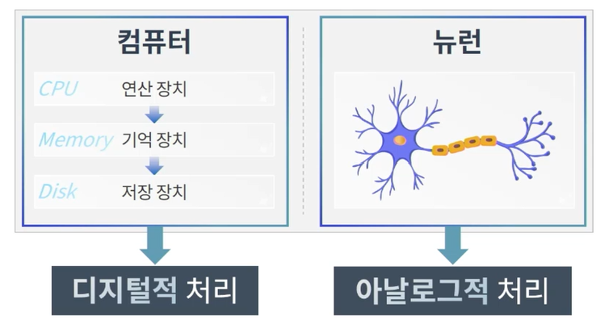

2. 클라우드(Cloud)

   - 2000년대 전후로 상용화되면서 기존 컴퓨터 구조에 틀을 깨기 시작

   - 클라우드 클러스터링 기술은 연산장치-기억장치-저장장치를 여러 개 묶고 이를 가상화해 하나처럼 동작하게 구성

     - 결과적으로 마치 인간의 뇌처럼 이 3가지가 한 곳에서 동시에 작동하는 것과 유사하게 됨

     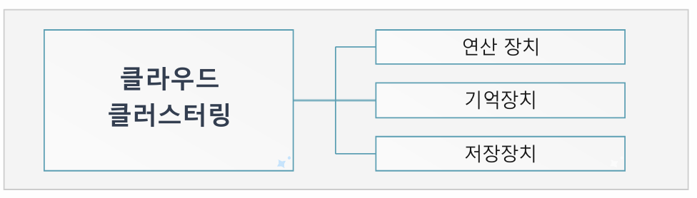

   - 기존 데이터 처리 방식

     1. CPU Core 수를 높여 병렬처리 : 연산 장치(CPU)의 뇌 개수를 늘려서 계산 속도는 빨라짐
     2. Data 전송(Memory) 및 Disk는 병렬처리x : 계산하는 뇌는 여러개인데, 기억장치와 저장장치로 오고 가는 길은 여전히 좁고 한개 => 병목현상 발생

   - 클라우딩 컴퓨팅(분산화+가상화 = 분산파일시스템)

     - CPU, Memory, Disk가 묶인 장치를 병렬로 확장
     - 분산화 : 수많은 컴퓨터(노드)를 네트워크로 줄줄이 연결
     - 가상화 : 물리적으로 쪼개져 있는 하드웨어를 소프트웨어 기술로 감싸서, 사용자가 볼 때는 "마치 거대한 하나의 컴퓨터, 하나의 저장 공간"인 것처럼 눈속임

     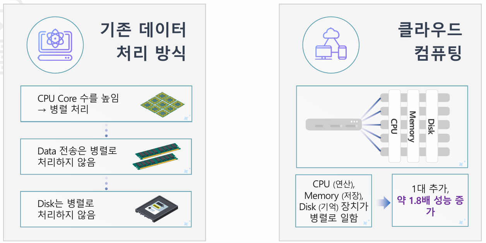

3. 딥러닝(Deep-Learning)

   - 인간의 뇌를 흉내내는 인공지능(딥러닝) 탄생
   - 병렬처리에 특화된 GPU가 부각되기 시작
   - 기존에는 할 수 없었던 영역이 가능해 지면서, 알파고가 탄생하고 자율 주행이 등장

- 현재의 인공지능
  - 머신러닝 : 데이터 기반 학습과 예측
  - 딥러닝 : 인공 신경망 기반 패턴 학습
  - 생성형 AI : 새로운 콘텐츠 창작 기술 (사람의 말을 알아듣고 -Encoding, 말을 잘 하는 - Decoding)

##### AI 기술 패러다임의 변화와 잠재적 리스크

1. 인공지능의 발전

   - 데이터 기반의 ML/DL을 이용한 업무 능력 90년대~ : 예측, 분류, 데이터 분석 등 인간이 정해준 규칙과 정답(레이블)을 학습하여 특정 문제를 해결
   - 창작 능력 (생성형AI, 17년~) : 트랜스포머 알고리즘(Attention is all you need)을 기점으로 텍스트, 이미지, 코드를 스스로 만들어내는 생성형 AI 시대

   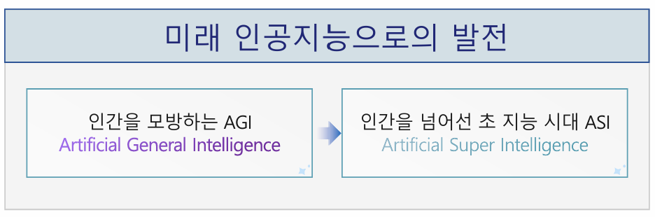

   - 인공지능은 생성형 AI가 발전하며, RAG의 확산으로 이어지는 중
   - AI연구는 인간을 향하는 AGI(Artifical General Intelligence) 그리고 인간을 넘어서는 ASI(Artificial Super Intelligence) 초지능 시대로 발전하고 있따는 특이점(Singularity) 동향이 나타나고 있음
   - 우리가 나아가고 있는 방향이 올바른 길로 다다를 수 있도록 AI 전문가의 역할이 필요함

2. 새로운 인공지능

   - 사람의 언어를 흉내내며 발전을 거듭하고, 인간을 뛰어넘는 역량으로 진화
   - AI 전문가들은 이미 사람의 언어만으로도 컴퓨터에게 필요한 지시를 할 수 있다고 말함. (Multi-Modal 인공지능이 로봇과 결합)
     - foundation model : (방대한 양의)레이블이 지정되지 않은 데이터를 스스로 학습하여 다양한 응용 분야의 기초(Foundation)가 되는 거대 인공지능 모델
   - 사람의 언어를 흉내내는 것을 넘어서서 상황 및 맥락을 이해하고 확률적으로 추정하고 자율적으로 동작

3. Hallucination

   - 인공지능이 사실과 다르거나 존재하지 않는 정보를 마치 진짜인 것처럼 그럴싸하고 자신 있게 제시하는 왜곡 현상
   - 생성형 AI는 사실 관계를 검증하는 것이 아니라, 입력된 맥락을 토대로 **통계적으로 가장 어울리는 다음 단어(Token)를 확률적으로 예측하여 문장을 생성**하기 때문에 구조적으로 발생
   - 상용 AI 모델들은 실시간 학습 내용을 반영할 수 없음
     - 치명적 망각 : 학습시킨 후에 실시간 변경을 적용하면 처음 학습시키는 데 사용한 파라미터와 가중치가 뭉개지므로, 시차를 두고 누적 학습시킴

- 임베딩(Embedding) : 글자를 숫자로 바꾸는 번역기

  - LLM은 내부적으로 단어의 뜻을 직접 이해하는 것이아니라 모든 것을 수학적 계산(행렬 연산)으로 처리

  - 의미가 비슷한 문장들은 수학적 공간(좌표계) 안에서 서로 가까운 거리에 위치
- Vector DB : 사람이 쓰는 자연어를 LLM이 이해할 수 있는 (의미가 채워진)수학적 숫자 배열(벡터, Vector)로 변환하여 저장하고, 이를 초고속으로 검색할 수 있게 해주는 저장소
  - 작동 방식 : 사용자가 질문을 던지면, 그 질문의 벡터 좌표와 **가장 가까운 거리(유사한 의미)에 있는 문서의 벡터들을 순식간에** 찾아냄 - Ex : "남자"와 "소년", "기쁨", "환희"처럼 글자는 달라도 의미가 유사한 데이터를 찾아내는 능력
  - LLM이 의미를 담아 만들어내는 벡터는 보통 [-0.023, 0.145, 0.891, ...]과 같은 수많은 실수들의 배열로 이루어짐
  - 차원의 개념 : 숫자 배열의 길이를 차원이라 부르며, 고성능 LLM일수록 하나의 단어나 문장을 수천 개의 숫자로 정밀하게 쪼개어 그 의미를 수학적 공간에 배치
    - 벡터 DB의 좌표 : 고차원 공간의 한 점 \((x_1, x_2, x_3, \dots, x_{n}) \rightarrow\) **숫자 n개**필요
- 실시간 데이터 조회 및 활용(RAG) 파이프라인
  1. 데이터 수집 단계(Data Ingestion)
     - **이벤트 발생:** 외부 원천 시스템(언론사의 CMS 데이터베이스 또는 증시 시스템의 시세 Feed)에 새로운 텍스트 데이터(뉴스 기사)가 적재되는 이벤트가 생성
     - **실시간 수집:** 기업의 데이터 수집 파이프라인(예: Kafka, RabbitMQ 같은 메시지 브로커 또는 웹훅 시스템)이 해당 이벤트를 감지하고 가공되지 않은 **텍스트 데이터(Raw Text)**를 API 통신을 통해 실시간으로 긁어옴
  2.  임베딩 및 데이터 가공 단계 (Embedding & Processing)
     - **텍스트 전처리:** 수집된 뉴스 텍스트에서 불필요한 HTML 태그, 특수문자를 제거하고, 긴 문서를 처리하기 적절한 길이로 쪼개는 **청킹(Chunking)** 과정을 거침
     - **벡터 변환:** 분할된 텍스트 조각들을 **임베딩 모델(Embedding Model)**의 입력값으로 주입. 임베딩 모델은 이 자연어 텍스트의 문맥적 의미를 연산하여 고정된 차원의 **실수 배열(Dense Vector, 예: 1,536차원의 숫자 열)**인 벡터 좌표값으로 출력
  3.  벡터 데이터베이스 적재 (Vector DB Upsert)
     - **인덱싱 및 저장:** 출력된 텍스트 벡터값을 원본 텍스트 메타데이터(발행 시간, 제목 등)와 매핑하여 **벡터 데이터베이스(Vector DB)**에 `Upsert(Insert 또는 Update)` 쿼리로 실시간 전송
     - **고속 탐색 준비:** 벡터 DB는 수신된 고차원 벡터를 HNSW(Hierarchical Navigable Small World)나 IVF(Inverted File Index) 같은 특수 알고리즘을 사용해 공간적으로 인덱싱하여 즉시 검색이 가능한 상태로 정렬
  4. 사용자 질의 및 유사도 검색 (Query & Similarity Search)
     - **질의 벡터화:** 사용자가 "오늘 삼성전자 주가 어때?"라는 질문을 입력하면, 시스템은 이 질문 텍스트를 앞서 사용한 것과 **동일한 임베딩 모델**에 통과시켜 질문의 벡터값을 생성
     - **유사도 연산:** 질문 벡터를 벡터 DB로 보내 저장된 데이터들과 **코사인 유사도(Cosine Similarity)** 또는 L2 유클리드 거리를 연산. DB는 질문 벡터와 가장 거리가 가까운(유사도가 높은), 즉 5분~10분 전에 적재된 최신 뉴스 벡터를 역추적하여 해당 **원본 텍스트(메타데이터)**를 추출
  5. 컨텍스트 주입 및 LLM 추론 (Context Injection & Inference)
     - **프롬프트 구성:** 벡터 DB에서 검색된 최신 뉴스 텍스트를 사용자의 원래 질문과 결합하여 하나의 거대한 **컨텍스트 포함 프롬프트(Context-infused Prompt)**를 생성
     - **최종 출력:** 이 프롬프트를 **LLM(대형 언어 모델)**의 입력값(Input Token)으로 전송. LLM은 자체 파라미터를 업데이트(학습)하지 않고, 입력된 프롬프트에 포함된 최신 뉴스 정보를 조건부 데이터(Condition)로 삼아 텍스트 생성 연산을 수행한 뒤, 환각 없이 정확한 사실이 담긴 답변을 출력

- LLM 생태계 분류

  - Closed Source Model
    - OpenAI의 ChatGPT, google의 Gemini, Anthropic의 Claude, Groq Cloud 등

  - [Open Weight Model](https://huggingface.co/)
    - Meta의 Llama, Alibaba의 Qwen 등

#### * 지능형 서비스기반 이해 관계자 가치 제고, 의사소통

- 기술 주기에 따른 가치 판단(가트너 하이프 사이클의 관점)

  - 어떤 아이디어가 아무리 훌륭해도, 그 아이디어가 속한 기술 자체가 **쇠퇴기(Decline)**에 접어들었다면 시장성X

  - 너무 앞서간 도입기(Introduction)의 기술은 거품이 꺼지는 시기를 견뎌야 할 리스크가 있음

    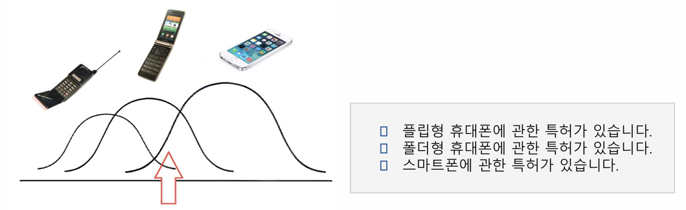

  - 따라서 **"이 아이디어가 대중화(Growth ~ Maturity)에 접어드는 적절한 파도를 타고 있는가?"**를 객관적으로 진단필요

- 가치 중심

  - 기술자체에 변화를 일으키는 요인 핵심을 파악하되, 이것을 현장에서 이해관계자의 가치 실현을 중심으로 기술을 재배치하는 것이 중요
    - 기술적 재배치 : 기술의 화려한 스펙은 뒤로 숨기고, 그 기술이 이해관계자에게 가져다줄 실질적 이득과 변화를 전면에 내세우는 것

- 실행 요약서(Executive Summary)

  - 바쁜 의사결정권자(임원, 투자자 등)가 전체 문서를 다 읽지 않고도 핵심 내용과 비즈니스 가치를 수 분 내에 파악할 수 있도록 압축한 핵심 요약 문서
  - 본문의 순서를 그대로 요약하는 것이 아니라, 독자가 가장 궁금해하는 [문제-해결책-이득] 구조로 재배치
  - 1단계 (Point) : 필요한 바 먼저 이야기하기 (핵심 제안)
    - 이 문서가 제안하는 최종 목표를 한두 문장으로 두괄식 제시
  - 2단계 (Reason) : 왜 그런 이야기를 했는지 (문제점과 배경)
  - 3단계 (Evidence) : 근거가 무엇이며 상세 내용은 무엇인지 (기술적 해결책과 증빙)
    - 이 기술이 왜 성공할 수밖에 없는지 데이터와 수치로 증명
  - 4단계 (Action & Value) : 나는 이것을 요청하는 것이며, 당신(이해관계자)의 이득은 이것입니다 (최종 요청 및 기대효과)
    - 이 프로젝트를 승인했을 때 기업, 직원, 고객이 얻을 실질적 이득 

- Technical Writing 용도와 배경 이해

  - 언론이 과학기술 관련 기사의 어렴움을 호소

  - 연구 내용을 쉽게 기자에게 설명하는 과학자는 전무

  - 독자 수준을 중학 2학년으로 간주하고, 상대가 기술을 모를 경우에 일반용어로 변환

    ~~~
    디셀포비브리오로 폐수속 중금속의 침전성공
    -> 중금속 먹는 세균 발견
    -> 광산 폐수 미생물로 정화
    모유 성분인 락토페린을 생산하는 젖소 탄생
    -> 젖소가 모유 생산
    원전 1차 계통 또는 핵증기 공급 계통(NSSS)
    -> 보일러 대신 핵분열로 생긴 열로 증기를 발생시키는 계통
    ~~~

  - Impress를 위한 글 vs Express를 위한 글

    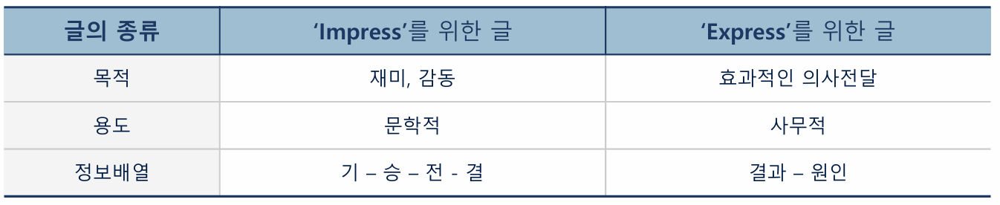

- Technical Writing 작성방법

  - 독자가 정보를 **가장 빠르고 오차 없이 이해하여 문제를 해결하도록 돕는 설계도 기반의 글쓰기**

    - 독자 중심 설계(Audience) : 이 문서를 읽을 사람을 파악 후 그들의 지식 수준에 맞춰 단어를 선택
    - 두괄식 구성(Point First) : 결론과 핵심 목적을 문단의 가장 첫 문장에 배치(뒤를 읽지 않아도 무엇을 해야 하는지 알 수 있어야함)

  - 3C원칙

    - **Correct (정확성):** 기술적 오류나 수치, 단위에 오차가 없어야 함
    - **Clear (명확성):** 주어와 목적어를 생략하지 않고, 모호한 대명사(이것, 저것) 대신 명확한 명사를 지정
    - **Concise (간결성):** 불필요한 미사어구나 형용사를 배제하고 문장을 짧게 끊어 쓰기. 긴 서술문보다 개조식 불릿포인트(•)를 적극 활용

  - The Power Writing

    - 문장에 숫자를 부여
      - 숫자는 추상적인 개념에서 구체적인 개념으로 이동
      - 숫자가 높을 수록 상세한 문장
      - 숫자가 올라 갈수록 설득하는 힘이 상승
    - Power1(주제/주장) : 글의 핵심 아이디어나 결론
    - Power2(근거/이유) : Power1을 뒷밤침하는 세부 항목이나 논거
    - Power3(증명/사례) : Power2를 완벽하게 증명하는 구체적인 수치•데이터•사실
    - Power4(결론) 

  - 정보의 배열방법

    - 독자가 글을 읽고 논리적으로 설득당할 수 있게 정보를 재배치할 것

    - 1단계 : 상황 공유 및 명분 빌드 (Why)

      - 목적 -> 배경 -> 필요성 -> 문제점
      - 우리가 왜 이 일을 해야 하는지(배경/필요성), 현재 현장에 어떤 치명적인 리스크(문제점)가 있는지를 먼저 짚어 독자의 공감을 이끌어내는 단단한 기초(Foundation) 작업

    - 2단계 : 핵심 솔루션 제시 (What/How)

      - 개선 방안 -> 증빙 자료 -> 제안 내용 -> 추진 방안
      - 문제를 해결할 구체적인 '기술과 아이디어(**개선방안**)'을 던지고, 주장을 뒷받침할 객관적인 데이터나 수치(**증빙자료**)를 곧바로 결합하여 신뢰성을 확보하고 구체적인 실행 계획(**추진방안**)으로 연결

    - 3단계 : 최종 가치 제안 및 행동 촉구(Value)

      - 건의 사항 -> 기대 효과
      - 이 제안을 승인했을 때 이해관계자(임원, 고객, 현장직원)가 얻게 될 '실질적인 이득과 변화(기대효과)'를 전면에 내세우며 마무리

      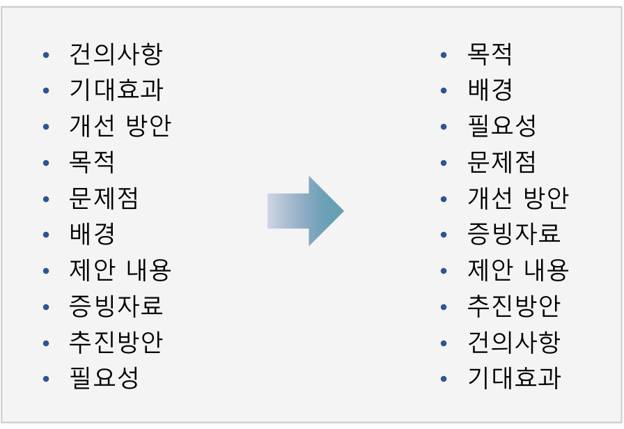

- 실무자와 결재권자의 커뮤니케이션 차이점

  - 결재권자는 결론, 전체와 개략, 민심에 관심

  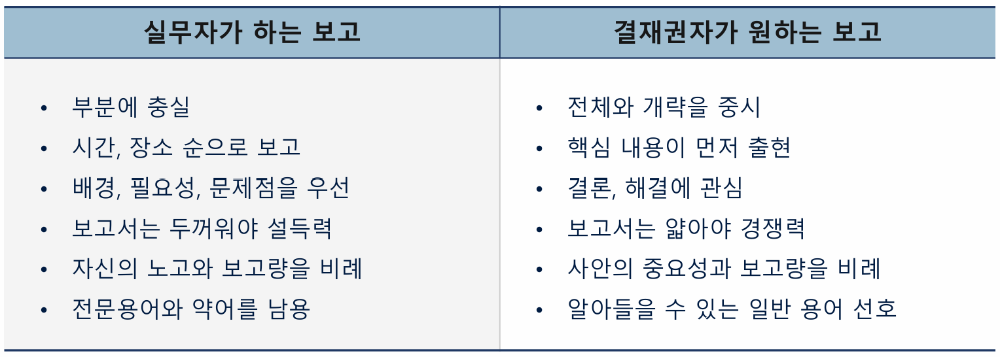

#### * 사업관리와 개발 리딩을 위한 개발 방법론 이해

- VUCA : 급변하는 디지털 시대와 예측 불가능한 비즈니스 환경

  - **Volatility (변동성):** 시장이나 환경이 매우 빠르고 예측할 수 없는 방향으로 변화하는 성격

  - **Uncertainty (불확실성):** 과거의 경험이나 데이터만으로는 미래를 예측하기가 극도로 어려운 상태

  - **Complexity (복잡성):** 수많은 요인이 인과관계 얽히듯 복잡하게 연결되어 있어 문제의 원인과 결과를 명확히 분리하기 힘든 상황

  - **Ambiguity (모호성):** 뚜렷한 경계나 규정이 없어 현상의 의미를 다각도로 해석할 수 있고, 명확한 해결책을 찾기 힘든 상태를 의미

- 디지털 트랜스포메이션(Digital Transformation)

  - **Environmental Sensing (환경 감지):** Digitalization을 가속화시키는 미래 비즈니스 변화에 따라 새로운 **Value(가치) 창출 및 비전 제시**를 담당
  - **Tools for Digitalization (디지털화 도구):** 디지털 기술에 대한 이해를 바탕으로 **비즈니스 적용 방안 및 성장 방향을 모색**하는 단계
  - **Driving Digital Strategy (디지털 전략 추진):** 비즈니스 전반을 아우르는 경영전략 차원의 **디지털 생산, 마케팅, 조직운영 역량을 향상**
  - 핵심 기술 및 패러다임
    - **인프라 및 데이터 테크:** Big Data, AI, Cloud, Open Source
    - **네트워크 및 융합 기술:** Internet of Things (IoT), Block Chain
    - **신산업 및 스마트 솔루션:** Platform Biz., Fin. Technology, Smart Farm, Smart Factory
    - **디바이스 및 가상 세계:** Smart Phone, VR/AR, Metaverse, NFT, 3D Printing
  - 디지털 혁신 도전 기업 70%가 실패
    - 일하는 방식을 바꾸지 않은 채 기술만 덧붙이는 이노베이션으로 새로운 가치를 창출할 수 없다
    - 혁신하는 기업은 민첩하고 유연한 조직문화를 가지고 있음
      - 빠른 의사결정과 대응, 고객·시장 중심, 공유·소통·피드백, Small Start·Fast Fail, 끊임없는 학습·개선활동, 협업·팀웍 중시

- 콘웨이 법칙

  - 시스템을 설계하는 조직은 그 조직의 소통 구조를 닮은 구조를 가진 시스템으로 설계할 것이다.
  - 즉, 소프트웨어 구조는 해당 소프트웨어를 설계/개발하는 조직의 커뮤니케이션 구조를 닮게 된다
  - 조직 자체의 구조 보다는 소통관계, 의사소통 구조가 시스템 구조에 영향을 끼친다.

- Agile개발 방법론

  - 짧은 Timebox 단위로 공정이 반복(Iteratively) 수행되며, Product를 점진적으로 완성

  - Agile은 시장 변화에 따라 빠르고 유연한 대응력, 즉 비즈니스 민첩성을 갖도록 도와줌

  - 애자일을 사용하는 것이 아닌 이해관계자를 이해하는 것이 목표

    - 경제적 가치(Economic Value), 공익적 가치(Socail Value)

  - 주기적인 리뷰와 피드백을 통해 고객 가치 중심으로 제품을 구현

    - 단계 완료가 목표가 아닌, 고객과 시장에 가치 있는 제품을 만드는 것이 목적

    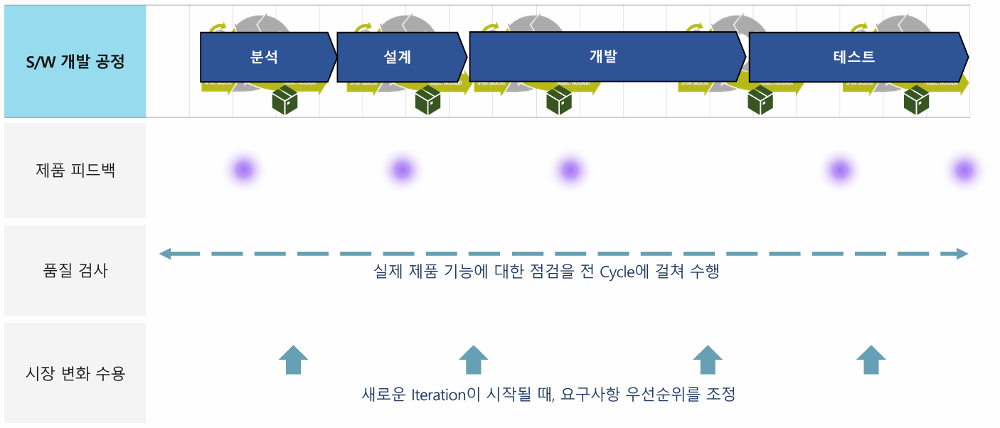

  - 모든 과정이 끝나는 Ending 단계가 아니라, 우선 순위에 따라 이른 출시(Release)가 가능

    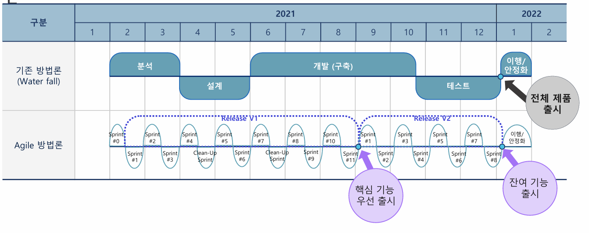

  - 완벽한 계획을 수립하는 대신, 일단 시작 후 일하는 방법을 발전시키며 진행

    -  Lessons Learned : 하나의 Iteration에서 실패를 하더라도 Lessons Learned를 통해 다음 계획을 수정 
    - Retrospective (회고) : 자기주도적으로 변화와 개선을 추구 
    - Daily Scrum : 매일 팀이 진행하는 내용을 공유하고 장애물 제거를 위해노력

    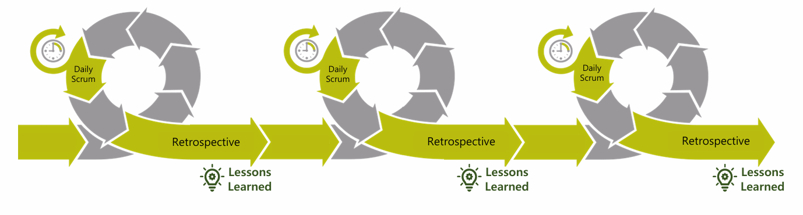

  - Scrum Team

    - Self-Organized, Cross-Functional
    -  높은 자율성과 책임을 가지며,팀 주도적으로 목표를 설정하고 이를 달성
    - 개발자와 Product Owner, Scrum Master로 구성
    - 팀 인원은 7 ±2 명이 적정

  - Scrum Master

    - 팀이 애자일을 제대로 이해하고 따르도록 Facilitating
    - 팀에 갈등이 있다면 해결을 위해 협의하고 조정
    - 스크럼 마스터를 통해 스크럼 팀끼리 미팅

  - Product Owner

    - Product와 관련된 이해관계자를 대표하는 사람
    - 제품의 기능 정의 및 우선순위 의사결정
    - 스크럼 팀 구성원으로써 개발팀과 함께 목표 달성에 주력

  - Scrum Process

    - 전체 과정은 작은 단위의  Sprint로 쪼개어 반복 수행

    - 각 스프린트는 4개의 이벤트 활동을 가지는 Scrum으로 구성

      - 스프린트 계획 회의, 일일 스크럼 회의, 스프린트 리뷰, 스프린트 회고

    - Scrum Process 내에서 작은 단위의 분석/설계/코딩/테스트를 진행

      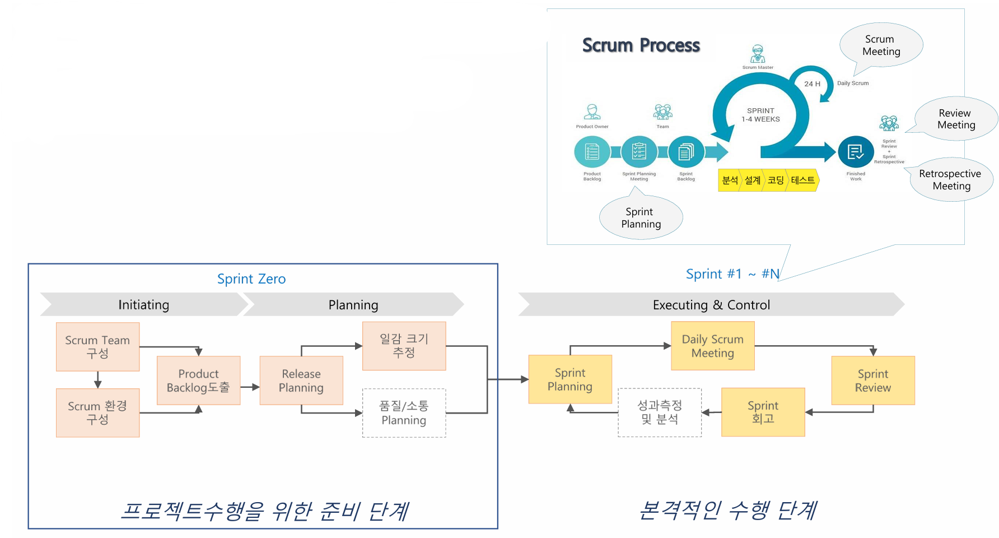

  - 요구사항으로부터 사용자 스토리와 제품 백로그를 만드는 과정

    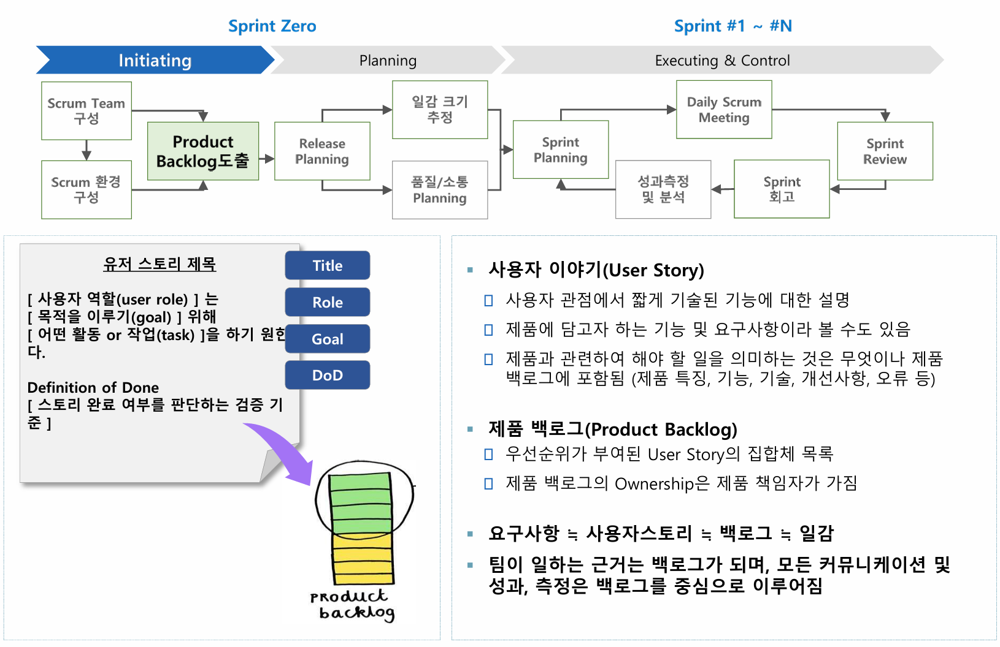

  - 릴리즈 계획은 백로그의 우선순위에 기반하여 제품의 출시 계획 및 스프린트 일정을 수립

    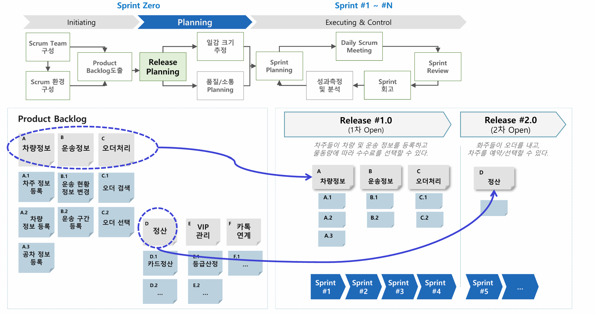

  - 어떤 것에 우선순위를 두고 먼저 만들어 배포할 것인가?

    - MoSCoW
      - **Must have (필수 요구사항):** 없으면 제품 출시 자체가 불가능한 핵심 기능
      - **Should have (중요 요구사항):** 필수적이지만 대체재가 있거나 다음 배포로 미룰 수 있는 기능
      - **Could have (선호 요구사항):** 있으면 좋지만(Nice-to-have) 없어도 무방한 기능
      - **Won't have (보류 요구사항):** 이번 출시(릴리즈)에는 절대 포함하지 않기로 합의한 기능
    - User 행동 기법
      -  **최소한의 가치(사용자에게 즉시 쓸모를 줄 수 있는 가장 작은 기능의 묶음)를 제공하는 배포 단위(MVP / Sprint 주깃별 범위)**를 쪼개는 기법

    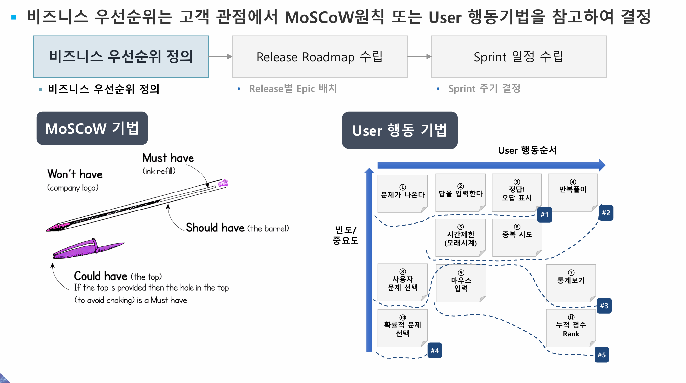

  - 일감크기란 하나의 UserStory를 완료하는 데 드는 노력에 대한 상대적인 크기

    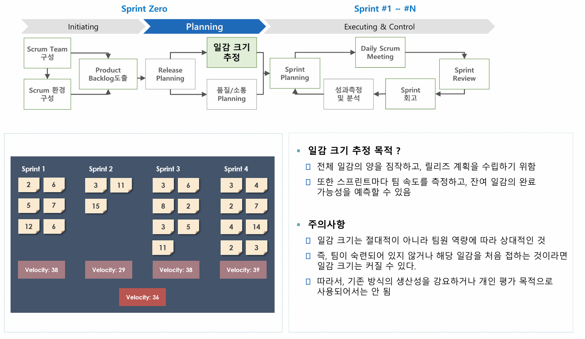

  - 스프린트에서 계획은 스프린트 목표와 스프린트 백로그를 구체적으로 정의하는 과정

    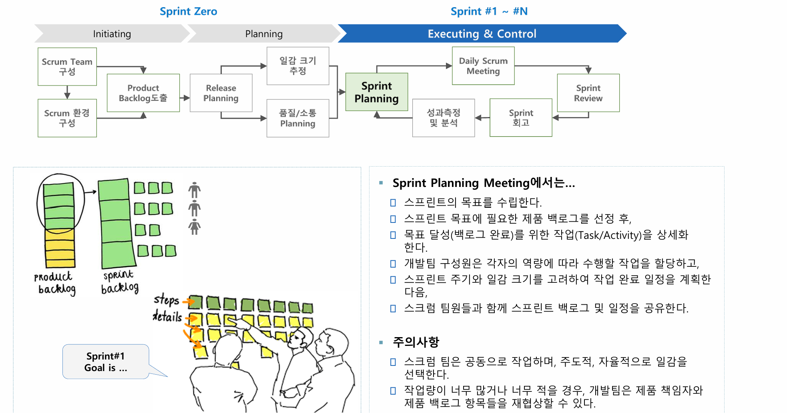

  - 애자일 프로젝트 특성에 따라, 개발 방법론을 테일러링 하여 Task 및 산출물 차별화 적용

    - 테일러링 : 개인이나 프로젝트의 특성에 맞춰 맞춤 제작하거나 조정하는 과정

    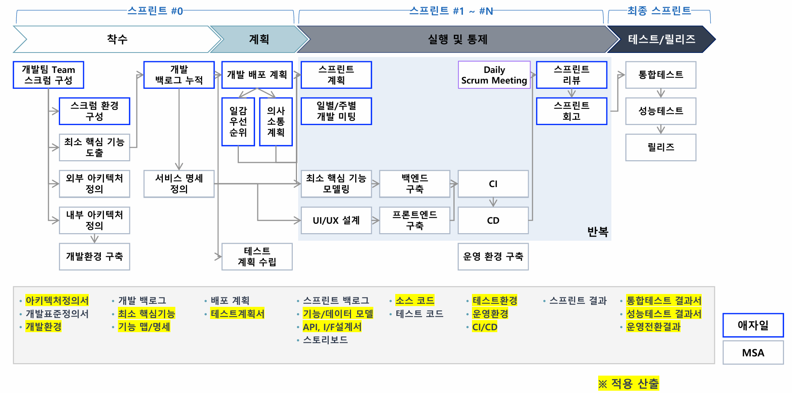

#### * 플랫폼기반 지능형 소프트웨어 개발

- 인터넷 서버의 세계는 두 가지 역할로 나뉜다

  - Web Server
    - 변화가 없는 **'정적인 파일'**을 사용자에게 그대로 보여주는 역할
  - Web Application Server
    - 사용자에 따라 결과가 계속 바뀌는 **'동적인 데이터'**를 처리

- Application 유형

  1. Cloud Immigrant(안정적인 백오피스에 적합)
     - 기록/통계/보고서 중심 업무
     - ERP, 지급 관리, 세무 관리, 재고 관리, 마스터데이터 관리, 회계 시스템 등
  2. Cloud Semi-Native(안정적인 백오피스에 적합)
     - 대부분의 기존 Application
     - 빠른 환경 구성 및 표준화
     - 자원부족에 따른 장애 최소화
     - 서비스변경 영향도 최소화
     - CRM, SCM, 웹/커머스, 마케팅, 조달, 분석시스템, Workforce관리 등
  3. Cloud Native(고객 접점 업무)
     - B2C Application(기업이 최종소비자에게 직접 제공하는 거래형태)
     - 빠른 출시, 시장반응 분석 및 빠른 수정/출시
     - SW 기반 기업으로의 전환
     - 모바일 앱, 소설 커머스, 인터넷 서비스, 위치기반서비스, IoT, 빅데이터, 머신러닝/분석 기반 등

- Cloud Migration 전략

  1. Replatforming(Cloud Ready)

     - 애플리케이션의 **핵심 코드는 그대로 유지**하되, 클라우드 환경에 맞게 **일부 컴포넌트나 인프라 환경만 변경**하는 전략
     - 예를 들어 자체 구축하여 운영하던 데이터베이스(DB)를 코드 수정 없이 클라우드의 관리형 DB 서비스(예: AWS RDS)로 교체하거나, 미들웨어를 PaaS(플랫폼형 서비스) 환경으로 바꾸는 방식

  2. Refactoring(Cloud Friendly)

     - 애플리케이션의 외부 동작은 유지하면서, 클라우드의 핵심 기능들을 최적화하여 누릴 수 있도록 **내부 소스 코드를 부분적으로 수정 및 개선**하는 전략
     - 부하에 따라 시스템 규모가 늘고 줄어드는 **자동 스케일링(Autoscaling)**이 가능
     - 배포 과정이 자동화되어 프로젝트 비용과 시간이 최소화

     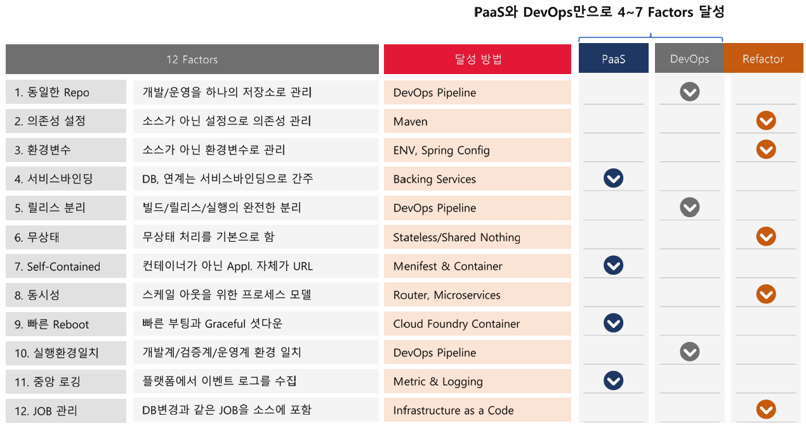

  3. ReArchitecturing(Cloud Native)

     - 거대한 하나의 덩어리였던 시스템(Monolith)을 기능별로 잘게 쪼갠 **마이크로서비스(Microservice)** 구조로 전환
     - 시스템 장애를 기본 전제로 설계하는 **Design for failure**, 기능 간 연동을 최우선하는 **API first Design**, 이벤트 기반으로 동작하는 **Event driven Design** 등의 고도화된 설계 기법이 필요

     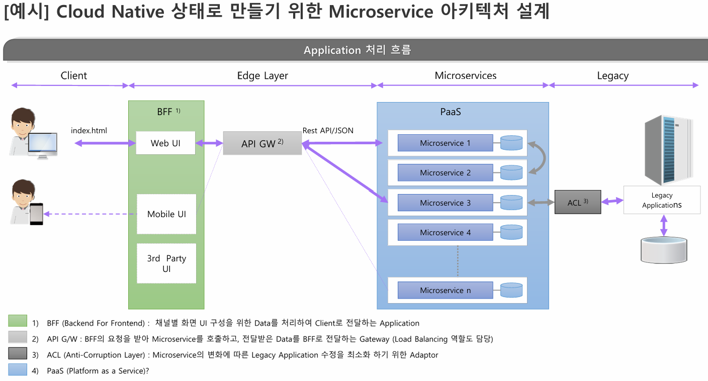

- 소프트웨어 애플리케이션 아키텍처의 발전

  1. 모놀리식 애플리케이션
     - **단일 구조:** 모든 비즈니스 로직(Silo logic)과 데이터베이스가 하나의 거대한 시스템 안에 묶여 있음
     - **높은 결합도:** 코드와 데이터가 서로 복잡하게 얽혀 있어, 작은 기능 하나만 수정해도 전체 시스템을 다시 배포
  2. 내부 컴포넌트화 애플리케이션
     - **로직 분리:** 비즈니스 로직을 기능별 컴포넌트(Logic)로 나누어 내부적인 모듈화를 이뤄냄
     - **데이터 공유:** 로직은 분리되었지만, 여전히 하나의 거대한 공유 데이터베이스(Silo database)를 바라보고 있어 데이터 계층의 의존성은 남아 있음
  3. 마이크로서비스 애플리케이션
     - **완전한 독립:** 기능별(Microservice component)로 서비스를 완전히 쪼개어 독립적으로 구동
     - **개별 데이터베이스:** 각 마이크로서비스가 **자신만의 독립된 데이터베이스**를 소유합니다. 서비스 간에는 API나 메시지를 통해서만 통신하므로 유연한 확장과 독립 배포가 가능

  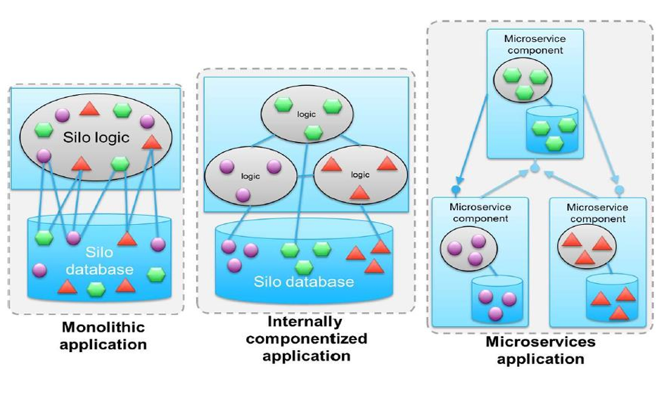

- 모놀리식 아키텍처(Monolithic Architecture)
  - 모든 서비스가 단일 프로세스 내에서 강하게 결합(Tight Coupling)되어 있음
  - 특정 기능의 장애가 시스템 전체로 확산되는 '장애 전파(Fault Cascading)'에 취약
    - **상황:** 똑같이 이벤트 페이지에 사람이 몰려 이벤트 서비스가 장애발생
    - **결과:** 하나의 거대한 컴퓨터(프로세스)가 통째로 다운
    - **현상:** 이벤트와 아무 상관 없는 주문 서비스, 상품조회 서비스, 결제 서비스까지 **전체 시스템이 먹통**이 되어 사용자가 아무것도 할 수 없음

- MSA(Microservice Architecture)

  - 애플리케이션을 **작고** **독립적**으로 배포 가능한 **개별 서비스 단위**로 나누어 구성하는 소프트웨어 개발 기법

  - MSA는 서비스마다 독립된 DB를 갖는 **Database-per-Service** 구조를 지향하므로, 하나의 비즈니스 로직이 여러 서비스의 DB를 거쳐 실행되는 **분산 트랜잭션** 형태를 띠게 되어, 트랜잭션 격리성 보장X

    - 트랜잭션 격리성(Transaction Isolation) : 동시에 여러 개의 트랜잭션(데이터베이스 작업 단위)이 실행될 때 **서로의 작업에 끼어들거나 중간 결과를 들여다보지 못하게 차단하는 성질**

    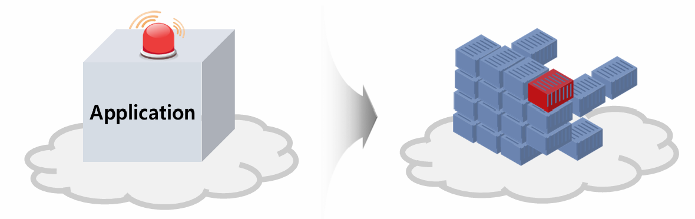

  - 데이터 처리 중심은 기존에는 DB 서버 중심, MSA 환경에서는 APP(WAS) 서버 중심

    1. 전통적인 DBMS(오라클)의 일관성 보장 원리 (Consistent Mode)

       - **SCN(System Change Number) 기준 조회:** 12시 00분 00초에 SQL 조회가 시작되는 순간, 타임스탬프 역할을 하는 **SCN 번호가 고정**
       - **타 트랜잭션 차단:** 조회가 진행되는 동안 다른 트랜잭션(2~5번)이 데이터를 수정하고 **Commit(변경 확정)**을 하더라도, 현재 조회 중인 SQL은 SCN 기준 시작 시점의 데이터만 바라봄
       - **RBS(Rollback Segment, 롤백 세그먼트) 활용:** 만약 다른 트랜잭션에 의해 값이 이미 바뀌어 시작 시점의 SCN과 차이가 발생하면, DB는 **RBS(롤백 백업본)에서 시작 시점의 원래 값을 역으로 찾아내어** 데이터 시점을 완벽하게 일치시킴
       - **이점:** 이 방식을 사용하면 대용량 테이블 조인(Join) 쿼리를 날려도 타 트랜잭션의 방해 없이 **정확하고 완벽한 트랜잭션 격리화 수준(Isolation Level)을 공짜로 보장**받을 수 있음

    2. WAS(애플리케이션) 중심 처리와 MSA에서의 한계 (위배 현상)

       - **조인(Join) 불가능:** MSA 환경에서는 A, B, C, D 테이블이 각기 다른 마이크로서비스의 독립된 DB로 쪼개져 있기 때문에, 이미지 하단과 같은 **전통적인 SQL 조인 쿼리(`select ... from A, B, C, D`)를 던지는 것 자체가 불가능**

       - **WAS 단으로 데이터 이관:** 결국 조인을 쓰지 못하므로 각각의 DB에서 데이터를 따로따로 읽어와 **WAS(어플리케이션 서버) 단에서 데이터를 조립하고 가공**해야함

       - **격리성 위배 (Isolation 손실):**

          이 과정에서 WAS가 데이터를 순차적으로 가져오는 도중에 다른 트랜잭션이 어떤 DB의 값을 바꾸어 버리면, WAS는 변경된 잘못된 값을 그대로 읽어 들이게 됩니다. 이는 다른 트랜잭션의 데이터 변경 영향 차단이라는 **'트랜잭션 격리화 수준'에 완벽히 위배(위반)**되는 결과를 초래

       - 데이터가 꼬이는 걸 막으려고 APP 단에서 조회가 끝나기 전까지 모든 테이블에 락(Lock)을 걸어버리면(`Lock table A, B, C, D`), 시스템 전체가 멈추는 심각한 병목 현상이 생김

  - MSA가 적합한 영역

    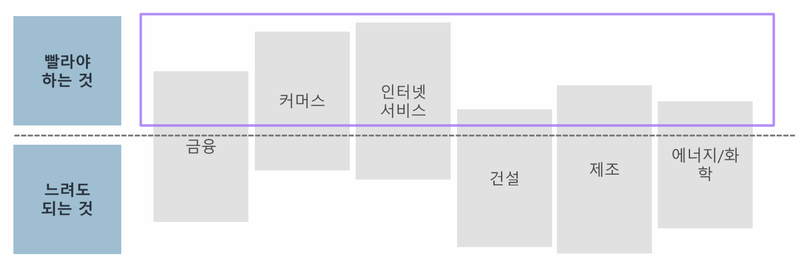

  - MAS를 구성하는 핵심 내부 컴포넌트

    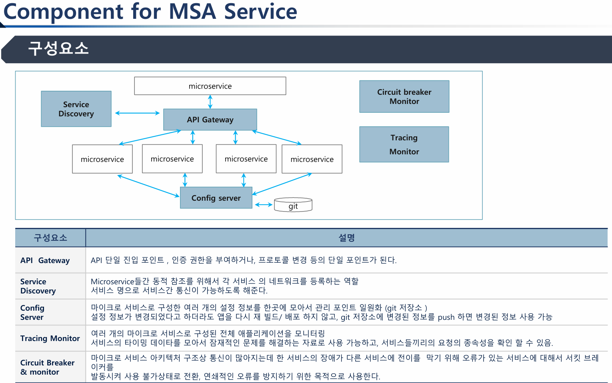

  - Circuit Breaker

    - 실패에 대한 설계

    - 서비스간 의존성이 발생하는 접근 포인트에 설계해서 장애 전파를 막고 fallback 함수를 지원

    - 현재 Circuit breaker의 상태를 대시보드를 통해서 모니터링

      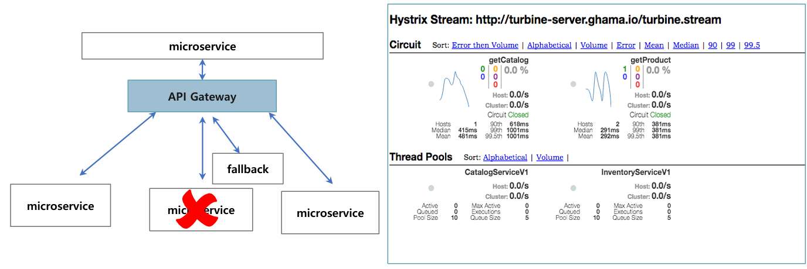

  - 핵심 용어

    - Bounded Context(독립적인 도메인 모델의 경계)
      - MSA에서는 각 서비스가 데이터를 따로 소유해야 하므로, 자체적인 비즈니스 영역과 데이터 모델을 갖는 독립된 경계
      
      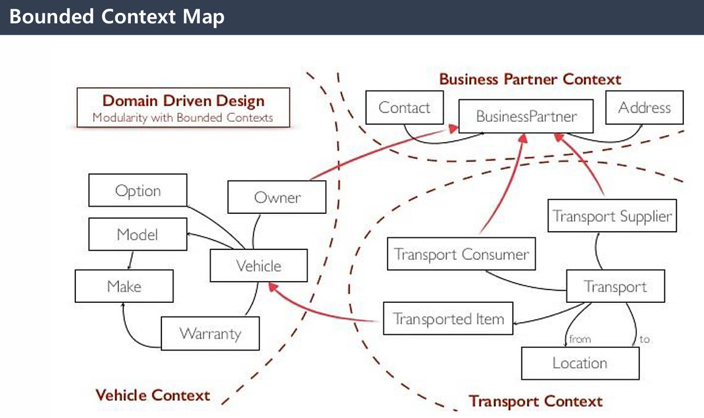
    - Context Map(Bounded Context간의 관계 정의)
      - 분산된 여러 Bounded Context(서비스)들이 서로 어떻게 상호작용하고 데이터를 주고 받는지 전체적인 지도를 그리는 것
    - Event Sourcing(변화 이력을 이벤트 객체로 저장)
      - 애플리케이션의 모든 변경 과정을 이벤트로 기록(대부분의 MSA간 상호작용은 이 이벤트를 근간으로 발생)
    - CQRS(명령C와 조회Q의 책임 분리)
      - 가용성을 극대화하기 위해 결과적 일관성을 추구하는 NoSQL 스타일의 모델

- 오염 방지 계층(Anti-corruption Layer)

  - **모델 간 독립성 유지:** 서비스 간에는 API(RESTful 등)로만 통신하고, **서로의 도메인 모델을 공유하지 않도록 차단**하는 변환 계층

  - **오염 방지:** 다른 서비스(외부 시스템)의 데이터 구조나 변경 사항이 우리 서비스 내부의 핵심 도메인 모델(Domain Model, Value Object 등)까지 침투하여 오염시키는 것을 막아줌

  - 작동 방식 : 필요한 경우 API를 호출한 서비스 측에 **Anti-corruption layer(AcL)**를 두고, 상대방 서비스가 보내온 API 결과(예: XML, 외부 데이터 양식)를 그대로 쓰는 것이 아니라, **AcL 영역에서 우리 서비스에 맞게 가공 및 변환(Translation)**하여 받아들임

    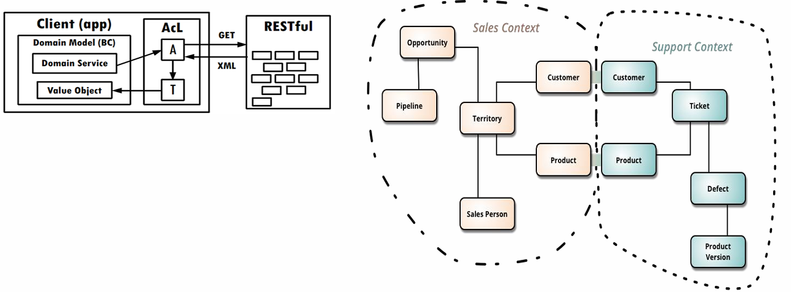

- 서비스 제공 모델 및 관리 범위 비교

  - On Premise (기존 방식)
    - 인프라, 서비스, 보고 생성을 모두 사용자가 직접 관리
  - IaaS (Infrastructure as a Service)
    - 하드웨어를 직접 사지 않고 가상 서버를 필요한 만큼 할당 받아 사용
    - 인프라(하드웨어, 서버 등)는 클라우드 제공업체가 제공
      - 가상 서버(VM), 스토리지, 네트워크
    - 서비스 아키텍처 및 소프트웨어는 사용자가 직접 관리
      - OS, 미들웨어 설치, 애플리케이션 코드 등
    - AWS EC2, Azure VM
  - PaaS (Platform as a Service)
    - 서버 설정이나 운영체제 관리에 신경을 쓰지 않고, 코드 작성과 실행에만 집중할 수 있음
    - 인프라와 서비스 아키텍처 관리(플랫폼, 개발환경)까지 제공
      - OS, 미들웨어(Tomcat 등), 런타임, DB 환경
    - 사용자는 **앱(Application)만 관리**
      - 애플리케이션 소스 코드와 데이터
    - IDE(통합 개발 환경), SDK, 프레임워크
    - Docker가 PaaS가 아닌 이유
      - 개발자가 직접 '도커 명령어'와 '설정 파일'을 짜며 인프라를 세팅
      - **Dockerfile 작성:** 프로그램이 돌기 위해 어떤 OS 기반 이미지(Ubuntu 등)를 쓸지, 자바 버전은 몇을 설치할지, 몇 번 포트를 열지 코드로 직접 명시
      - **서버 인프라 관리:** 도커 박스를 실행할 **실제 리눅스 서버(IaaS 등)를 구매하고, 그 서버에 직접 도커 엔진을 설치하고 운영**
      - **운영 체제(OS) 패치:** 도커를 실행하는 베이스 OS의 보안 패치나 커널 업데이트를 개발자나 인프라 담당자가 직접 관리
  - SaaS
    - 클라우드 환경에서 동작하는 소프트웨어의 기능을 네트워크를 통해 이용하는 형태
    - 별도의 설치 없이 웹 브라우저나 앱을 통해 기능 사용가능
    - Gmail, 구글 스프레드시트, Netflix, Slack
  - XaaS (Anything as a Service)
    - 모든 것이 서비스 형태로 제공되는 개념
      - SW, DB, AI, 컨테이너 등
    - 사용자는 복잡한 과정 없이 **보고 및 결과만 전달받는** 방식

- 기존 시스템(As-Is)에서 MSA 및 클라우드 기반의 미래 시스템(To-Be)의 변화

  - 인프라 및 운영체제
    - **As-Is (기존):** HP, Oracle, IBM 등 제조사별로 **다양한 하드웨어 머신**을 사용하고, HP-UX, Solaris, AIX, Linux 등의 **OS가 복잡하게 혼재**
    - **To-Be (변경 후):** 인프라를 **IaaS(클라우드 가상화 인프라)로 통합**하고, OS 역시 **Linux로 표준화**하여 관리 효율성을 극대화
  - 미들웨어 및 프레임워크
    - **As-Is (기존):** WebLogic, WebSphere 같은 무거운 **상용 WAS들이 혼재**되어 있었으며, 애플리케이션 구조는 하나의 거대한 덩어리인 **모놀리식(Monolith)**
    - **To-Be (변경 후):** 가볍고 유연한 **오픈소스 가상화 서버(Tomcat)로 단일화**하고, 애플리케이션 구조는 앞서 대화 나누었던 **마이크로서비스(Microservice)** 형태로 쪼개어 전환
  - 관리, 프로비전 및 보안
    - **As-Is (기존):** 머신과 OS가 제각각이라 **관리 도구(Tooling)가 서로 달랐고**, 새로운 서버를 준비(Provision)하는 데 **수일에서 수개월**이 걸림. 패치 또한 OS와 미들웨어별로 개별 적용
    - **To-Be (변경 후):** 클라우드 플랫폼 기반의 **단일 관리 도구**를 사용하며, 서버 준비 시간이 **수분에서 수시간**으로 획기적으로 줄어듬. 보안 패치 역시 단일 플랫폼 환경에서 **서비스 중단 없이(Zero downtime patching)** 적용 가능

- Paas 환경에서 배포 절차

  1. 배포(Deployment)
     - 개발자가 로컬 컴퓨터에서 코딩을 마친 후, **애플리케이션(AMS) 패키지 파일**을 클라우드 플랫폼에 전송(Push)
     - 이 패키지 안에는 개발자가 짠 **순수 애플리케이션 코드**뿐만 아니라, 이 프로그램이 작동하는 데 필요한 **인프라 설정 정보**(어떤 프로그래밍 언어인지, 어떤 WAS(톰캣 등)를 쓸 것인지, 어떤 DB를 연결할 것인지)가 명세서 형태로 담겨있음
  2. 시스템 SW구성(Build Enviroment)
     - 플랫폼(PaaS)은 개발자가 보낸 명세서(인프라 설정)를 읽고, 상단 우측에 있는 **시스템 SW 자원 풀(Pool)**에서 알맞은 부품을 매칭
  3. 적재(Conatainerization & Staging)
     - 도커 기술을 이용해 독립된 방(컨테이너)을 순식간에 만들어 내고, 그 방 안에 WAS와 소스 코드를 밀어 넣고 구동시키는 단계
  4. DB 서비스 연결(Service Binding)
     - 배포된 컨테이너가 정상적으로 정상 작동하려면 데이터를 저장할 데이터베이스와 연결되어야함
     - 서비스 브로커가 컨테이너 내부에 DB 접속 정보(계정, 패스워드, 주소)를 안전하게 주입하고 연결을 완료(Binding)

  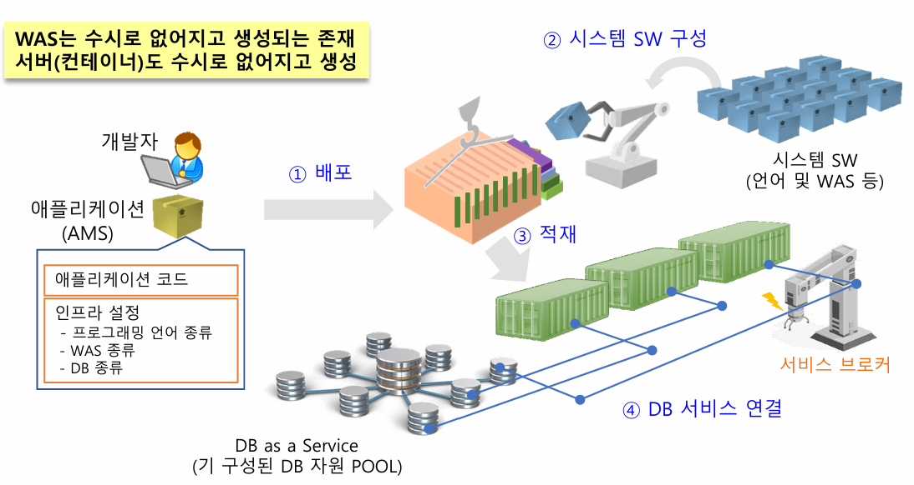

#### * 딥러닝과 생성형 AI이해

- 생성형 AI의 등장

  - [Attention is all you need]([[1706.03762\] Attention Is All You Need](https://arxiv.org/abs/1706.03762))으로 부터 2017년도 새로운 인공지능인 생성형 AI가 등장
  - 기존 딥러닝으로 인간의 뇌가 인지하는 기능을 흉내내는 것은 좋았으나, 말하는 언어 능력을 흉내내기에는 부족
  - 하지만, 생성형 AI를 통해 인간이 모국어를 익히는 구조를 Attention과 Self-Attention으로 정의하고 이 방식을 적용한 결과 효과적으로 말을 생성할 수 있었음

- 딥러닝

  - 인간의 뇌 구조와 동작하는 방식을 모방

    - CNN(시각 정보 모방) : 이미지나 영상처럼 공간적 정보를 추출하고 처리
      - 작동원리 : 데이터 전체를 한 번에 처리하며, 필터(커널)를 슬라이딩하며 이미지의 국부적인 특징을 잡아내는 **합성곱(Convolution) 연산**과 데이터 크기를 줄이는 **풀링(Pooling) 연산**을 반복. 이를 통해 이미지 내 객체의 위치가 바뀌어도 동일하게 인식하는 특징(이동 불변성)을 가짐
    - RNN(언어 정보 모방) : 텍스트, 음성, 주가 등 시간의 흐름에 따라 순서가 있는 **시퀀스 데이터(Sequential Data)**나 **시계열 데이터(Time-series Data)**를 처리하는 데 특화
      - 작동 원리: 데이터를 순차적으로 하나씩 입력받으며, 내부의 **은닉 상태(Hidden State)**를 통해 과거에 학습한 정보를 기억했다가 현재의 연산에 함께 반영
      - Hidden State : RNN이 과거의 입력을 기억하기 위해 내부적으로 가지고 있는 **'메모리(기억)'**
        - 순차적인 데이터(예: 문장의 단어들)를 처리할 때, 이전에 들어온 단어들의 정보를 압축하여 저장해둠. 다음 단어가 들어오면 이 메모리(Hidden State)와 새 단어를 함께 조합하여 다음 단어를 예측

  - 대량의 데이터를 학습하며 패턴을 인식(분류와 예측에 활용)

  - 이미 존재하는 정보를 분석하고 결과 도출

  - 사물을 인식하고 패턴을 학습하는 사고 과정에 집중

  - 핵심 구성 요소

    - 뉴런 : 딥러닝에서 연산이 일어나는 가장 작은 **기본 단위(노드)**, 주변 뉴런들로부터 여러 신호(데이터)를 받아들여 하나로 합치는 역할
    - 가중치 : 어떤 뉴런의 신호를 얼마나 중요하게 반영할지 결정하는 **'치우침(중요도)'**, 인공지능이 '학습을 한다'는 것은 오차를 줄이기 위해 이 **가중치 값을 최적의 숫자로 찾아가는 과정**을 말함
    - 활성화 함수 : 뉴런이 합산한 신호 값을 최종적으로 **'다음 뉴런으로 전달할지, 말지, 혹은 얼마나 강하게 보낼지'** 결정하는 필터
    - 다층 퍼셉트론 : (뉴런, 가중치, 활성화 함수)가 모여서 '층(Layer)'을 이루고, 그 층이 여러개 쌓인 것

  - 인공 신경망에서의 전파 방식은 정보가 강렬하거나 충격적인 신호가 들어오면 뉴런간 전파되어 오래 기억됨

    - 인공지능이 예측을 크게 틀렸을 때 발생하는 **큰 오차(Loss)**나, 특정 필터를 강력하게 통과한 **높은 활성화 값(Activation)**이 곧 '충격적인 신호'

    - "뉴런 간 전파됨" = 순전파와 역전파
      - **순전파(Forward):** 자극이 입력층에서 출력층으로 쭉 흘러가며 전기 신호처럼 전파
      - **역전파(Backpropagation):** '충격(오차)'을 받은 출력 뉴런이 그 충격의 원인을 찾기 위해 **거꾸로 이전 뉴런들에게 오차 신호를 전달**
    - "오래 기억됨" = 가중치(Weight)의 큰 업데이트와 LSTM의 Cell State
      - **가중치(Weight) 업데이트:** 역전파를 통해 충격 신호가 전달되면, 뉴런과 뉴런 사이의 연결 고리인 가중치(Weight)가 크게 바뀐다. 딥러닝에서 이 가중치가 변하는 것이 바로 **'학습(기억)'**하는 과정. 강한 충격을 준 정보일수록 가중치에 깊게 각인되어 오래 유지
      - **LSTM의 Cell State (세포 상태):** RNN의 발전형인 **LSTM** 모델에는 아예 '오래 기억하기 위한 장기 기억 장치'인 **Cell State**가 따로 있음. 여기에 충격적이거나 중요한 정보(예: 문장의 핵심 주어)가 들어오면, 신경망의 '입력 게이트(Input Gate)'가 열리면서 이 정보를 장기 기억 속에 쏙 집어넣고 아주 오랫동안 보존

- 생성형 AI(Generative AI)

  - 딥러닝 기술(트랜스포머 아키텍처)을 기반으로 구축 및 동작
  - 인간의 언어 습득 과정 모방
  - 새로운 콘텐츠 창작 : 텍스트, 이미지, 음악 등 다양한 형태의 콘텐츠 생성
  - 학습한 패턴을 바탕으로 창의적인 결과물 제작
  - 언어 모델의 기본 원리 및 문맥 이해
    - 방대한 텍스트 데이터에서 단어 간의 통계적 관계 학습하여 문장 구조와 의미를 파악
    - 확률 기반 예측 : 이전 단어들의 문맥을 바탕으로 다음 단어를 확률적으로 예측하여 자연스러운 텍스트를 생성
  - 파라미터(Parameter, 매개변수)
    - 모델이 학습하는 핵심 요소(가중치, 편향)
      - **하이퍼파라미터:** 학습을 시작하기 전에 **사람(엔지니어)이 직접** 세팅해 주는 값 (예: 인공 신경망을 몇 층으로 쌓을지, 한 번에 데이터를 몇 개씩 학습시킬지 등)
    - 파라미터의 개수가 많을수록 AI가 더 복잡한 맥락을 이해하고 많은 지식을 저장 가능
  - 파라미터(매개변수/가중치)를 딥러닝 방식으로 학습하며, 파라미터의 개수가 많을수록 더 복잡하고 많은 지식을 학습 가능

- 생성형 AI의 한계와 RAG 등장

  - 생성형 AI는 태생적으로 환각(Hallucination) 현상을 가질 수 밖에 없음

    - 생성형 AI가 동작하는 방식은 현재 문장이나 맥락을 토대로, 이후 발생할 문장을 예측하는 방식이기 때문

  - 생성형 AI의 한계를 극복하기 위해 검색 증강 생성(Retrieval-Augmented Generation)이 등장생성형 AI의 한계와 RAG 등장

  - 벡터(Vector) 데이터베이스에서 질의와 관련된 정보를 검색하여 이를 프롬프트에 함께 전달하는 방법으로, 2022년 LLM 등장 이후 LLM의 가장 대표적인 애플리케이션으로 부상함

    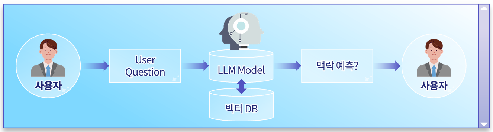

- 임베딩(Embedding) : 글자를 숫자로 바꾸는 번역기

  - LLM은 내부적으로 단어의 뜻을 직접 이해하는 것이아니라 모든 것을 수학적 계산(행렬 연산)으로 처리

  - 의미가 비슷한 문장들은 수학적 공간(좌표계) 안에서 서로 가까운 거리에 위치

- Vector DB : 사람이 쓰는 자연어를 LLM이 이해할 수 있는 (의미가 채워진)수학적 숫자 배열(벡터, Vector)로 변환하여 저장하고, 이를 초고속으로 검색할 수 있게 해주는 저장소
  - 작동 방식 : 사용자가 질문을 던지면, 그 질문의 벡터 좌표와 **가장 가까운 거리(유사한 의미)에 있는 문서의 벡터들을 순식간에** 찾아냄

- 실시간 데이터 조회 및 활용(RAG) 파이프라인
  1. 데이터 수집 단계(Data Ingestion)
     - **이벤트 발생:** 외부 원천 시스템(언론사의 CMS 데이터베이스 또는 증시 시스템의 시세 Feed)에 새로운 텍스트 데이터(뉴스 기사)가 적재되는 이벤트가 생성
     - **실시간 수집:** 기업의 데이터 수집 파이프라인(예: Kafka, RabbitMQ 같은 메시지 브로커 또는 웹훅 시스템)이 해당 이벤트를 감지하고 가공되지 않은 **텍스트 데이터(Raw Text)**를 API 통신을 통해 실시간으로 긁어옴
  2. 임베딩 및 데이터 가공 단계 (Embedding & Processing)
     - **텍스트 전처리:** 수집된 뉴스 텍스트에서 불필요한 HTML 태그, 특수문자를 제거하고, 긴 문서를 처리하기 적절한 길이로 쪼개는 **청킹(Chunking)** 과정을 거침
     - **벡터 변환:** 분할된 텍스트 조각들을 **임베딩 모델(Embedding Model)**의 입력값으로 주입. 임베딩 모델은 이 자연어 텍스트의 문맥적 의미를 연산하여 고정된 차원의 **실수 배열(Dense Vector, 예: 1,536차원의 숫자 열)**인 벡터 좌표값으로 출력
  3. 벡터 데이터베이스 적재 (Vector DB Upsert)
     - **인덱싱 및 저장:** 출력된 텍스트 벡터값을 원본 텍스트 메타데이터(발행 시간, 제목 등)와 매핑하여 **벡터 데이터베이스(Vector DB)**에 `Upsert(Insert 또는 Update)` 쿼리로 실시간 전송
     - **고속 탐색 준비:** 벡터 DB는 수신된 고차원 벡터를 HNSW(Hierarchical Navigable Small World)나 IVF(Inverted File Index) 같은 특수 알고리즘을 사용해 공간적으로 인덱싱하여 즉시 검색이 가능한 상태로 정렬
  4. 사용자 질의 및 유사도 검색 (Query & Similarity Search)
     - **질의 벡터화:** 사용자가 "오늘 삼성전자 주가 어때?"라는 질문을 입력하면, 시스템은 이 질문 텍스트를 앞서 사용한 것과 **동일한 임베딩 모델**에 통과시켜 질문의 벡터값을 생성
     - **유사도 연산:** 질문 벡터를 벡터 DB로 보내 저장된 데이터들과 **코사인 유사도(Cosine Similarity)** 또는 L2 유클리드 거리를 연산. DB는 질문 벡터와 가장 거리가 가까운(유사도가 높은), 즉 5분~10분 전에 적재된 최신 뉴스 벡터를 역추적하여 해당 **원본 텍스트(메타데이터)**를 추출
  5. 컨텍스트 주입 및 LLM 추론 (Context Injection & Inference)
     - **프롬프트 구성:** 벡터 DB에서 검색된 최신 뉴스 텍스트를 사용자의 원래 질문과 결합하여 하나의 거대한 **컨텍스트 포함 프롬프트(Context-infused Prompt)**를 생성
     - **최종 출력:** 이 프롬프트를 **LLM(대형 언어 모델)**의 입력값(Input Token)으로 전송. LLM은 자체 파라미터를 업데이트(학습)하지 않고, 입력된 프롬프트에 포함된 최신 뉴스 정보를 조건부 데이터(Condition)로 삼아 텍스트 생성 연산을 수행한 뒤, 환각 없이 정확한 사실이 담긴 답변을 출력

- 생성형 AI의 발전

  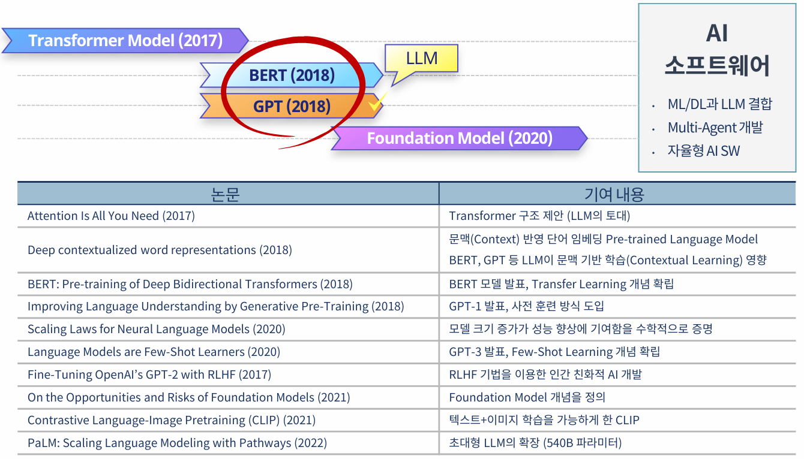

- Perplexity
  - 생성형 AI의 환각 현상을 극복하여 동작하는 하이브리드 방식
  - 검색형 LLM 도구, 웹 검색 + 요약 + 인용 기능을 실습
- Storm
  - 다양한 관점을 통합하는 AI Scientist
  - 전문가 대화형 AI, 관점 기반 논의 + 보고서 생성 기능을 실습

#### * 생성형 AI로 보는 인공지능의 과거와 현재

- 머신러닝 문제 유형에 따라 알맞은 알고리즘(모델)을 선택하는 의사결정 트리(Decision Tree) - 과거

  1. Unsupervised Learning : Clustering (비지도학습 : 군집화)
     - **진입 조건:** 정답(라벨)이 없는 데이터(`Labelled Data` ➔ No)를 비슷한 특성끼리 묶어줄 때 선택
     - **알고리즘 선택 기준**
       - 카테고리형(범주형) 변수 위주라면 `K-Modes`, 일반적인 수치형 데이터에 그룹 수(K)를 지정하려면 `K-Means`를 씁니다. 확률 기반 방식이 선호된다면 `Gaussian Mixture Model`을 선택
       - 미리 그룹 수(K)를 지정하기 어렵다면 데이터 밀도 기반의 `DBSCAN`이나 계층적 구조의 `Hierarchical` 방식
  2. Unsupervised Learning : Dimension Reduction (비지도학습 : 차원 축소)
     - **진입 조건:** 정답이 없는 데이터에서 중요도가 낮은 특성을 쳐내고 데이터의 크기(차원)를 줄여 핵심만 남기고 싶을 때(`Dimension Reduction` ➔ Yes) 선택
     - **알고리즘 선택 기준**
       - 텍스트의 핵심 주제를 뽑아내는 토픽 모델링(`Topic Modelling`) 분야라면 확률 기반의 `Latent Dirichlet Analysis(LDA)`나 `Singular Value Decomposition(SVD)`을 씀
       - 그 외 일반적인 데이터의 차원 축소에는 가장 대표적인 `Principal Component Analysis(PCA, 주성분 분석)`를 활용
  3. Supervised Learning : Classification (지도학습 : 분류)
     - **진입 조건:** 라벨(정답)이 있는 데이터(`Labelled Data` ➔ Yes)이면서, 예측하려는 값이 숫자가 아닐 때(`Prediction Numeric` ➔ No) 선택
     - **알고리즘 선택 기준:**
       - **속도 vs 정확도:** 속도가 중요하다면 `Linear SVM`이나 대용량 데이터일 경우 `XG Boost`를 선택합니다. 설명 가능성(`Explainable`)이 중요하다면 `Decision Trees`나 `Logistic Regression`을 씀
       - **정확도 극대화:** 속도보다 정확도가 중요하다면 `Kernel SVM`, `Random Forest`, `k-Nearest Neighbor(k-NN)`, 그리고 우리가 앞서 배운 `Neural Network(신경망/딥러닝)`을 선택
  4. Supervised Learning : Regression (지도학습 : 회귀)
     - **진입 조건:** 라벨이 있는 데이터이면서, 예측하려는 값이 연속적인 '숫자'일 때(`Prediction Numeric` ➔ Yes) 선택 (예: 주가 예측, 집값 예측 등)
     - **알고리즘 선택 기준:**
       - **속도 우선:** 빠른 연산이 필요하면 `Decision Trees`나 `Linear Regression`을 씀
       - **정확도 우선:** 더 정밀한 예측이 필요하면 `Random Forest`나 `Neural Network(신경망/딥러닝)`을 활용

  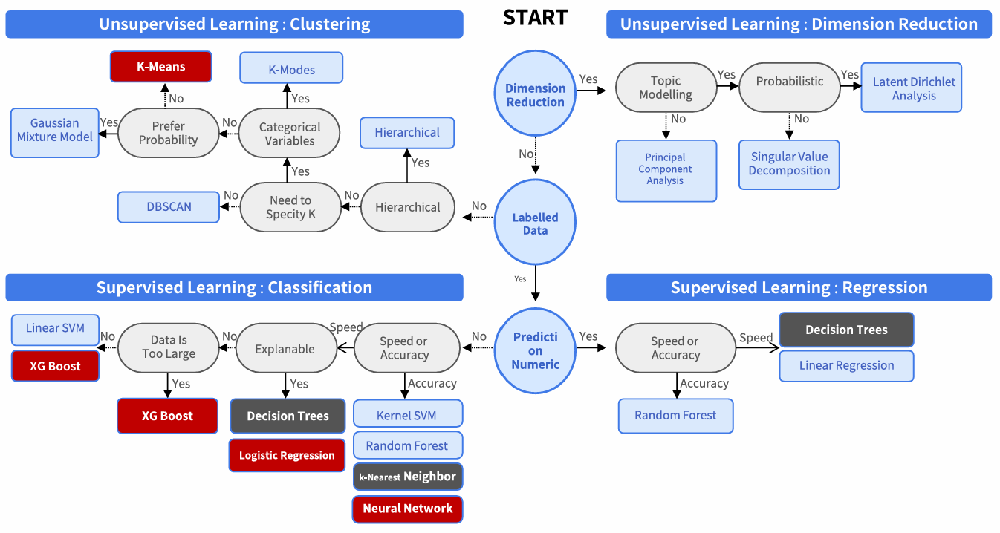

- 과적합(Overfitting) : AI 모델이 학습 데이터에 **너무 과하게 최적화되어, 정작 실제 새로운 데이터가 들어왔을 때는 엉뚱한 예측을 하는 현상**

  - XGBoost의 과적합 방지 메커니즘
    - 정규화 (L1 / L2 Regularization) : 모델이 너무 복잡해지지 않도록 **가중치(Weight)의 크기를 강제로 억제**하는 패널티(벌점) 시스템
    - 조기 종료 (Early Stopping) : 학습을 반복하다가 **최적의 타이밍에 컴퓨터가 학습을 스스로 멈추게 하는 기능**

- XGBoost / GBDT 작동 방식

  1. 약한 결정 트리 (Weak Learner)를 순차적으로 학습
     - 하나하나의 트리는 대단한 성능을 내지 못하고 정답률이 다소 떨어지는 단순한 트리 구조
     - 이를 한 번에 병렬로 만드는 것이 아니라, **첫 번째 트리 ➔ 두 번째 트리 ➔ 세 번째 트리처럼 차례대로(순차적으로)** 이어 붙이며 학습
  2. 이전 트리의 오차를 다음 트리가 보완
     - 첫 번째 트리가 데이터를 분류하거나 예측하고 나면 반드시 틀린 부분(오차)이 생김
     - 두 번째 트리는 처음부터 다시 공부하는 게 아니라, **첫 번째 트리가 흘린 오차 데이터만을 타깃으로 삼아** 이를 해결하는 데 집중, 세 번째 트리는 앞선 트리들이 또 틀린 오차를 해결함. 이 과정이 반복되면서 모델의 전체적인 성능이 정밀해
  3. Gradient Descent (경사하강법)의 활용
     - **오차를 가장 효과적으로 줄일 수 있는 수학적 방향(Gradient, 기울기)**을 계산, 그 방향으로 다음 트리를 설계하여 오차를 빠르게 0에 가깝게 깎아 내려감
     - \(\theta _{new}=\theta _{old}-\alpha \nabla _{\theta }L(\theta _{old})\)
       - **θ (파라미터):** 우리가 구하고자 하는 모델의 **가중치(w)**와 **편향(b)**
       - **\(\nabla_{\theta} L(\theta)\) (기울기, Gradient):** 현재 위치에서 오차가 가장 크게 늘어나는 방향, 오차를 줄여야 하므로 이 값 앞에 **마이너스(-) 부호**를 붙여 **반대 방향(내리막길)**으로 이동
       - **α (학습률, Learning Rate):** 한 번에 가중치를 얼마나 크게 바꿀지 결정하는 **보폭**
         - **보폭이 너무 크면:** 최저점을 지나쳐 반대편 언덕으로 튕겨 나갑니다(발산)
         - **보폭이 너무 작으면:** 하염없이 조금씩 내려가느라 학습이 너무 오래 걸림

- XGBoost 코드

  ~~~python
  # XGBoost 알고리즘 사용하기 위해 패키지 가져오기
  import xgboost as xgb
  # 머신러닝 연습용 데이터 중 하나인 유방암 진단 데이터셋 불러오는 기능
  from sklearn.datasets import load_breast_cancer
  # 전체 데이터를 학습용·검증용 데이터로 쪼개주는 유용한 함수
  from sklearn.model_selection import train_test_split
  # 학습이 끝난 후 모델이 얼마나 잘 맞췄는지 정확도 점수를 계산해주는 도구
  from sklearn.metrics import accuracy_score
  
  # 데이터 로딩
  # X(Feature/특성), y(taget/정답)
  data = load_breast_cancer()
  X, y = data.data, data.target
  
  # 데이터 분할(과적합 방지)
  # test_size = 0.2 : 학습데이터 80%, 시험데이터20%
  # random_state = 42 : 데이터를 섞어서 무작정 나눌 때, 코드를 다시 실행해도 똑같은 규칙으로 쪼개지도록 고정하는 일종의 '시드 번호'
  X_train, X_test, y_train, y_test= train_test_split(X, y, test_size=0.2, random_state=42)
  
  # XGBoost분류기 모델 생성
  # use_label_encoder=False: 경고 메시지가 뜨는 것을 방지하기 위해 구버전 기능을 끄는 설정
  # eval_metric='logloss': 앞서 배운 "오차를 계산하여 트리들을 구성한다"고 했을 때, 그 오차(손실)를 계산하는 수학적 방식으로 logloss(로그 손실)를 채택하겠다고 지정한 것
  model = xgb.XGBClassifier(use_label_encoder=False, eval_metric='logloss'
  
  # 학습
  model.fit(X_train, y_train)
  # 예측
  y_pred= model.predict(X_test)
  # 정확도 출력
  print("Accuracy:", accuracy_score(y_test, y_pred))
  Accuracy: 0.956140350877193

- 학습 알고리즘(최적화, Optimization)

  1. **순전파:** 현재 가지고 있는 가중치와 편향을 이용해 입력데이터를 넣고 일단 예측 결과를 낸다
  2. **오차 계산:** 모델의 예측값과 실제 정답을 비교하여 **오차(Loss/Cost)**를 계산
  3. **역전파:** 오차를 줄이려면 가중치를 어느 방향으로 얼마나 수정해야 하는지 **미분(기울기, Gradient)을 통해 뒤에서부터 거꾸로 계산**
  4. **가중치 업데이트:** 역전파로 알아낸 기울기를 바탕으로, **경사하강법 수식을 이용해 가중치를 내리막길 방향으로 조금씩 수정**

- Transformer모델 아키텍처

  - 인코더(Eoncoder)
    - Input Embedding : 입력 단어를 고정된 크기의 벡터로 변환
    - Positional Encoding : Transformer는 RNN처럼 순서를 자동으로 기억하지 못하므로, 각 단어의 위치 정보 추가
    - Multi-Head Attention : 입력 문장 내 단어들끼리 서로 어떤 관계가 있는지 파악(ex : 문장 내 `he`가 가리키는 대상이 앞선 단어인 `doctor`임을 찾아내는 맥락 이해)
    - Add & Norm (안정화) : Layer Normalization + 잔차 연결(residual connection) 수행
      - **층 정규화(Layer Normalization):** 데이터의 값들이 너무 튀지 않도록 평균과 분산을 맞추어 균일하게 정렬
      - **잔차 연결(Residual Connection):** 입력된 신호를 변형하지 않고 뒤로 그대로 한 번 더 더해주는(`Add`) 기술, 딥러닝 학습 단계 중 **역전파 과정에서 신호(기울기)가 끊기지 않고 맨 앞 층까지 안전하게 전달**되도록 도움
      - Encoder Layer(Nx) : 안정화를 여러 층(N번) 반복하여 쌓음으로써 깊고 강력한 문맥 이해 능력을 갖추게 됨
    - Feed Forwar : 맥락을 파악한 데이터를 각 위치별로 동일한 작은 신경망을 통과시켜 비선형 특징을 추출
  - 디코더(Decodr)
    - Masked Multi-Head Attention (컨닝 방지용 첫 번째 어텐션)
      - **미래 단어 가리기:** 디코더는 단어를 순차적으로 생성해야 하므로, 학습할 때 **아직 생성되지 않은 미래의 단어들을 볼 수 없도록 가림막(`masking`) 처리**
      - **이유:** 문장을 학습할 때 뒤에 올 정답 단어들을 미리 봐버리면(컨닝하면), 실전에서 스스로 단어를 예측하는 능력을 기를 수 없기 때문입니다. 오직 **현재 예측 시점 이전의 단어들만** 보고 다음 단어를 맞추도록 훈련함
    - Multi-Head Attention (인코더와 연결되는 두 번째 어텐션)
      - 왼쪽의 인코더가 원문(입력 문장)을 분석해서 넘겨준 정보를 바탕으로, 현재 내가 생성하고 있는 단어가 전체 맥락과 잘 맞아떨어지는지 다시 한번 대조하며 집중하는 단계
    - Feed Forward : '자신이 지금까지 생성한 단어들'과 '인코더가 넘겨준 정보'가 결합된 데이터를 처리
    - Linear + Softmax (최종 확률 계산)
      - **확률 기반 예측의 실체:** 모든 신경망 연산(`Feed Forward`)과 안정화(`Add & Norm`)를 거친 데이터는 맨 위에서 확률로 바뀜
      - **역할:** 사전에 등재된 수만 개의 단어 후보들 중 **"지금 문맥상 다음에 올 확률이 가장 높은 단어가 무엇인가"**를 0과 1 사이의 확률 분포로 계산해 내고, 그중 가장 높은 단어 하나를 최종 출력(`Outputs`)으로 채택

  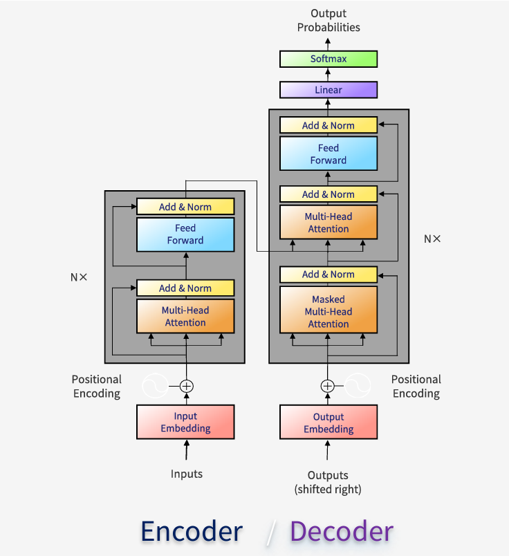

- Transformer의 핵심 기술

  - 토크나이저(Tokenizer)
    - 트랜스포머 인코더와 디코더의 가장 첫 입구(`Embedding` 직전 단계)와 가장 마지막 출구(`Softmax` 직후 단계)에 위치
    - **입력 시:** 사람이 준 문장을 트랜스포머가 계산할 수 있는 숫자 조각(**토큰**, 정보를 처리할 수 있는 단위)으로 잘게 쪼개서 넘겨줌
    - **출력 시:** 트랜스포머 디코더가 최종 계산해서 뱉어낸 숫자 조각들을 다시 사람이 읽을 수 있는 언어로 합성(복호화)
  - 자기회귀 디코딩(Auto-regressive Decoding) -> 트랜스포머 구동방식
    - 트랜스포머의 오른쪽 기둥인 **디코더(Decoder)**가 문장을 출력하는 방식 그 자체
    - 첫 단어를 확률 기반으로 예측해 낸 뒤, **그 단어를 다시 디코더의 입력창에 집어넣어서** 두 번째 단어를 예측하고, 또 그 두 단어를 입력창에 넣어 세 번째 단어를 예측하는 방식
      - 꼬리에 꼬리를 무는 이 반복 구동 방식이 바로 트랜스포머 디코더의 문장 생성 원리

- Transformer 모델을 적용한 번역코드

  ~~~python
  # transformers : 허깅페이스(Hugging Face)에서 제공하는 AI 모델 저장소이자 라이브러리
  # torch : AI 연산의 뼈대가 되는 페이스북의 파이토치(PyTorch) 딥러닝 프레임워크
  # sentencepiece : 구글에서 만든 텍스트 분석 도구로, 단어를 서브워드(Subword) 단위로 잘게 쪼개는 역할
  # from transformers import ...: 트랜스포머 계열 번역 모델의 아키텍처 구조인 MarianMTModel과 글자-숫자 변환기인 MarianTokenizer 구조를 파이썬으로 불러옴
  !pip install transformers torch sentencepiece
  from transformers import MarianMTModel, MarianTokenizer
  
  # 영어 → 한국어용 사전학습 모델 (Helsinki-NLP 기반)
  model_name= "Helsinki-NLP/opus-mt-en-ko"
  
  # 토크나이저 및 모델 로드
  # from_pretrained()이 함수를 실행하면 전 세계 서버에서 해당 번역 모델의 '인코더-디코더 신경망 구조'와 '최적화된 가중치 파일(파라미터)'을 내 컴퓨터나 코랩 환경으로 쏙 다운로드해 와서 메모리에 올림
  tokenizer = MarianTokenizer.from_pretrained(model_name)
  model = MarianMTModel.from_pretrained(model_name)
  
  # 번역할 영어 문장
  english_text= "The weather is nice today."
  
  # 토큰화 및 번역 수행
  # 토크나이저의 역할: 트랜스포머는 수학 계산기이므로 글자를 숫자로 바꿔야 함. 이 함수가 영어 문장을 잘게 쪼개어 고유한 숫자 배열(토큰 아이디)로 매핑
  # return_tensors="pt": 결괏값을 파이토치(PyTorch)가 연산할 수 있는 특수한 수학 행렬 형태인 텐서(Tensor) 데이터 구조로 반환
  # padding=True: 여러 문장을 한 번에 처리할 때 문장 길이를 똑같이 맞춰주는 채우기(Padding) 옵션
  tokens = tokenizer(english_text, return_tensors="pt", padding=True)
  # 내부 인코더가 숫자로 변환된 영어 단어들의 맥락을 뼈대까지 파악, 그 후 디코더가 자기회귀(Auto-regressive) 방식과 확률 기반 예측을 사용해 첫 단어부터 문장이 끝날 때까지 꼬리에 꼬리를 물며 한국어에 해당하는 숫자 조각(토큰)들을 하나씩 예측하여 조립
  translated = model.generate(**tokens)
  
  # 번역 결과 디코딩
  korean_text= tokenizer.decode(translated[0],
  skip_special_tokens=True)
  print("원문 (영어):", english_text)
  print("번역 (한국어):", korean_text)

- ML/DL + 생성형 AI 서비스 시나리오

  1. 스마트 의료 상담
     - 기존의 ML 기반 질병 예측 모델 + LLM 기반 대화형 증상 상담
  2. 제조 품질 이상 감지 + 리포트 자동 생성
     - CNN 기반 결함 감지 + GPT 기반 리포트/ 알람 문서 생성
  3. 금융 사기 탐지 + 자동 설명 생성
     - ML랜잭션 기반 ML모델 + LLM이 사기 사유 설명
  4. HR 채용 필터링 + 면접 질문 생성
     - 이력서 필터링 ML 모델 + 적합한 질문을 생성형AI로 생성
  5. 교육 개인화 추천 + 맞춤 콘텐츠 생성
     - 학습 행동 기반 추천 시스템 + GPT로 문제/자료 자동 생성

- 평가 지표 Pool(실무 기획이나 AI 과제 제안서(RFP)를 작성할 때 평가 지표는 보통 3개)

  - 기능성 : 요구된 기능이 잘 동작하는 지 여부

  - 사용성 : 요구된 기능 사용성 적합도 판단

  - 시장성 : 현재 또는 미래 수요와 진입 기회

  - 경제성 : 기술 구현비용 대비 수익성

  - 효율성 : 자원 사용 대비 생산성 제고

  - 효과성 : 사용자 만족도, 문제 해결 능력

  - 유지보수성 : 운영을 고려한 유지보수 능력

  - 이식성 : 타 플랫폼 이식 및 이전 용이

  - 첫 번째 선택 기준 : 기술의 본질이 잘 작동하는가? (기술 관점)

    - **추천 지표 Pool:** **기능성, 유지보수성, 이식성**
    - **설명:** AI 모델이 기술적으로 사기나 불량을 잘 잡는지, 생성형 AI가 헛소리(환각)를 안 하는지 검증합니다. 이게 무너지면 서비스 자체가 성립하지 않습니다.

    두 번째 선택 기준 : 도입했을 때 진짜 이득이 되는가? (비즈니스 관점)

    - **추천 지표 Pool:** **효율성, 경제성, 시장성**
    - **설명:** 이 시스템을 구축하기 위해 들어간 서버 비용(GPU 비용, API 비용) 대비 업무 시간이 단축되거나 매출이 늘어나는지 계산하는 공급자 중심의 지표입니다.

    세 번째 선택 기준 : 사람이 쓰기에 안전하고 만족스러운가? (사용자 관점)

    - **추천 지표 Pool:** **효과성, 사용성**
    - **설명:** 아무리 똑똑하고 경제적인 AI라도 현장 직원이 쓰기 어렵거나(사용성), 환자나 고객이 불안해하면(효과성) 폐기됩니다. 실제 인간과의 상호작용을 평가

- ML 모델과 생성형 AI 결합 사례

  - 위에서 시장성+경제성+효과성을 기반으로 교육 개인화 시나리오 선정
  - 선정된 시나리오에 대해 개인화 추천 + GPT 기반 맞춤 문제를 생성

  ~~~python
  import pandas as pd
  from sklearn.ensemble import RandomForestClassifier
  from sklearn.model_selection import train_test_split
  # 예시 데이터: 학생 점수
  data = pd.DataFrame({
  "math": [40, 65, 80, 30, 90],
  "science": [35, 60, 75, 25, 85],
  "english": [70, 80, 85, 60, 95],
  # 목표 변수, 수학 낙제 여부 (1 = 낙제, 0 = 통과)
  "fail_math": [1, 0, 0, 1, 0]
  })
  
  # 입력 변수(X): 과학, 영어 점수, 출력 변수(y): 수학 낙제 여부
  X = data[["science", "english"]]
  y = data["fail_math"]
  X_train, X_test, y_train, y_test= train_test_split(X, y)
  # 여러 개의 결정 트리를 앙상블해 예측을 수행하는 모델
  model = RandomForestClassifier()
  model.fit(X_train, y_train)
  
  
  # 새로운 학생 예측
  # 과학 50점, 영어 60점인 학생의 데이터를 모델에 입력
  new_student= pd.DataFrame({"science": [50], "english": [60]})
  prediction = model.predict(new_student)
  # 예측 결과: 1이면 낙제, 0이면 통과
  print("수학 낙제 예측:", prediction[0])
  
  
  # gpt prompt 생성 구조로 결합 서비스 구성
  import openai
  # 클라이언트 인스턴스를 생성
  client = openai.OpenAI(api_key="your-api-key") 
  prompt = """
  수학에서 함수 단원을 어려워하는 고등학생에게 적합한 연습 문제를 3문제 생성하라.
  각 문제는 난이도 중간, 짧은 설명 포함.
  ""
  
  response = client.chat.completions.create(
  model="gpt-4",
  messages=[
  {"role": "user", "content": prompt}
  ]
  )
  print(response.choices[0].message.content)

#### * 생성형 AI/RAG 실습 환경 구성

- RAG 시스템 구현 단계

  - 지식 저장소 구축
    - 문서 수집 및 전처리를 진행, 효율적인 청크 분할 전략을 적용
  - 벡터 DB 구축
    - 임베딩 모델로 벡터 생성, 인덱싱 및 메타데이터를 연결
  - 검색 기능 개발
    - 유사도 검색 구현, 관련성 기반 랭킹 알고리즘을 적용
  - LLM 통합
    - 검색 결과 주입 프롬프트를 설계, 응답 생성 파이프라인을 최적화

- 서빙 아키텍처

  - 데이터 사이언티스트가 내 컴퓨터나 실험실(로컬 환경)에서 학습을 완료한 **AI 모델 파일을, 실제 수많은 사용자가 안정적이고 빠르게 쓸 수 있도록 인터넷 웹 서비스 형태로 배포·운영하는 서버 시스템 구조**

    - 클라이언트 요청
      - **Client / Frontend (요청부):** 사용자가 앱에서 버튼을 누르거나 이미지, 텍스트(프롬프트)를 입력하여 서버로 전달

    - API 게이트웨이 / 웹 서버
      - API Layer / Web Server (FastAPI 파트): 데이터 규격이 맞는지 검증(`Pydantic`)하고, 동시다발적으로 들어오는 트래픽을 비동기(`async`)로 쪼개어 대기열을 관리

    - AI 추론 엔드포인트
      - **Inference Engine (AI 추론부): **서버 컴퓨터의 메모리(RAM/VRAM)에 미리 올려둔 **AI 모델(XGBoost, PyTorch 등)**에 데이터를 밀어 넣어 결과(예측값, 생성된 문장)를 계산해 내는 아키텍처의 핵심 심장
    - 데이터베이스 / 자원
      - **Model Registry / Storage (저장부):** 학학습이 완료된 AI 모델 가중치 파일(예: `.pkl`, `.pt`, `.safetensors`)을 안전하게 관리하고 버전별로 보관하는 보관소
    - FastAPI : 파이썬(Python) 환경에서 **AI 모델을 웹 서비스(API)로 변환할 때 전 세계 엔지니어들이 현재 가장 많이 사용하는 백엔드 웹 프레임워크**
    - End Point : "외부(웹, 앱, 프론트엔드)에서 AI 서버에 접근할 수 있도록 열어놓은 최종 목적지 주소(URL)"
      1. **POST 방식 엔드포인트 (데이터를 주며 요청할 때)**
         - **주소 예시:** `/predict` 또는 `/generate-report`
         - **설명:** AI 서비스는 보통 데이터(이미지, 문장, 수치 등)를 서버에 **전송(POST)**해야 추론가능. (가장 많이 사용되는 형태)
      2. **GET 방식 엔드포인트 (정보를 가져오거나 상태를 체크할 때)**
         - **주소 예시:** `/healthcheck` 또는 `/model-version`
         - **설명:** AI 서버가 죽지 않고 잘 살아있는지 모니터링 시스템이 1초마다 노크하며 확인할 때 주로 사용

- 개발 환경 구성(기본 요소)

  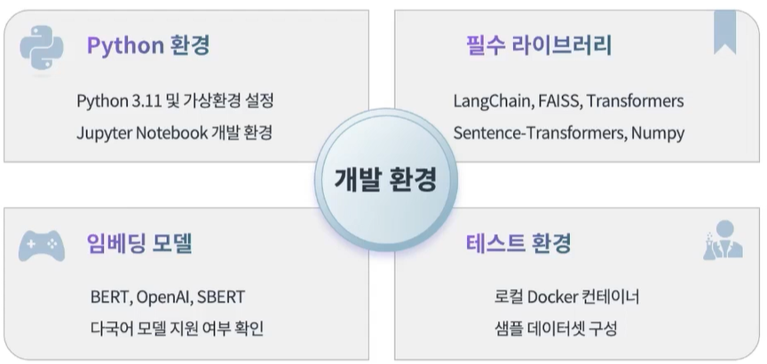

- Python 단점 극복

  - 글로벌 패키지 오염 및 버전 충돌 제어
    - **해결책:** **가상환경 (Virtual Environment: venv, Conda 등)**
    - **도입 이유:** 파이썬은 기본적으로 시스템 전역(Global) 공간에 패키지를 설치. 이로 인해 한 컴퓨터에서 복수의 프로젝트를 진행할 때 버전 꼬임(예: A 프로젝트의 `XGBoost 1.5`와 B 프로젝트의 `XGBoost 2.0` 충돌)이 발생하여 작동을 멈추는 대참사가 일어남.
    - **효과:** 완전히 독립된 격리 가상 공간을 생성하여, 각 프로젝트가 서로 간섭 없이 필요한 라이브러리 버전을 안전하게 사용하도록 보장.

  - 환경 재현 및 종속성 동기화의 어려움 해결
    - **해결책:** **의존성 명세 (Dependency Specification: requirements.txt, Poetry 등)**
    - **도입 이유:** 파이썬 라이브러리들은 꼬리에 꼬리를 무는 복잡한 의존성 구조를 가짐. 내가 개발한 코드를 클라우드 서버나 동료 PC에 배포할 때, 패키지 목록과 버전 정보가 정확히 기록되어 있지 않으면 환경 불일치 에러가 발생.
    - **효과:** 명령어 한 줄로 어느 환경에서든 완벽하게 일치하는 개발·운영 환경을 그대로 재현(복제).
    - **실무 현장 표준 (Best Practice):** 최근 상용 서버(Server Local) 환경에서는 기존 `requirements.txt`보다 패키지 간 버전 종속성을 훨씬 정밀하고 체계적으로 통합 관리해 주는 **Poetry** 도입이 표준으로 자리 잡고 있음.

  - OS 파편화 극복 및 무거운 AI 모델 배포 효율화
    - **해결책:** **컨테이너화 (Containerization: Docker 등)**
    - **도입 이유:** 개발자 PC 환경(예: macOS 맥북)과 운영 서버 환경(예: Linux 우분투)이 다르면 C/C++ 기반의 무거운 AI 연산 라이브러리(PyTorch 등)가 실행 오류를 일으킬 수 있음. 또한, 서버 증설 시마다 무거운 모델 환경을 매번 새로 세팅하는 것은 대단히 비효율적.
    - **효과:** 소스 코드, 가상환경, 패키지, 운영체제(OS) 환경까지 하나의 가벼운 **'박스(Docker Image)'**로 통째로 패키징합니다. Docker 엔진만 실행 중이라면 전 세계 어떤 서버에서든 1초 만에 동일하게 동작하는 서비스를 구동가능.
    - 보안 운영 팁: 기업 인프라 환경에서는 보안 취약점과 오픈소스 라이선스 리스크를 방어하기 위해, 소프트웨어 자재명세서인 **SBOM(Software Bill of Materials)** 검증을 통과한 자체 패키징 컨테이너 이미지만 빌드·배포에 사용.

  - 런타임 에러 예방 및 고부하 자원 관리
    - **해결책:** **모니터링 (Monitoring: Prometheus, Grafana, ELK 스택 등)**
    - **도입 이유:** 파이썬은 변수의 타입을 미리 지정하지 않는 **동적 타이핑(Dynamic Typing)** 언어. 코드가 실제로 돌아가는 도중(Runtime)에 예상치 못한 형식의 데이터가 들어오면 서버가 불시에 다운될 위험이 큼. 아울러 대규모 AI 추론 연산은 대량의 GPU/CPU 및 메모리 자원을 소모하므로 실시간 감시가 필수적입
    - **효과:** FastAPI 엔드포인트의 **에러 발생률, 응답 지연 시간(Latency), 자원 과부하 상태**를 실시간 대시보드로 시각화하여 감시합니다. 시스템 임계치 도달 시 관리자에게 자동 알람을 제공하여 선제적 장애 대처를 가능하게 함

- 상용 서버 배포의 현대적 표준 스택

  - [ FastAPI (초고속 비동기 서빙) ] + [ Python 가상환경 ] + [ Poetry (정밀 종속성 관리) ] + [ Docker Container (환경 격리 및 SBOM 검증) ] + [ Prometheus/Grafana (실시간 인프라 모니터링) ]

#### * ML/DL 이해 및 구현

- 머신러닝
  - 데이터로부터 스스로 패턴을 학습하여 의사 결정을 할 수 있는 알고리즘을 개발(단, 요구사항을 알고리즘으로 구현하는 것과 다름)
    - 전통적인 프로그래밍은 규칙에 따라 계산된 결과
    - 머신러닝은 데이터를 설명하는 의사 결정 모델(Rule, Pattern)
  - 지도학습(Supervised Learning)
    - 정답(Label)이 있는 데이터를 주어주고 새로운 데이터의 정답을 맞추도록 학습
    - 주어진 입력 값에 대하여 신뢰성 있는 출력 값을 출력하는 함수를 학습하는 과정에서 **출력 변수 \(y\)가 최적 함수 \(f\)를 찾도록 지도**하는 방법
      - \(y\): 출력변수, 종속변수 (예측하고 싶은 변수)
      - \(X\): 독립변수 (영향을 주리라고 생각되는 데이터를 담는 변수)
      - 학습 데이터 \((X, y)\)로부터 \(y = f(X)\)를 만족하는 여러 함수 \(f\) 중 최적의 \(f\)를 찾는 과정
      - **회귀 (Regression)**: 출력변수가 연속형인 지도학습입니다. (예: 선형 회귀 모형, 일반화 선형 모형)
      - **분류 (Classification)**: 출력변수가 범주형인 지도학습입니다. (예: 로지스틱 회귀 모형, 서포트 벡터 머신)
  - 비지도학습(UnSupervised Learning)
    - 정답 없이 데이터만 제공하며, 데이터 자체의 숨겨진 구조나 패턴 등을 목표로 학습하는 과정
    - 관심의 대상이 되는 변수(출력변수, 종속변수)가 없는 데이터 (또는 모든 데이터가 관심이 되는 데이터)
    - 데이터 구조 파악을 위한 군집 분석(K-means Clustering, Gaussian Mixture Model) 및 데이터 분포 파악을 위한 밀도 함수 추정(Kernel Density Estimation 등)이 있음
  - 강화 학습(Reinforced Learning)
    - 강화 학습은 의사결정 주체**에이전트**가 매 시점 자신의 **상태**를 파악하고 최선의 **행동**을 선택하며, 궁극적으로 '누적 보상을 최대화'하는 최적의 전략**정책**을 배워나가는 과정
      - **vs 비지도 학습:** 목표(보상 최대화)와 행동 기준(정책)이 명확히 존재
      - **vs 지도 학습:** 주어진 정답 데이터를 단순히 학습하는 데 그치지 않고, 시스템이 직접 행동하며 **새로운 상태, 의사결정 시점, 보상 데이터를 능동적으로 생성**
    - **에이전트 상태 집합(환경)을** \(S\)**, 행동 집합을** \(A\)라고 하면, 에이전트는 **매** \(t\) **시점마다 자신의 상태** \(s_t \in S\)와 이 상태에서 취할 수 있는 행동 \(a \in A(s_t) \subset A\) 가 있다
      - 상태에 따른 행동이 발생한다면, **어떤 함수** \(\pi : S \rightarrow A\)가 있어서 \(\pi(s_t) = a\)라고 볼 수 있음
      - 이 때 \(\pi \)**를 정책(Policy)**이라고 하며, 마지막 \(t\) 시점에서 행동 \(a\)를 취했다면 **다음 시점의 새로운 상태** \(s_{t+1}\)로 변하며 **보상** \(r_{t+1}\)을 받게 되는 것
  
- 지도학습 - 분류(Classification) 알고리즘
  1. 거리 기반
     - 새 데이터와 가까운 이웃들의 다수결로 분류하는 가장 직관적인 방법
     - 게으른 학습(Lazy Learning) : 다른 모델들처럼 복잡한 수학 공식이나 경계면을 미리 학습해두지 않고, 평소에는 데이터를 그대로 기억(저장)만 하고 있다가, 새로운 입력 데이터가 들어오는 순간 실시간으로 거리를 계산하여 예측시작
     - 작동 방식
       1. **거리 계산:** 새로운 데이터가 들어오면 기존의 모든 데이터와 거리를 측정 (주로 피타고라스 정리를 이용한 *유클리드 거리* 사용)
       2. **이웃 선택:** 계산된 거리 중 가장 가까운 순서대로 **\(k\)개**의 데이터를 뽑는다
       3. **다수결 (Voting):** 선택된 \(k\)개의 이웃이 가진 정답(레이블) 중 **가장 많은 표를 얻은 범주**로 최종 분류
     
  2. 트리 기반(단일 트리)
     - 입력값에 대한 예측값을 트리(Tree) 형태로 나타내주는 모형
     - 성장(growing) 단계
       - 최적화할 목적함수(불순도 지표)를 정하고 이를 바탕으로 데이터를 가장 잘 나눌 수 있는 최적의 독립변수와 분리 기준(Threshold)을 찾아 하위 가지를 뻗어 나감
       - 최적의 독립변수 : 데이터를 컴퓨터가 알아서 분류할 때 **"수많은 조건(질문)들 중에서 어떤 질문을 첫 번째로 던져야 정답을 가장 확실하게 가려낼 수 있을까?"**를 고민해서 **최고의 질문 주제(변수)를 고르는 것**
     - 가지치기(pruning)단계
       - 트리가 너무 깊게 성장하면 예측 능력이 떨어지고 규칙이 복잡해지므로, **해석이 어렵거나 불필요한 가지를 제거**하여 모형을 단순화하고 일반화 성능을 높임
     - **똑같은 하나의 알고리즘**을 성격이 완전히 다른 두 가지 데이터(`Iris`, `Titanic`)에 각각 적용해 보면서, **"데이터에 따라 전처리(데이터 정제 작업)가 얼마나 쉽고 어려워지는지 그 차이를 한눈에 비교하기 좋음**
     - Iris는 수치형 Feature의 다중 클래스 분류, Titanic은 범주형-결측치가 섞인 이진 분류(생존 여부)라서 전처리 난이도로 대비를 보여주기 좋음
     
  3. 트리 기반(앙상블)
     - 앙상블 : 여러 개의 기본 모델(Ex: 의사결정나무)을 조합하여 하나의 강력한 모델을 만드는 전체적인 전략(단일 트리의 한계를 극복하고 성능을 끌어올림)
       - 배깅(ex : Random Forest) - 과적합 방지
         - 여러 나무를 서로 독립적으로(병렬) 만들어서 각자의 결과를 투표/평균으로 합산하는 방식
         
       - 부스팅(ex : XGBoost, LightGBM) - 오차 감소
         - 나무를 순차적으로(직렬) 만들면서 앞선 나무(모델)의 실수(오차, 잔차)를 뒤의 나무가 정답을 맞힐 수 있도록 순차적으로 보완해 나가는 방식
         
         - 오차가 0이 될 때까지 나무를 끊임없이 추가하면 과적합 발생
         
         - XGBoost(Extreme Gradient Boosting)
           - Gradient Tree Boosting 알고리즘에 과적합 방지를 위한 Hyper Parameter(𝜆, 𝛾)가 추가된 알고리즘
           
             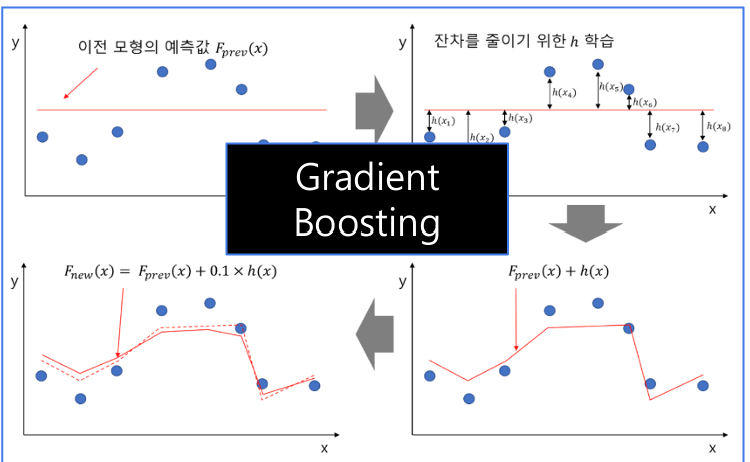
           
           - 리프 노드(최종 노드)의 예측값(w, 가중치)
             - 트리가 학습을 마친 후 최종 노드(리프 노드)에 도달했을 때, 그 노드에 모인 데이터들의 오차를 해결하기 위해 부여하는 **최종 '보정 수치'**
             - \(\text{예측값 }(w)=-\frac{\text{방에 있는 오차들의 합}}{\text{데이터 개수}+\lambda }\)
           
           - 분할 조건 계산 : 유사도 점수와 Gain
           
             - 유사도 점수
               - 해당 노드 내부 오차들의 방향성이 얼마나 일치하는지(응집되어 있는지) 평가하는 점수
               - \(\text{Similarity\ Score}=\frac{(\sum \text{Residuals})^{2}}{\sum h_{i}+\lambda }\)
               - \(\sum \text{Residuals}\)는 방에 있는 오차들의 합, \(h\)는 헤시안(오차 함수를 두 번 이차미분한 값
               - **회귀 문제일 때:** \(h_i = 1\)이 되므로 분모는 (데이터 개수 + \(\lambda \) )와 같아짐.
               - **이진 분류 문제일 때:** \(h_i = P(1-P)\)가 되므로 분모는 (\(\sum\) P(1-P) + \(\lambda \) )가 됨
             - Gain :분할 전후의 점수를 비교
               - 의사결정나무가 분할(가지치기)을 진행할 때, 분할 전후로 모델이 얼마나 발전했는지 유사도 점수로 비교하는 지표
               - Gain = Similarity_Left + Similarity_Right - Similarity_Parent
           
           - \(\lambda \) (L2 Regularization / 가중치 규제)
           
             - 나무의 리프 노드들이 가지는 예측값(가중치)의 크기를 억제
             - 유사도 점수와 예측값의 분모에 위치하여, 값이 커질 수록 분모를 키워 최종점수와 가중치를 낮춤
             - \(\lambda \) 값이 커지면 분할할 때의 '유사도 점수(Similarity Score)' 분모가 커져 점수가 낮아짐
           
           - 𝛾(Gamma / 최소 손실 감소 값)
             - 나무가 마디를 하나 더 쪼갤 때, **최소한 이만큼의 오차(손실)는 줄어들어야 분할을 허용하겠다**는 커트라인(Threshold)
             -  \(\gamma \) 값이 커지면 웬만큼 오차를 많이 줄여주지 않는 이상 새로운 가지를 만들지 못하게 차단
             - 최종 판단 값 = Gain - 𝛾
               - **합격 (\(\text{Gain} - \gamma > 0\)):** 가지 분할을 허용
               - **불합격 (\(\text{Gain} - \gamma < 0\)):** 최종 판단 값이 **음수(-)**가 되므로, 이미 만들어진 가지라도 가차 없이 잘라버립니다 (Pruning)
  
- 비지도학습 - 군집화(K-Means)
  - 레이블 없이 데이터의 거리 구조만으로 그룹(클러스터)을 나누는 알고리즘
  
  - 사전 클러스터 개수 k와 초기 중심점(Centroid)을 바탕으로, 데이터들을 가장 가까운 중심점에 할당하고 중심점을 업데이트해 나가는 방식
  
  - 알고리즘이 직관적이고 계산이 빨라 대용량 데이터 처리에 매우 유리
  
  - 초기값(중심점)에 민감하며, 그룹 내 분산 구조 반영이 어렵고 데이터의 변수(차원)가 많아질 수록 거리 계산의 변별력이 떨어져 효과 급감
  
  - 거리 기반 계산이므로 범주형 데이터(문자형) 적용 불가 - 수치화 과정 필요
  
    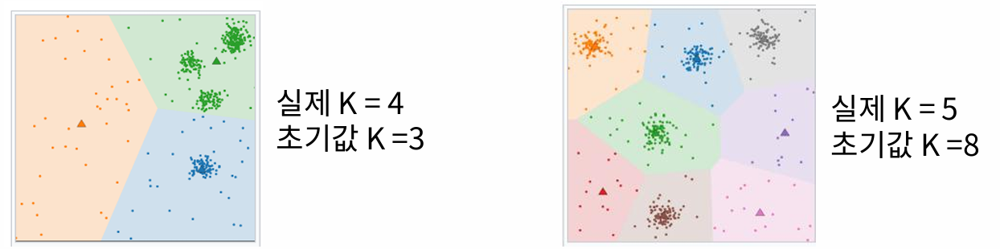
  
- 딥러닝 - 신경망 (순차 데이터 처리)
  - 앞의 전통적 ML 알고리즘과 달리 순서·시계열 정보를 기억하고 맥락을 파악하며 처리하는 신경망 구조
  - 순차 데이터 처리 신경망의 발전 과정 (RNN -> LSTM -> Transformer)
  - RNN (Recurrent Neural Network, 순환 신경망)
    - 데이터를 순차적으로 하나씩 입력받으며, 내부의 **은닉 상태(Hidden State)**를 통해 과거에 학습한 정보를 기억했다가 현재의 연산에 함께 반영
    - Hidden State : RNN이 과거의 입력을 기억하기 위해 내부적으로 가지고 있는 **'메모리(기억)'**
      - 순차적인 데이터(예: 문장의 단어들)를 처리할 때, 이전에 들어온 단어들의 정보를 압축하여 저장해둠. 다음 단어가 들어오면 이 메모리(Hidden State)와 새 단어를 함께 조합하여 다음 단어를 예측
      - (예: "나는" ➔ "밥을" ➔ "먹는다")
    - **치명적 한계 (장기 의존성 문제, Long-Term Dependency):** 문장이 길어질수록 앞쪽 단어의 기억(Gradient)이 점점 희미해져 사라지는 **기여도 소실(Vanishing Gradient)** 현상 발생
  - LSTM (Long Short-Term Memory, 장단기 메모리)
    - RNN의 치명적인 기억력 한계를 극복하기 위해 **'메모리 셀(Cell State)'**과 **'문지기(Gate)'** 시스템을 도입한 발전형 신경망
    - 작동방식 : 3개의 문지기를 통해 무엇을 기억하고 버릴지 스스로 결정(기억을 관리)
      - **망각 게이트(Forget Gate):** 과거 정보 중 불필요한 것은 지움
      - **입력 게이트(Input Gate):** 현재 정보 중 중요한 것을 기억에 추가
      - **출력 게이트(Output Gate):** 업데이트된 전체 기억 중에서 **지금 당장 다음 값을 예측하는 데 필요한 정보만 필터링해서 은닉 상태(다음 칸)로 내보냄**
  - Transformer
    - 순차적으로 데이터를 처리하던 고정관념을 깨고, 문장 전체를 한 번에 입력받아 **병렬(동시) 처리가 가능하도록 만든 혁신적인 신경망 구조**
    - 핵심 메커니즘 : Attention
      - 특정 단어를 예측할 때 문장 내의 **어떤 단어들이 서로 밀접하게 연관되어 있는지** 컴퓨터가 스스로 점수를 매겨 집중(Attention)하는 기술
      - (Ex: "그 *강아지*는 뼈다귀를 먹더니 *그것*이 맘에 들었나 보다"에서 '그것'이 '강아지'가 아닌 '뼈다귀'와 강하게 연결되어 있음을 스스로 파악)

- 파운데이션 모델 고도화 단계(비지도 기반 범용 학습에서 지도 기반 특화학습으로)
  - 사전 학습(Ex : GPT, Llama) 
    - 아무것도 모르는 인공지능 모델에게 거대한 데이터를 통째로 집어넣어 세상의 기초 지식과 언어 구조를 배우게 하는 초반 단계
      - 컴퓨터의 핵심 가중치를 정교하게 초기화하는 과정
    - 학습 방식 : 주로 정답 라벨이 없는 수십억 개의 텍스트나 이미지 데이터를 스스로 학습하는 비지도 학습 또는 자가지도 학습 방식을 사용
  - 미세 조정(Fine-tuning)
    - 범용적인 지식을 가진 사전 학습 모델을 가져와서, 내가 원하는 특정 목적(Task)에 맞게 능력을 다듬는 과정
    - 학습 방식 : "질문-정답" 쌍이 명확하게 맞춰진 고품질의 라벨링 데이터를 활용해 지도학습을 진행
    - Ex : 일반 언어를 다룰 줄 아는 베이스 모델에 '의학 논문과 진료 기록'을 추가 학습시켜 '전문 의료 진단AI'로 업그레이드 하는 형태

#### * 딥러닝 한계와 생성형 AI를 이용한 극복

- 단어 임베딩

  - 단어를 컴퓨터가 이해할 수 있는 벡터 공간에 표현하는 기술

    - 기본 전제 : 컴퓨터는 인간의 언어(자연어)를 직접 이해할 수 없음
    - 해결 방안 : 자연어를 모델에 입력하고 컴퓨터가 인지하도록 하려면, **단어를 숫자인 ‘벡터(Vector)’로 변환**하는 과정이 필수적
    - **임베딩의 목적:** 단어의 순서, 맥락, 유사성 및 관계를 수치화하여 컴퓨터가 단어 간의 영향도를 비교·판단하고 의미를 이해하게 만듬

  - 단어 간의 유사성과 관계를 수치적으로 표현

  - 단어 임베딩 공간 내에서는 유사한 관계(예: 성별, 문법 시제 등)를 가진 단어 쌍들이 서로 비슷한 거리와 방향(평행한 벡터)을 유지하며 배치된다

  - 차원 축소

    - 인간이 인지하는 고차원 데이터를 컴퓨터가 효율적으로 인식할 수 있는 **저차원으로 변환**
    - 모든 차원을 다루는 것은 자원 대비 비효율적이므로, 주요 차원에 집중하여 축소(모델링)함으로써 컴퓨터가 문맥을 처리

  - 주요 기술(**Word2Vec(2013), GloVe, FastText** 등)

  - 원-핫 인코딩 vs 단어 임베딩

    | 구분          | 원-핫 인코딩 (초기 방식)                                     | 임베딩 (Embedding)                                           |
    | ------------- | ------------------------------------------------------------ | ------------------------------------------------------------ |
    | **표현 형태** | • **Sparse Vector (희소 벡터)**  • 각 단어에 고유 번호를 부여하고, 해당 위치만 1, 나머지는 0으로 표시 (예: 0, 0, 1, ...) | • **Dense Vector (밀집 벡터)**  • 실수 값으로 공간을 꽉 채워 표현하는 방식 |
    | **특징**      | • 단어 간 **의미 반영 불가** (예: King-Queen 등 유사성 표현 불가능)  • 단어가 많아질수록 **차원이 너무 커짐** | • 단어 간의 의미가 **공간상 거리**로 나타남  • 단어 간 **의미 반영 가능**, **차원이 낮음** |

- 단어간 공간 거리 시각화

  - 의미적 관계의 평행성 (성별 관계)

    - Man(남성)에서 Woman(여성)으로 이동하는 **화살표의 방향과 길이**는, King(왕)에서 Queen(여왕)으로 이동하는 화살표와 거의 일치
      - 컴퓨터는 단어의 정확한 뜻을 사전적으로 아는 것이 아니라, **"Man과 Woman의 관계는 King과 Queen의 관계와 같다(성별 전환)"**라는 규칙을 공간상의 벡터 연산으로 이해
      -  Vector(King) - Vector(Man) + Vector(Woman) = Vector(Queen)

  - 문법적 관계의 평행성 (시제 관계)

    - Draw(현재형)에서 Drew(과거형)로 가는 화살표와, Go(현재형)에서 Went(과거형)로 가는 화살표의 방향과 길이가 유사

    - 컴퓨터가 **단어의 문법적 규칙(현재형 -> 과거형)** 역시 공간상의 일정한 거리와 방향으로 학습했음

      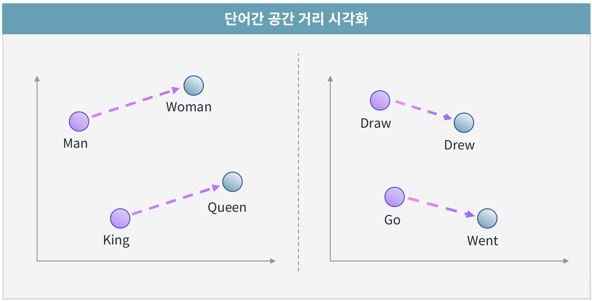

- 단어 임베딩의 한계점

  - 동음이의어 처리 불가

    - 하나의 단어는 문맥에 상관없이 항상 **동일한 하나의 고정된 벡터**로 변환

    - Ex : ""강가에 있는 **배**(Boat)"와 "맛있게 먹는 **배**(Pear)"

      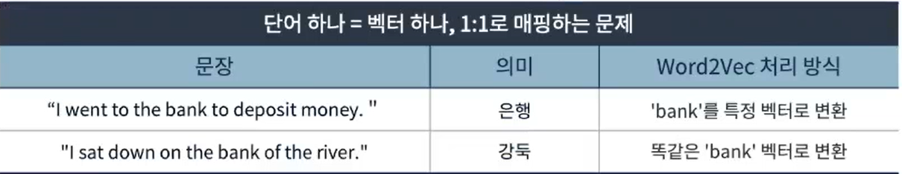

  - 오타 및 새로운 단어 처리 불가

    - 모르는 단어는 <UNK>와 같은 카테고리로 처리해서 정보의 손실 발생

      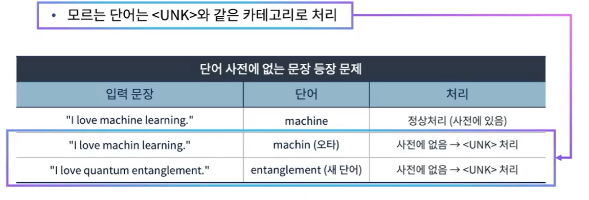

- 딥러닝(RNN-LSTM)에서 생성형 AI의 주류인 LLM이 탄생한 배경

  - 딥러닝(RNN-LSTM)은 순차 데이터를 다루지만, 긴 문맥을 제대로 이해하고 유지하는 데 한계가 있음

  - 이 한계를 극복하고 문맥을 자유롭게 다루기 위해 Transformer 모델이 개발되었고, 이게 생성형 AI로 이어지게 됨

    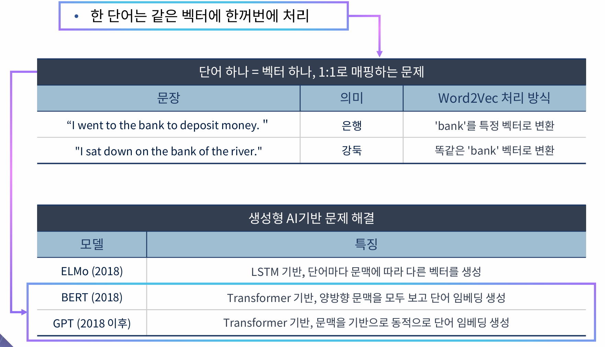

    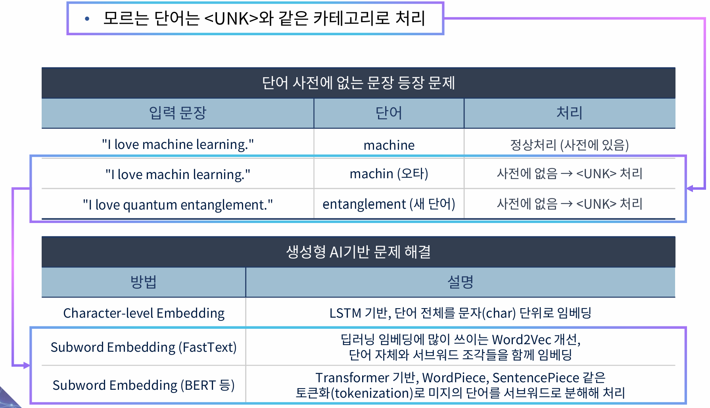

- LLM (Large Language Model, 거대 언어 모델)

  - 매개변수(파라미터)의 규모를 기하급수적으로 확장하여, 수조 단위의 방대한 데이터셋을 온전히 학습하고 수용할 수 있도록 설계된 거대 모델
    - 파라미터는 인공지능 뇌 속에 있는 뇌세포(시냅스)의 개수
  - 파라미터 규모가 커질수록 지식 수용량이 폭발적으로 증가하며, 특정 임계점을 넘으면 인간처럼 추론하고 문제를 해결하는 **'창발적 능력(Emergence)'**이 나타남

#### * 검색 증강 생성/RAG 기술이 주목받는 이유

- 생성형 AI를 성공적으로 도입하기 위해서는 LLM을 문장 생성과 맥락 이해를 담당하는 '범용적 공용 모델'로 정의하고, 기업 고유의 '내부 특화 지식'은 이와 분리하여 별도의 데이터베이스로 관리하는 아키텍처가 장기적으로 훨씬 유리

- 생성형 AI와 정보의 한계

  - 시간적 제약
    - LLM은 훈련된 시점 이후 데이터 반영이 어려움
    - Catastrophe Forgetting
      - 이미 기존 데이터(A)를 잘 학습해 둔 모델에 **새로운 데이터(B)나 특정 부분만 추가하여 재학습(파인튜닝 등)을 진행할 때, 새로 입력된 데이터에만 가중치(Weight)가 과도하게 업데이트되면서 기존에 완벽하게 학습했던 지식(A)을 완전히 잊어버리고 값이 뭉개지는 현상**
      - **발생 원인:** 딥러닝 모델의 파라미터(가중치)들은 모든 지식을 촘촘하게 공유하고 있습니다. 따라서 특정 정보를 추가하기 위해 미세 조정을 가하면, 그 조율 과정이 기존 지식을 유지하던 가중치 체계를 뒤흔들어 전체적인 성능이 무너짐
      - 따라서, 기본 모델(Base Model)을 생성하고, 각 목적별로 추가 학습시키는 형태로 배포
  - 지식 범위 한계
    - LLM은 내부에 특화된 업무 지식을 포함하기 어려움
    - LLM 모델은 생성형 AI 동작을 위한 공용 모델이기 때문에 내부 특화 지식을 학습시켜 두고 사용하기 곤란함
    - 내부 고객 정보나 개인 정보 등 민감한 데이터를 학습에 사용할 수 없음
    - 따라서, 보안이 확보된 별도 분리된 공간에서 처리

- 검색 증강 생성(Retrieval-Augmented-Generation)

  - LLM이 답변(생성)을 하기 전에, 외부의 신뢰할 수 있는 지식 베이스에서 관련 정보(검색)를 먼저 찾아와 참조하는 기술

    - 기존 LLM의 기능을 특정 도메인 지식으로 확장

  - 모델 재학습 없이 맞춤형 정보 제공

    - 외부 지식 소스(Vector DB 등)의 문서만 업데이트하면 되므로, **카타스트로피(가중치 뭉개짐) 현상을 원천 차단**하고 비용절약함

  - 최신성과 정확성 확보

    - LLM은 과거 특정 시점까지의 데이터만 학습한 상태로 멈춰있음
    - RAG를 활용하면 실시간 정보나 시시각각 변하는 사내 최신 데이터를 외부에서 공급해주므로 늘 정확한 답변이 가능

  - 생성형 AI의 환각 현상 감소

    - 지식을 분리하여 "이 내부 문서(특화 지식) 안에서만 찾아서 답변해라"라고 제약을 걸면, 모델이 엉뚱한 상상을 하지 않고 정확한 사실에 기반한 답변을 생성

  - 동작원리

    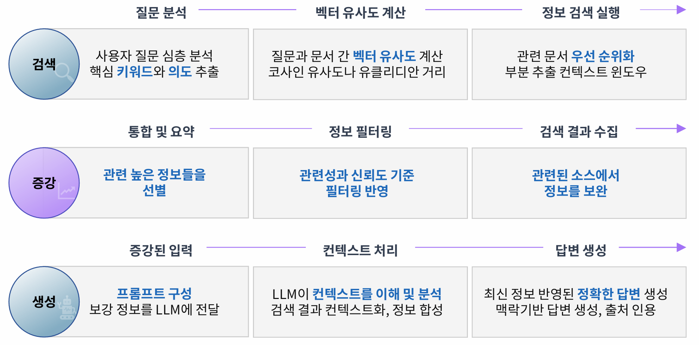

    - 검색단계(Retrieval)

      - Indexing(지식 구축) : 벡터 데이터베이스(Vector DB) 구성하기

        - 사내 문서나 전문 지식 같은 가공되지 않은 텍스트 데이터를 잘게 쪼갠 뒤,  **단어 임베딩 기술을 사용해 밀집 벡터(Dense Vector)로 변환**
        - 변환된 벡터 데이터들을 고속으로 검색할 수 있는 **벡터 데이터베이스(Vector DB)**에 미리 저장
        - **프로젝트의 규모와 인프라 환경**에 따라 적절한 데이터베이스를 선택
          - 크로마 DB (Chroma DB) : 로컬 및 소규모 프로젝트에 최적
            - 파이썬 코드 몇 줄만으로 내 컴퓨터(로컬) 메모리나 가벼운 파일 형태로 즉시 실행할 수 있는 오픈소스 벡터 DB
          - 컨테이너 기반 및 분산형 DB (Milvus, Qdrant 등) : 대규모 및 엔터프라이즈 환경
            - 도커(Docker)나 쿠버네티스(Kubernetes) 같은 **컨테이너 환경** 위에서 독립된 서버 형태로 띄우거나, 클라우드 완전 관리형(SaaS)인 **파인콘(Pinecone)** 등을 사용하는 방식

      - Processing(처리) : 입력 쿼리 처리하기

        - 사용자가 입력한 질문(쿼리) 역시 컴퓨터가 이해하고 비교할 수 있어야 함
        - 사용자 질문을 지식 베이스와 동일한 임베딩 모델을 사용해 **벡터 값으로 인코딩(변환)**

      - Searching(검색) : 쿼리가 주어지면, 가장 적합한 데이터 검색하기

        - 질문 벡터가 주어지면, 벡터 데이터베이스(FAISS, Pinecone) 내에서 **공간상의 거리가 가장 가까운(유사도가 가장 높은)** 최적의 지식 데이터를 찾아냄

          - King-Queen 시각화처럼 의미가 통하는 문서를 찾아내는 과정
          - 검색할 데이터 소스는 사전에 준비 된 문서(논문, 뉴스, 웹페이지, 데이터베이스 등)로 구성 가능

        - 청킹(Chunking) : 문서 데이터를 벡터 DB에 저장하기 전, 의미가 통하는 적절한 크기로 잘게 쪼개어 '청크(Chunk)'라는 **텍스트 조각**으로 변환하는 과정

          - LLM과 임베딩 모델에는 한 번에 읽을 수 있는 **글자 수 제한(Context Window)**이 있음

          - 질문과 가장 관련이 높은 **핵심 요점만 콕 집어서 검색**해오기 위해 적절한 크기의 청크 분할이 필수적

          - **글자 수 기준 분할:** 단순히 500자, 1000자 단위로 자르는 방식입니다. 문장 중간이 툭 끊길 수 있어, 보통 앞뒤 청크를 일부 겹치게 만듭니다(**Overlap**

            )

          - **의미론적 분할 (Semantic Chunking):** 줄바꿈(`\n`)이나 마침표(`.`), 혹은 문맥이 바뀌는 지점을 AI가 판단하여 의미 단위로 깔끔하게 자르는 고도화된 방식

        - 유사도 측정 방식(유클리디안 거리, 코사인 유사도)

          - 벡터 DB 내에 저장된 수많은 '청크 벡터' 중에서 **사용자의 '질문 벡터'와 가장 뜻이 잘 통하는 청크를 찾아내기 위해 사용하는 수학적 척도**
          - 유클리디안 거리 (Euclidean Distance)
            - 두 벡터 사이의 **'최단 직선거리'**를 측정(피타고라스 정리의 확장형)
            - 거리가 **0에 가까울수록(값이 작을수록)** 두 데이터가 서로 가까이 있고 유사함
            - **문서의 길이(단어의 빈도수)에 큰 영향**을 받음. 똑같은 주제의 글이라도 한 문서의 길이가 압도적으로 길면 거리가 멀게 측정되는 단점이 존재
          - 코사인 유사도 (Cosine Similarity)
            - 두 벡터가 가리키는 **'방향의 사잇각(**\(\theta \)**)'**을 측정(크기나 길이는 무시)
            - 값이 **1에 가까울수록** 두 벡터의 방향이 일치하므로 의미가 완전히 유사, **0이면** 직교(상관없음), **-1이면** 완전히 반대 방향을 뜻
            - 문서의 길이나 단어의 개수가 달라도 **'이야기하는 주제와 문맥의 방향성'**만 같다면 매우 정확하게 유사하다고 판단

          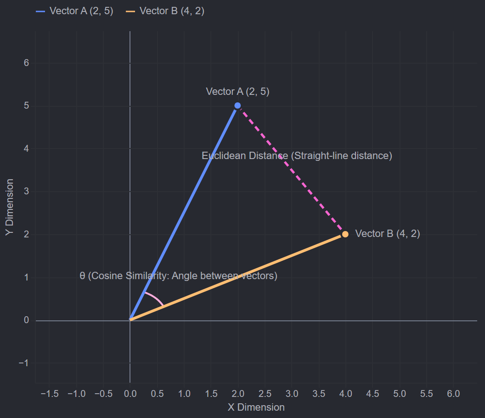

    - 생성단계(Generation)

      - Augmenting(프롬프트 문맥 증강) : 데이터+쿼리 조합해서 프롬프트 만들기
        - 사용자의 질문 뒤에, 검색단계에서 찾은 외부 지식 데이터를 참조 컨텍스트로 이어 붙임
      - Generating(생성) : LLM에 전달해 답변 생성하기
        - 증강된 프롬프트를 범용 공용 모델인 **LLM에 전달**
        - LLM은 자기가 가진 기억(학습 파라미터)에만 의존하지 않고, 눈앞에 주어진 확실한 문서를 기반으로 **환각 없이 정확하고 자연스러운 답변을 생성**하여 사용자에게 제공

- 벡터 DB 구축을 위한 RAG 기술의 핵심 4단계

  1. 세분화 : 데이터를 분석 및 처리하기 쉽도록 작은 단위(Chunk)로 쪼개는 단계
  2. 벡터화 : 세분화된 텍스트 데이터를 임베딩 모델을 통해 고차원의 벡터 데이터로 변환하는 단계
  3. 저장 : 변환된 벡터 데이터를 Vector DB에 효율적으로 보관하는 단계
  4. 검색 : 사용자의 질문이 들어왔을 때, DB에 저장된 Vector 데이터 중 유사도가 가장 높은 관련 정보를 찾아내는 단계
  
- RAG 성능 개선을 위한 기법

  1. 도메인 특화 미세 조정 (Fine-tuning)

     - 범용적인 임베딩 모델은 특정 산업군(의료, 금융, 법률 등)의 전문 용어나 사내 은어를 잘 이해하지 못함. 이를 해결하기 위해 모델을 우리 도메인에 맞게 최적화하는 전략
     - **핵심:** 산업별 특화 데이터로 사전 학습된 임베딩 모델을 미세 조정하여, 분야별 전문 용어와 개념에 대한 이해도를 높임
     - **세부 실행 요인:**
       - 특정 도메인(산업군/사내 데이터)의 전문 텍스트 데이터 수집
       - 질문-답변 또는 문맥 쌍 기반의 학습용 레이블링 데이터셋 구성
       - 모델 파라미터 미세 조정을 통한 도메인 맞춤형 임베딩 모델 가중치 업데이트

  2. 전처리 기법 적용 (Preprocessing Pipeline)

     - 임베딩 모델에 텍스트를 입력하기 전, 검색에 방해가 되는 노이즈(Noise) 데이터들을 걸러내고 컴퓨터가 텍스트의 의미를 가장 잘 파악할 수 있는 형태로 다듬는 과정

       - **핵심:** 데이터의 특성에 맞는 맞춤형 전처리 규칙(정규화, 불용어 처리, 토큰화)을 구축하여 임베딩의 품질과 일관성을 높임

       - **세부 실행 요인:**
         - **텍스트 정규화:** 특수문자 제거, 오탈자 및 띄어쓰기 교정 규칙 설정
         - **도메인별 불용어(Stopwords) 필터링:** 의미 전달에 불필요한 단어나 조사 등을 제외하는 목록 구성
         - **토큰화(Tokenization) 및 청킹 전략:** 텍스트를 의미 단위로 쪼갤 때, 모델이 가장 잘 이해할 수 있는 최적의 덩어리(Chunk) 크기와 분할 방식 수립

  3. 차원 축소 및 업데이트 (Dimension Reduction & Monitoring)

     - 데이터가 고차원화되면서 발생하는 연산 병목을 해결하고, 지식이 과거에 머물러 있지 않도록 벡터 DB의 효율성과 최신성을 유지보수하는 영역
       - **수학적 압축:** 수학적인 알고리즘(예: PCA 등)을 이용해 **수천 개의 숫자 배열에서 중요도가 낮은 복잡성을 깎아내어 용량을 줄이는 컴퓨터 전용 압축 기술**을 포함
       
       - **핵심:** 고차원 벡터의 연산 효율을 높이기 위한 인덱싱 및 최적화 기법을 적용하고, 데이터의 실시간 추가·변경에 대응하는 자동화 체계를 구축
       
       - **세부 실행 요인:**
         - **벡터 최적화 및 인덱싱 기법 적용:** 대규모 차원 연산 속도를 높이기 위해 의미 손실을 최소화하는 인덱싱(예: HNSW, 양자화 기법 등) 최적화
         - **주기적 임베딩 갱신 자동화 (데이터 동기화):** 사내 문서나 신규 데이터가 추가·변경될 때, 실시간 또는 배치(Batch) 형태로 임베딩을 다시 수행하여 최신성 유지
         - **임베딩 및 검색 품질 모니터링:** 데이터 변경 이후 검색 결과의 유사도 점수나 정확도가 떨어지지 않는지 지속적인 벤치마크 및 모니터링 수행

#### * 생성형 AI 특성 이해와 Prompt Engineering 활용

- 맥락의 중요성

  - AI에게 단순히 명령어만 던지는 것이 아니라, 풍부한 배경과 상황(맥락)을 함께 제공할 때 답변의 품질이 상승함

  1. 상황 이해(Situation Understanding)
     - AI가 답변을 작성하기 전, 자신이 어떤 위치와 목적을 가지고 대화에 임해야 하는지 방향타를 잡는 가장 기초적인 단계
     - **핵심:** AI의 응답 방향과 페르소나(역할)를 설정하는 가장 기본적인 토대를 형성
     - **세부 실행 요인:**
       - 사용자의 현재 상태 및 타겟 독자 설정 (예: "초보자를 위한 글이야")
       - AI의 역할 및 태도 정의 (예: "너는 10년 차 마케팅 전문가야")
       - 최종 결과물의 목적 명시 (예: "보고서 작성이 목표야")
  2. 배경 정보(Background Information)
     - AI가 엉뚱한 소리(환각 현상)를 하지 않고, 우리가 원하는 정확한 지식의 울타리 안에서만 사고할 수 있도록 참고 자료를 쥐여주는 단계
     - **핵심:** AI가 답변을 생성할 때 직접적으로 참조하고 인용할 수 있는 관련 지식과 데이터를 주입
     - **세부 실행 요인:**
       - 질문과 관련된 설명서, 데이터시트, 내부 문서 제공
       - 답변에 반드시 포함되어야 하는 필수 조건이나 제약 사항 명시
       - 이전 대화 기록이나 관련 비즈니스 히스토리 공유
  3. 정확한 응답(Accurate Response)
     - 앞선 두 단계(상황 이해 + 배경 정보)가 완벽하게 결합했을 때 도달하는 최상위 결과물
     - **핵심:** 촘촘하게 짜인 맥락을 바탕으로 사용자의 의도에 완벽히 부합하는 고품질의 결과물을 생성
     - **세부 실행 요인:**
       - 모호함이 제거된 명확하고 구체적인 답변 도출
       - 불필요한 정보나 왜곡(환각)이 없는 정제된 텍스트 생성
       - 사용자가 추가 수정할 필요가 없을 정도로 완성도 높은 아웃풋 완성

- 프롬프트 엔지니어링 : 명령어 설계

  - 사람이 쓰는 자연어를 활용해 LLM에게 어떻게 명령하고 질문할 것인가를 연구하고 설계하는 기술적 접근법

  - 구성 요소

    - 지시문(Instruction) : AI에게 수행할 작업을 명확히 요청
    - 맥락(Context) : 작업 수행에 필요한 배경 정보를 제공
    - 출력 형식(Output Format) : 원하는 결과물의 형태를 지정
    - 입력 데이터(Input Data) : AI가 처리할 구체적인 정보를 제공

  - 종류 : 점진적 프롬프트, CoT, ReAct, Zero-shot Learning(예시 없이 직접적인 지시로 작업 수행), Role Prompting(AI에게 특정 역할 부여), RAG(의부 지식을 활용한 응답 생성), Self-Consistency(여러 솔루션 생성 후 일관성 확인)

  - 점진적 프롬프트(Incremental Prompting)

    - 사람이 질문(업무)을 논리적인 조각으로 직접 쪼개어 순서대로 질문을 던지며 답변을 실시간으로 보강해 나가는 프롬프트 엔지니어링 기법
      - 사람이 프로젝트 매니저(PM)가 되어, 거대한 업무를 `[1단계 질문] ➔ (AI 답변) ➔ [2단계 질문(보강)] ➔ (AI 답변)` 형태로 차근차근 나누어 지시함으로써 AI가 매 단계마다 최고의 집중력과 정확도를 발휘하게 만듬

  - Chain of Thought(CoT)

    - AI에게 복잡한 질문을 던질 때, 정답을 바로 요구하지 않고 최종 결론에 도달하기까지의 논리적 사고과정을 단계별로 풀어서 설명하도록 유도하는 프롬프트 엔지니어링 기법
      - **핵심:** "차근차근 단계별로 생각해 봐"라는 지시를 통해 AI가 스스로 문제를 쪼개어 해결하게 만듦으로써, 인간이 복잡한 수학 문제를 풀 때 연습장에 풀이 과정을 적어 내려가는 것과 같은 효과를 낼 수 있음
      - 수학 문제, 논리 퍼즐, 의사결정과정, 프로그래밍에 효과적
    - 성능 극대화 : AI 모델의 성능을 끌어낼 수 있음
    - 오류 감소 : 불명확한 지시로 인한 오해와 실수를 줄임
    - 정확성 향상 : 사용자 의도에 맞는 정확한 결과물 생성
    - 효율적 개선 : 모델 재학습 없이 출결 품질 향상 가능

  - ReAct(Reasoning + Acting)

    - AI가 당면한 문제를 해결하기 위해 **스스로 다음에 할 일(생각)을 추론하고, 외부 도구를 사용해 이를 직접 실행(행동)하며, 그 결과를 보고 다음 단계를 수정·보완해 나가는 자율형 에이전트 기법**

      - 핵심 : AI가 스스로 "생각 ➔ 행동 ➔ 결과 관찰 ➔ 다음 생각"의 고리를 반복하며 정답을 찾아

    - 추론(Reasoning) : 주어진 질문이나 문제를 분석하고, 이를 해결하기 위해 지금 당장 무엇을 해야 하는지 판단하여 접근 방법을 계획

    - 행동(Acting) : 스스로 세운 계획에 따라 외부 API 호출, 웹 검색, 데이터베이스(Vector DB) 조회 등 구체적인 행동을 실행

    - 반복(Repeating) : 행동을 통해 얻은 결과(Observation)를 확인하고, 목표를 달성할 때까지 **[추론 ➔ 행동 ➔ 관찰]**의 과정을 끊임없이 반복하며 오류를 수정하고 최종 답변을 완성

      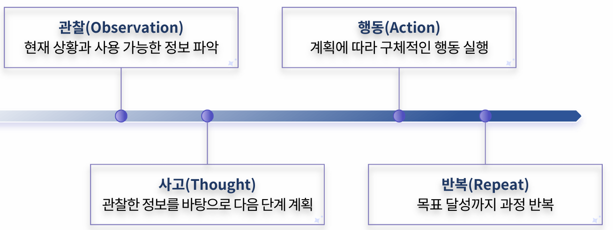

    - ReAct 작동 메커니즘 및 실전 예시

      -  지식 검색 및 추론 (Text-Based QA)

        - **Thought 1:** "Apple Remote가 원래 호환되던 프로그램을 찾아야겠어."
        - **Act 1 [Search]:** Apple Remote 검색 수행
        - **Obs 1:** "원래 Front Row 미디어 센터 프로그램을 제어하기 위해 설계됨"이라는 정보 획득
        - **결과:** 이러한 **[생각 ➔ 행동 ➔ 관찰]**의 사슬을 4번 반복한 끝에, 검색 실패를 극복하고 `keyboard function keys`라는 정확한 최종 정답을 도출

        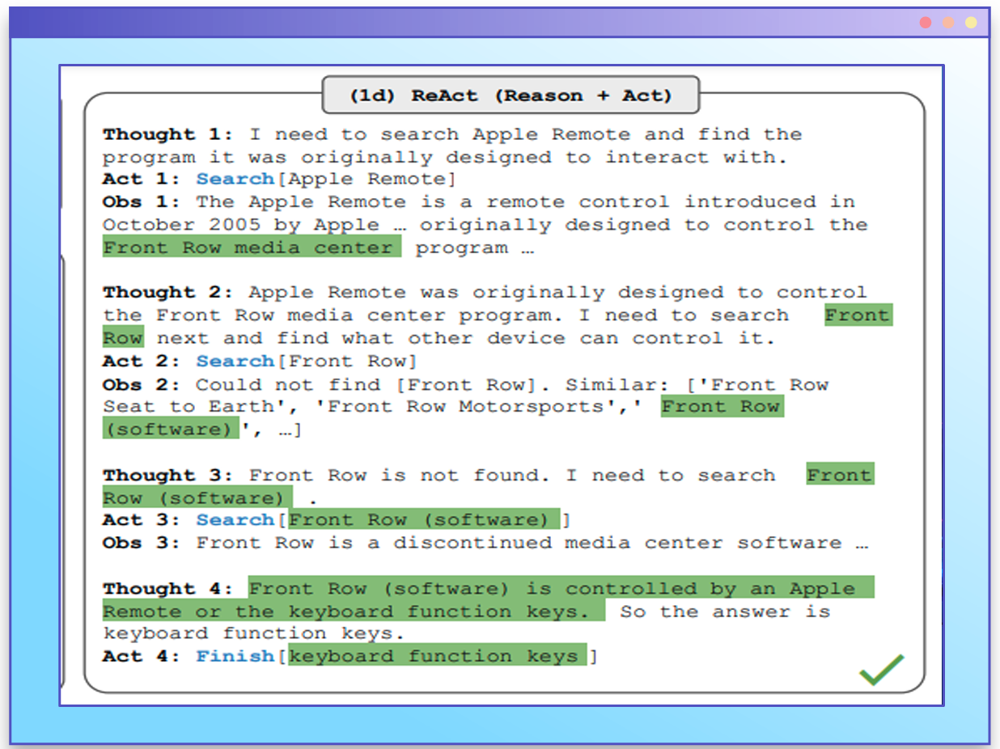

      - 환경 상호작용 및 에이전트 (AlfWorld 가상 환경 테스트)

        - 가상 공간 안에서 특정 미션("서랍 안에 후추통 넣기")을 수행할 때, **생각(Think)의 유무가 어떤 차이**

        - **❌ Act-Only (행동만 하는 경우 - 실패):**

          - 중간에 "왜?"라는 추론 과정 없이 `서랍 열기 ➔ 싱크대 가기 ➔ 후추통 집기`라는 명령어만 무작정 내린다
          - 싱크대에 후추통이 없는데도 `Act 4: 후추통 집기` ➔ `Obs 4: 아무 일도 안 일어남`을 겪고, 왜 실패했는지 판단하지 못해 `Act 5: 후추통 집기`를 똑같이 반복하다가 결국 **미션 실패(X)**

          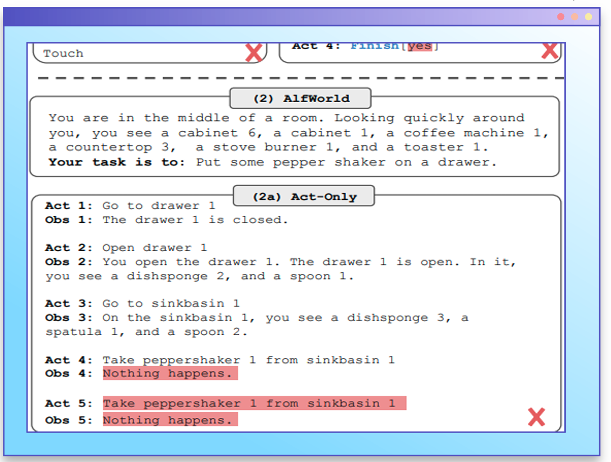

        - **⭕ ReAct (추론과 행동을 결합한 경우 - 성공):**

          - `Act 1: Think[...]` 단계에서 **"후추통은 보통 캐비닛(1~6)이나 조리대(1~3)에 있을 확률이 높아"**라고 스스로 가설을 세우고 접근
          - 조리대를 뒤져 후추통을 찾은 후에도, `Act 8: Think[...]`를 통해 **"이제 후추통을 찾았으니 다음 목표인 서랍 1로 이동해서 넣어야겠어"**라고 다음 행동의 당위성을 스스로 부여하며 **미션을 완벽히 완수(O)**

          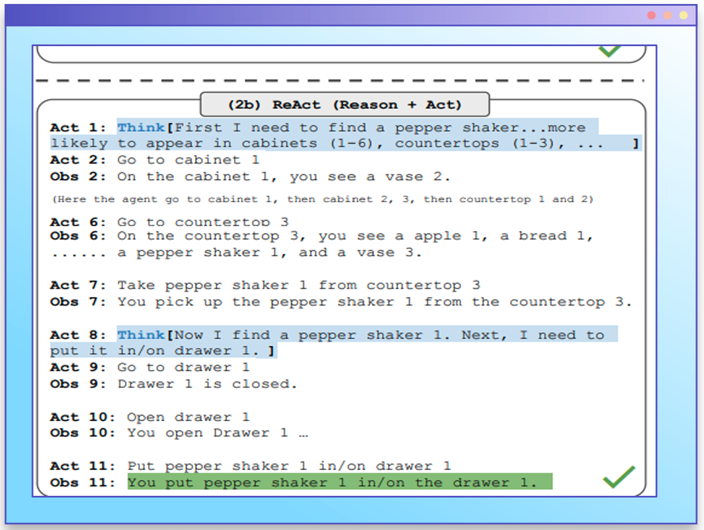

- [프롬프트 설계(어떻게 지시하냐)에 따라 AI의 실제 성능이 얼마나 극적으로 달라지는지 확인](' ReAct: Synergizing Reasoning and Acting in Language Models, https://arxiv.org/abs/2210.03629')

  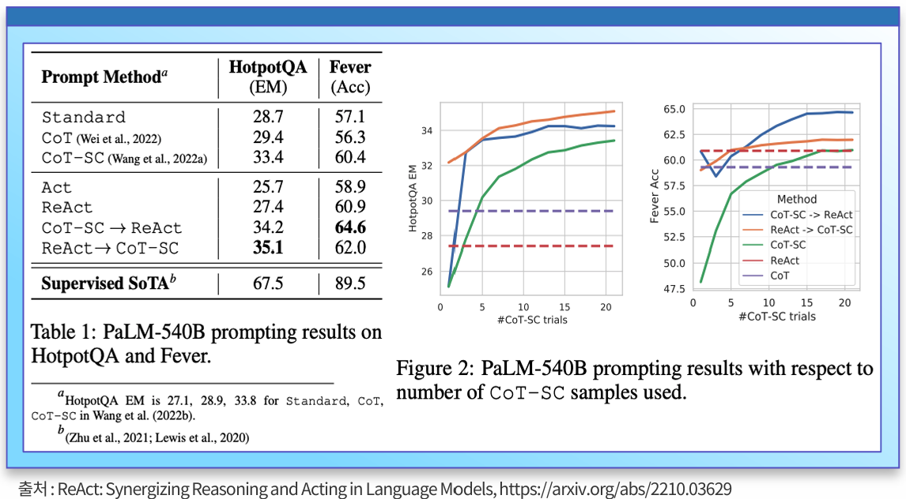

  - 복잡한 추론과 사실 검증이 필요한 **어려운 문제 세트(HotpotQA, Fever)**에서 지시 방식(Prompt Method)을 고도화할수록 AI의 정답률이 압도적으로 상승함

    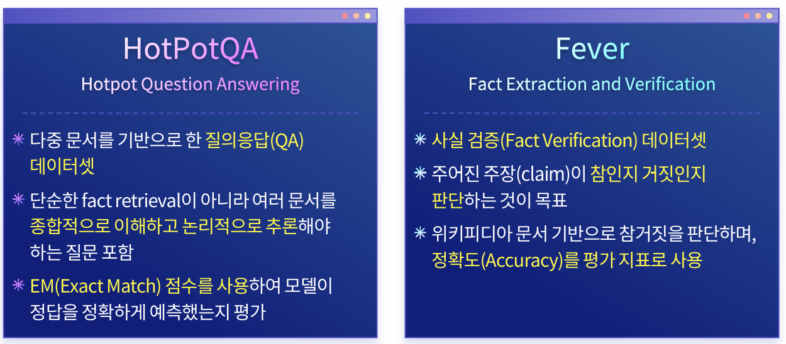

  - 일반적인 질문 방식 (Standard) vs CoT

    - Standard : 아무런 가이드 없이 질문을 툭 던지면(Standard) 성능이 **28.7% / 57.1%**로 매우 낮게 나옴

    - CoT 적용 : 스스로 쪼개서 생각하게 만드는 CoT를 적용하는 것만으로도 성능이 소폭 상승하기 시작

      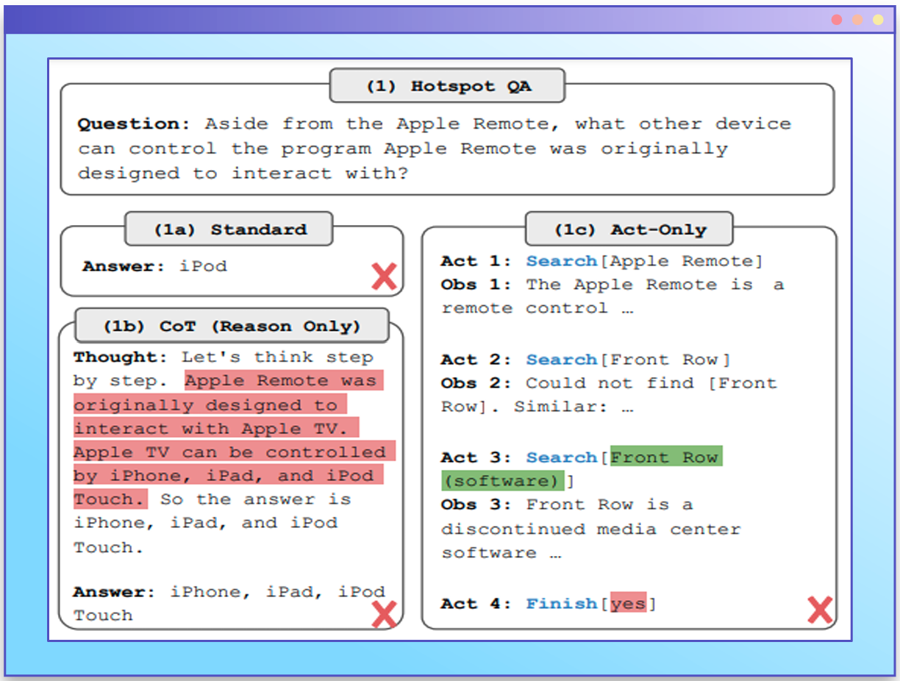

  - CoT-SC (Self-Consistency, 자기 일관성) 기법

    - 질문을 이어나가며 **"이게 정말 맞아?"** 하고 스스로 검증과 보강을 거치는 방식
    - **핵심:** AI에게 같은 문제를 여러 번(예: 10번) 각기 다른 생각의 흐름으로 풀어보게 만든 뒤, **가장 많이 나온 정답을 다수결(Voted)로 채택**하는 방식
    - **효과:** 일회성 답변에서 올 수 있는 사소한 연산 실수를 걸러내어 성능을 **33.4% / 60.4%**까지 크게 끌어올림

  - CoT-SC ➔ ReAct

    - 먼저 머릿속으로 여러 번 시뮬레이션을 돌려 "이게 정말 맞나?" 검증한 뒤, 가장 유력한 계획을 가지고 외부 도구(웹 검색 등)를 사용해 행동하는 방식

  - **ReAct ➔ CoT-SC :** 먼저 외부 도구를 활용해 팩트 데이터를 수집한 뒤, 그 데이터를 기반으로 "이 정보들이 정말 일관되게 정답을 가리키고 있나?"를 다수결로 쪼개어 검증하는 방식

- Context Engineering : 맥락 및 데이터 설계
  - AI가 답변을 생성할 때 참조할 **배경지식, 외부 데이터, 대화의 역사(히스토리)**를 어떻게 효율적으로 주입할 것인가를 다루는 영역
    - 핵심: AI의 한정된 기억력(Context Window) 안에 쓰레기 데이터(Noise)를 걸러내고, 가장 가치 있는 정보만 압축해서 밀어 넣는 데이터 파이프라인 관리
  - 주요 작업:
    - **청킹 전략:** 방대한 문서를 AI가 읽기 좋은 크기로 조각내기
    - **벡터 DB 검색:** 질문과 관련성이 가장 높은 데이터만 쏙쏙 골라오기
    - **메모리 관리:** 이전 대화 기록 중 핵심만 요약하여 AI의 기억 유지하기

| 구분             | ✍️ 프롬프트 엔지니어링                            | 🗂️ 컨텍스트 엔지니어링                                       |
| ---------------- | ------------------------------------------------ | ----------------------------------------------------------- |
| **핵심 질문**    | "AI에게 **어떻게 명령**해야 말을 잘 들을까?"     | "AI에게 **어떤 배경 지식**을 쥐여주어야 정확할까?"          |
| **제어 대상**    | 대화의 규칙, 톤앤매너, 추론 방식 (CoT, ReAct 등) | 데이터의 가공, 검색 범위, 청크 크기, 대화 메모리 수명       |
| **최적화 주체**  | 주로 **인간 사용자**가 프롬프트 문구를 수정      | 주로 **엔지니어(시스템)**가 RAG 파이프라인으로 구현         |
| **실패 시 현상** | AI가 지시를 무시하거나 형식을 안 지킴            | AI가 낡은 정보(과거 지식)를 말하거나 엉뚱한 데이터를 참조함 |
