## 강화학습

#### * 강화학습이란?

- 어떤 환경(Environment, Agent가 적응해야하는 환경)안에서 정의된 에이전트(Agent, 로봇·모델)가 현재의 상태(State)를 인식하여, 선택 가능한 행동(Action)들 중 보상(Reward)을 최대화하는 행동 혹은 행동 순서를 선택하는 방법

  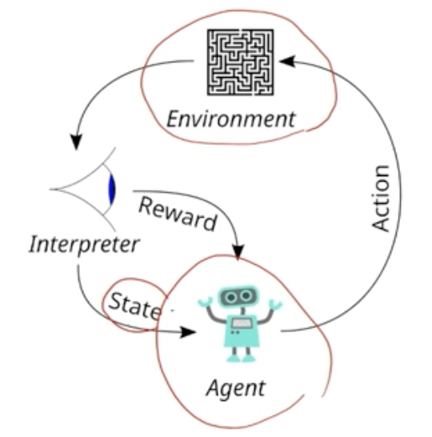

- 강화학습은 단일 분야가 아닌 여러 학문의 교차점에 있다

  - 컴퓨터 과학 : 기계학습(Machine Learning)
    - 정답(Label)이 주어지지 않는 환경에서, 에이전트가 시행착오를 겪으며 데이터(경험)를 스스로 쌓고 신경망을 통해 가치 함수나 정책을 업데이트
  - 공학 : 최적 제어(Optimal Control, 보상을 최대화 시키는 최적화 알고리즘)
    - 시스템을 어떻게 최적의 상태로 제어할 것인가에 대한 수학적 공식과 이론을 제공 (벨만 방정식, 동적 계획법)
  - 심리학 : 조건화 학습(Classical/Operant Conditioning)
    - 환경의 긍정적 피드백(보상)은 행동을 강화하고 부정적 피드백(벌)은 행동을 약화시키는 구조
  - 경제학 : 제한된 합리성(Bounded Rationality)
    - 모든 정보를 다 알 수 없고 계산 능력도 유한한 상황(제한된 합리성)에서, 에이전트가 어떻게 완벽하진 않더라도 최선의 이익(효용)을 내는 의사결정을 내릴 수 있는지 분석

- 기계학습 안에 지도학습, 비지도학습, 강화학습이 포함된다

  - 지도학습(Supervised Learning)
    - 정답이 주어짐, 입력-출력 쌍으로 학습
    - Ex) 고양이 사진 -> '고양이'라는 정답 레이블
  - 비지도학습(Unsupervised Learning)
    - 정답이 없음, 데이터 내 숨겨진 패턴을 스스로 찾음
    - Ex)고객 군집화 (비슷한 고객끼리 그룹핑), 차원 축소(고차원 데이터를 시각화)
  - 강화학습(Reinforcement Learning)
    - 정답 대신 '보상'이 있음. 시행착오(Trial-and-Error)로 학습
    - Ex)게임에서 점수 올리기, 로봇 걷기 학습
    - 지도학습과의 차이점
      - 지도학습은 '이게 정답이야'라고 선생님이 알려주는 학습 방법
      - 강화학습은 '잘했어/못했어'라고만 알려줌. 정답은 스스로 찾아야 함

  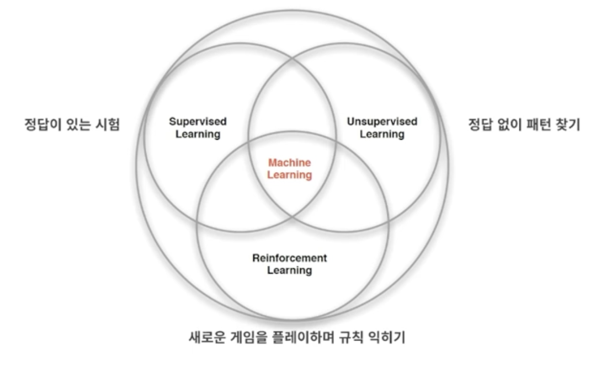

- 강화학습 4가지 핵심 특징

  1. 선생님(Supervisor)이 없음

     - 정답을 알려주는 선생님이 없음. 오직 보상 신호(Reward signal)만 존재.
     - '이 행동이 맞아'가 아니라 '이 행동은 +10점, -5점' 형태로 피드백

  2. 피드백이 즉각적이지 않음(Delayed Reward)

     - 행동의 결과가 한참 후에 나타남
       - 체스에서 오프닝 실수가 50수 후 패배로 이어질 수 있음.

  3. 시간이 중요함

     - 데이터가 순차적(Sequential)이고, 서로 독립적이지 않음

       - Agent는 아무런 지식이 없는 상태에서 출발하여, "과거의 보상 경험"을 이정표 삼아 미래의 행동 전략을 수정해 나간다.

       1. 상태 관찰(State) : 에이전트가 현재 환경의 상황을 파악
       2. 행동 선택(Action) : 에이전트가 어떤 행동을 취한다
       3. 보상 및 다음 상태 획득(Reward & Next State): 환경은 그 행동을 평가하여 플러스·마이너스 보상을 주고, 다음 상태로 변화
       4. 학습 및 업데이트(Learning) : 에이전트는 '이전에 받았던 보상들'을 기억하고 분석하여, 어떤 상태에서 어떤 행동을 하는 것이 이득이었는지 머릿속(신경망 또는 테이블)에 기록

     - 현재 상태는 과거 행동의 결과

  4. 핸동이 미래 데이터에 영향

     - 에이전트의 현재 행동이 미래에 받을 데이터를 바꿈

- 과거 보상을 기반으로 할 때 생기는 두가지 핵심 과제

  1. 탐색과 활용의 딜레마(Exploration vs Exploitation)
     - **탐색(Exploration):** 과거 보상 데이터는 적거나 없지만, 혹시 더 큰 보상이 숨겨져 있을지 모르니 **'새로운 길'**을 시도해보는 성향
     - **활용(Exploitation):** 이전에 보상을 많이 받았던 **'이미 아는 안전한 길'**로만 가려는 성향
       - *균형:* 과거의 보상을 기반으로 행동하되, 가끔은 새로운 시도를 하도록 제어해야 최적의 정답을 찾을 수 있음
  2. 지연된 보상(Delayed Reward)문제
     - 지금 당장 받은 보상뿐만 아니라, 과거에 했던 수많은 행동들이 누적되어 미래에 큰 보상으로 이어지는 경우가 많음
     - 에이전트는 단순히 '직전의 보상'뿐만 아니라 '앞으로 받을 보상의 총합(기대 가치)'을 예측하여 지금의 행동을 결정하도록 발전

- 응용 분야

  - 로보틱스 : 휴머노이드 보행, 드론 제어
  - 자율주행 : 복잡한 교통 상황에서 의사결정
  - 금융 : 고객 맞춤형 포트폴리오 최적화, 사기 탐지 시스템
  - 의료 : 환자 맞춤형 치료 계획 최적화, 신약개발

- 강화학습의 역사적 성과

  1. TD-Gammon

     - Gerald Tesauro가 개발한 백게먼 게임 프로그램

     - 지도학습을 전혀 이용하지 않고 자기 자신과 대국하며 학습(Self-play)해 세계 챔피언 수준에 도달함

     - 신경망+시간차(TD)학습의 첫 성공 사례

  2. Deep Q-Network(DQN)

     - DeepMind의 DQN이 49개 아타리 게임에서 인간 수준 초과 달성
     - 화면 픽셀만 보고 학습(수작업 특성 설계 없음)
     - 딥러닝 + 강화학습의 시작

  3. AlphaGo

     - DeepMind의 알파고가 이세돌 9단을 4:1로 격파
     - 바둑은 경우의 수가 10^170개로 체스보다 훨씬 복잡한데, 수많은 경기를 통해 시행착오를 겪으며 정책 네트워크의 확률을 조정

#### * 보상과 순차적 의사결정

- 보상(Reward)

  - **보상(\(R_{t}\)):** 시간 t에서 에이전트가 받는 숫자 형태(점수)의 피드백 신호

  - 현재 시점에서 에이전트가 '얼마나 잘하고 있는지'를 알려줌

  - 에이전트는 단순히 즉각 보상이 아닌, 누적 보상(Cumulative Reward)을 최대화하는 것을 목표로 함

    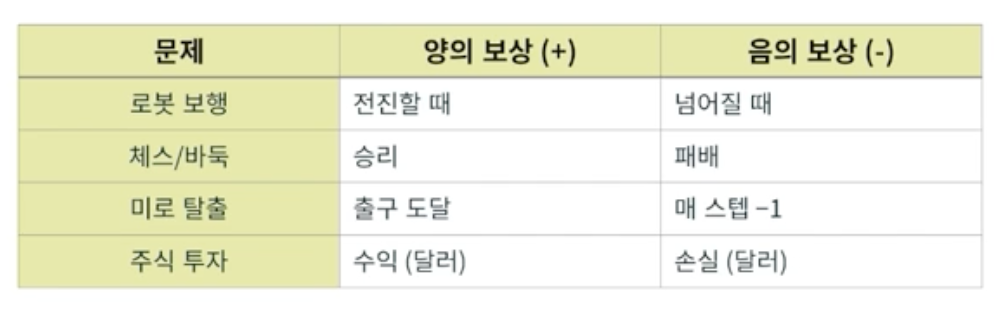

- 보상 가설(Reward Hypothesis)

  - Agent의 모든 목표는 기대 누적 보상의 최대화로 표현 가능하다(강화학습의 핵심 가정)
  - Ex) '배고픔 해결'도 '음식 획득 보상 최대화'로 표현 가능

- 순차적 의사결정

  - 목표 : 미래의 총 보상을 최대화하도록 행동을 선택함
  - 현재의 선택이 당장의 결과 뿐만 아니라 미래의 상황과 보상에도 영향을 미치는 연속적인 선택 과정(행동에는 장기적 결과가 따름)
  - 보상이 지연될 수 있음
  - 당장의 보상을 포기하고 장기 보상을 얻는게 나을 수 있음
    - 즉시 보상 vs 지연 보상의 trade-off (지금 당장은 +5점, 10스텝 후 +100점)
    - 금융 투자(수익이 몇 달/몇 년 후 실현될 수 있음), 바둑·체스(현재 두는 수가 수십 수 후 승리에 기여할 수 있음)

- 할인율(Discount Factor)
  - 미래 보상을 현재 가치로 환산하는 계수 (0 <= γ <= 1)
  - 필요한 이유
    - 수학적 이유 : 무한한 미래 보상의 합이 발산하지 않도록 + 보상을 할인하면 계산이 편리
    - 현실적 이유 : 미래는 불확실 (보상 가치가 기하급수적으로 감소)
    - 금융적 이융 : 보상이 금전적이라면, 즉각적 보상이 지연된 보상보다 더 많은 수익을 얻을 수 있음
    - 동물/인간 행동 : 생물학적으로 즉각적 보상을 선호하는 경향이 있음
  - 할인된 누적 보상 (Return)
    - \(G_t = R_{t+1} + \gamma R_{t+2} + \gamma^2 R_{t+3} + ...\)
    - \(\gamma = 0\): 오직 즉각 보상만 (근시안적)
    - \(\gamma = 0.99\): 미래 보상도 중요하게 고려 (원시안적)
    - 게임처럼 짧은 에피소드면 \(\gamma \) 높게, 실시간 제어면 \(\gamma \) 낮게 설정함

#### * 상태와 환경

- 에이전트와 환경의 상호작용

  - 에이전트(Agent / 쥐) : 관측 \(O_{t}\) 받음 → 행동 \(A_{t}\) 실행 → 보상 \(R_{t}\) 받음

    - **관측 (\(O_{t}\)):** 쥐(에이전트)는 미로(환경)를 둘러보고 현재 자신이 막다른 길에 있는지, 갈림길에 있는지 상태를 **관측 **
      - **핵심 (정보의 흐름):** 쥐가 스스로 알아낸다기보다, **환경(미로)이 쥐에게 '현재 눈앞의 시각 데이터'를 전송(입력)해 주는 구조**
      - 강화학습의 시스템 구조에서는 '정보의 흐름(누가 누구에게 데이터를 전달하는가)'을 기준으로 보기 때문에 환경이 에이전트에게 관측을 줌
    - **행동 (\(A_{t}\)):** 관측한 정보를 바탕으로 쥐는 앞으로 갈지, 왼쪽으로 갈지 **행동**을 실행
    - **보상 (\(R_{t}\:**) 행동의 결과로 미로가 막혔다면 마이너스 점수를, 치즈(목적지)에 가까워졌다면 플러스 **보상**을 받으며 다음 상태로 이동 

    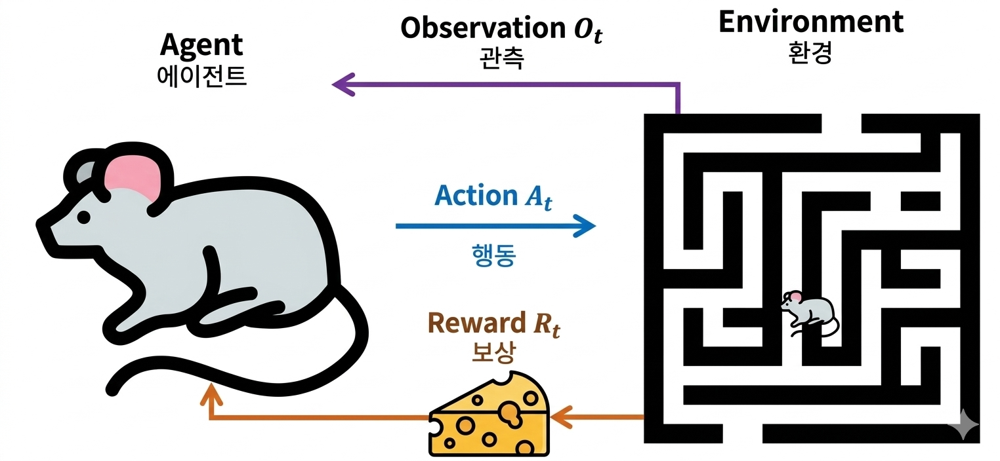

  - 환경 (Environment / 미로) : 행동 \(A_{t}\) 받음 → (Agent)상태 업데이트 → 다음 관측 \(O_{t+1}\), 보상 \(R_{t+1}\) 방출

    - 에이전트가 놓인 외적인 세계이자, 에이전트의 행동에 반응하여 새로운 상황과 보상을 주는 대상
    - **행동 \(A_{t}\) 받음** : 에이전트가 현재 시점(\(t\))에서 결정한 행동을 환경에 전달
    - **상태 업데이트** : 환경은 에이전트의 행동을 반영하여 물리적인 상태나 내부 데이터를 변화시킴
    - 상태가 바뀌었으므로 환경은 에이전트에게 **새로운 시간대(\(t+1\))의 정보**를 건네준다
      - **다음 관측 (\(O_{t+1}\)):** 바뀐 위치에서 에이전트가 새로 보게 될 주변 상황
      - **보상 (\(R_{t+1}\)):** 직전 행동이 얼마나 좋은 행동이었는지 성적표를 줌

    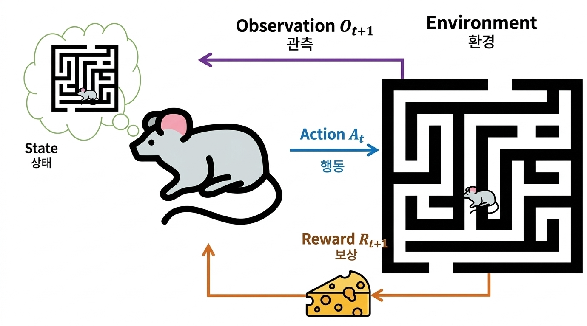

  - 이력 (History)

    - \(H_t = O_1, A_1, R_1, ..., O_t, A_t, R_t\) : 지금까지 모든 관측, 행동, 보상의 시퀀스

  - 상태 (State)

    - 다음에 무슨 일이 일어날지 결정하는 데 필요한 충분한 정보
    - \(S_t = f(H_t)\) : 상태는 이력에 대한 함수

  - 최종 목표

    쥐의 목표는 단순히 눈 앞의 치즈 한 조각만 먹는 것이 아니라, 앞으로 받을 모든 보상의 **총합(\(G_{t}\)을 극대화**하는 최적의 미로 탈출 경로를 찾아내는 것

    이때 **할인인자(γ)**를 조절하여, 지금 당장의 보상만 좇을지(근시안적) 혹은 조금 멀리 돌아가더라도 결국 탈출하는 큰 그림을 그릴지(원시안적) 결정

- 3가지 상태

  1. 환경 상태 (Environment State, \(S_{t}^{e}\))
     - **(현재 시점)환경의 실제 전체 모습**, 모든 데이터가 포함된 '진짜 현실' 스냅샷
       - 다음 환경이 어떻게 변할지 결정하는 데 필요한 모든 데이터를 포함
     - 보통 에이전트에게 이 데이터가 전부 제공되지는 않으며, 일부는 숨겨져 있는 경우가 많음
     - **쥐 미로 예시**: 미로의 전체 크기, 보이지 않는 곳에 숨겨진 모든 벽의 위치, 치즈가 놓인 정확한 좌표 등 미로 세상의 모든 정답지 데이터를 뜻
  2. 에이전트 상태 (Agent State, \(S_{t}^{a}\))
     - **에이전트(인공지능)가 받아들여서 머릿속에 기억하고 있는 정보**, 에이전트는 이 상태 정보를 바탕으로 다음 행동을 결정
     - 에이전트가 어떤 알고리즘을 쓰느냐에 따라 이전 기억을 많이 담을 수도 있고, 방금 본 것만 담을 수도 있음(주관적, 불완전)
     - **쥐 미로 예시**: 전체 미로 지도는 모르지만, 쥐가 지금까지 걸어오면서 머릿속으로 기억해 둔 **"직전에 왼쪽으로 꺾었고, 방금 치즈 냄새를 맡았다"** 같은 기억과 현재 눈앞의 시야 정보를 합친 기억 장부
  3. 정보 상태 / 마르코프 상태 (Information State / Markov State)
     - **미래를 예측하는 데 필요한 과거의 모든 유용한 정보가 현재에 이미 다 요약되어 있는 상태**
     - "현재 상태를 알면 과거의 기록은 미래를 예측하는 데 아무런 도움이 되지 않는다"는 마르코프 성질(Markov Property)을 만족하는 상태
     - 환경상태·이력은 마르코프 성질을 지닌다
       - 강화학습에서는 이력 전체를 쓰는 대신, 미래를 예측하기 위해 필요한 모든 정보의 요약본(마르코프 상태)을 찾는 것을 목표로 함
     - **쥐 미로 예시**: 쥐가 미로의 한 칸에 서 있을 때, **그 칸의 좌표 (x, y)**가 바로 마르코프 상태가 될 수 있습니다. 이 좌표만 알면 쥐가 과거에 뱅뱅 돌아서 왔든, 지름길로 왔든 상관없이 '앞으로 탈출하기 위해 어디로 가야 하는가'를 완벽히 결정할 수 있기 때문
  
- Markov Decision Process(완전 관측, MDP)

  - 에이전트가 환경 전체를 관측(이상적인 상태)
  - \(O_t = S_t^a = S_t^e\)  (관측된 정보 상태 = 에이전트 상태 = 환경 상태)
    - 관측된 정보(\(O_{t}\)) 자체가 마르코프 성질을 가짐, 현재 보이는 화면만 보고 행동해도 최적의 결과를 낼 수 있음
    - Ex) **체스, 바둑** (판 위의 말 위치가 전부 공개),
      **비디오 게임의 일부** (화면 안에 모든 적과 장애물이 다 보이는 경우)

- Partially observable Markov decision process (부분 관측, POMDP)

  - 에이전트가 환경의 일부만 관측하거나, 관측 정보에 노이즈가 섞임
  - 현실 세계의 문제 대부분에 해당
  - \(O_t \neq S_t^e\) (환경 상태의 일부 혹은 변형된 정보만 관측)
    - 에이전트가 별도로 \(S_{t}^{a}\)를 구축함
      - 이력 기반(\(S_t^a = H_t\)), 믿음 상태 기반(확률 기반 추정), 메모리 기반(RNN)

    - Ex) **포커** (상대의 패를 볼 수 없음), **자율주행** (센서 범위를 벗어난 사각지대, 앞차에 가려진 신호등)

#### * RL 에이전트의 구성요소

- RL 에이전트는 아래 구성 요소 중 무조건 하나 이상을 포함한다.(한개 이상의 요소만 있어도 완벽한 강화학습 알고리즘 만들 수 있음)
  - 정책, 가치함수, 모델

1. 정책(Policy, 𝜋)

   - 에이전트가 현재 상태를 입력받아 어떤 행동을 취할지 결정하는 행동 규칙 (상태 공간에서 행동 공간으로의 매핑)
   - 형태에 따라 상태에서 행동으로 이어지는 '하나의 고정된 규칙'일 수도 있고, 각 행동을 할 '확률 분포'일 수도 있음
   - 정책은 시간에 독립적 (현재 상태만이 중요하므로 '언제'인지는 중요하지 않음)
   - 결정적 정책 : 𝑎=𝜋(𝑠)
     - (입력값)특정 상태 𝑠에서는 (결과값)무조건 하나의 행동 𝑎를 수행함
     - ex) 사람이 있으면 멈춘다. 빨간불이면 멈춘다. (rule기반 action)
   - 확률적 정책 : 𝜋(𝑎|𝑠) = ℙ[𝐴𝑡 = 𝑎|𝑆𝑡 = 𝑠]
     - 상태 s가 주어졌을 때, 각 행동들을 할 확률 분포를 반환
     - Ex) 상태 𝑠에서 행동 𝑎를 할 확률은 70%, 행동 b를 할 확률은 30%(탐험을 위해 주로 사용)

2. 가치 함수(Value Function, V&Q)

   - 현재 상태(혹은 상태-행동 쌍)의 장기적 가치 예측(현재 상태가 미래에 얼마나 많은 보상을 가져다줄지 평가)

   - 정책과 가치함수를 모두 사용하는 경우

     - 정책이 행동을 제안하면 가치함수가 그 행동이 얼마나 좋은지 평가하며 서로를 발전시킴

   - 상태 가치 함수 \(V_{\pi}(s)\)

     - 상태 s에서 정책 π를 따르는 것이 얼마나 좋은 지
     - \(v(s)=\mathbb{E}[G_{t}|{}S_{t}=s]\) : 현재 상태 s에서 시작했을 때, 앞으로 받을 누적 보상의 평균값
       - \(\mathbb{E}[\dots]\) (기댓값, Expectation) : 수학적으로 **평균(Average)**을 의미, 미래는 확률에 따라 이리저리 바뀔 수 있으므로, 발생할 수 있는 여러 미래 경로의 점수들을 종합해서 낸 평균치

     - 누적 반환 값 (G_{t}) : 시간 t에서 시작하여 에이전트가 미래에 받을 모든 보상을 누적한 값, 미래의 보상은 불확실성과 현재 가치를 반영하기 위해 감쇠 인자(Discount Factor, 𝛾∈[0,1])를 곱하여 누적합니다.

       - \(G_{t}=\gamma^{0} R_{t+1}+\gamma R_{t+2}+\gamma ^{2}R_{t+3}+\dots =\sum _{k=0}^{\infty }\gamma ^{k}R_{t+k+1}\)

         - \(R_{t+1}\): 다음 단계에서 받는 즉각적인 보상

         - \(\gamma \) (감마): 미래 보상을 얼마나 가치 있게 볼 것인가를 결정하는 가중치 (1에 가까울수록 장기적인 보상을 중시)
       - 가치함수의 정의에 누적 반환값을 대입하면,  \(v(s)=\mathbb{E}[R_{t+1}+\gamma R_{t+2}+\gamma ^{2}R_{t+3}+\dots |{}S_{t}=s]\)
         - 어떤 상태의 가치(v)란, 그 상태에서 출발해서 얻을 누적 보상(G)의 기댓값(평균)
     - **정책의 유무에 따른 의미 차이**
       1. **정책 존재 (\(V^{\pi}(s)\))** : 에이전트가 현재 정책 스타일대로 계속 행동했을 때 얻을 수 있는 누적 보상의 기댓값
       2. **정책X / 최적 가치함수 (\(V^{\*}(s)\))** : 가능한 모든 정책 중 가장 이상적이고 완벽한 선택들만 내렸을 때 얻을 수 있는 최대 누적 보상

   - 행동 가치 함수 \(Q_{\pi}(s, a)\)

     - 기존 정책(\(\pi \))의 흐름을 깨고, 현재 상태(s)에서 (만약 이 행동을 하면 어떻게 될지 가상으로 대입) 특정 행동(a)을 한 후, 그 이후부터는 기존 정책(π)를 따랐을 때 얻을 수 있는 미래 보상의 총합(점수) => 어떤 행동이 미래 보상을 최대화하는지 비교

       ~~~
       기존 정책을 깨고 특정 행동을 넣었을 때 어떤 행동이 미래보상을 최대화하는지 비교
       기존 정책 :
       "골대 앞(s)에서는 수비가 붙으니까, 보통 70% 확률로 패스를 찌르고 30% 확률로 가끔 슛을 쏜다."
       
       현재 (s):
       기본 전술(패스 70%, 슛 30%)의 흐름을 깨고, 이번 딱 한 번은 무조건 '슛'을 쏜다고 가정
       
       현재 (s): 기본 전술의 흐름을 깨고, 이번 딱 한 번은 무조건 '패스'를 찌른다고 가정
       ~~~

3. 모델(Model)

   - 에이전트가 이해한 환경의 동작 원리
     - 이 행동을 했을 때 환경이 어떻게 변할지 미리 예측(Planning)할 수 있게 함
   - 전이 모델 \(P(s'\vert{}s, a)\): 다음 **상태** 예측
   - 보상 모델 \(R(s, a)\): 다음 **보상** (즉각적인)예측

- Ex) 미로 찾기

  - 보상 : 매 스텝 -1 (빨리 탈출할수록 좋음)

  - 행동 : N, E, S, W (북, 동, 남, 서)

  - 상태 : 에이전트의 위치

    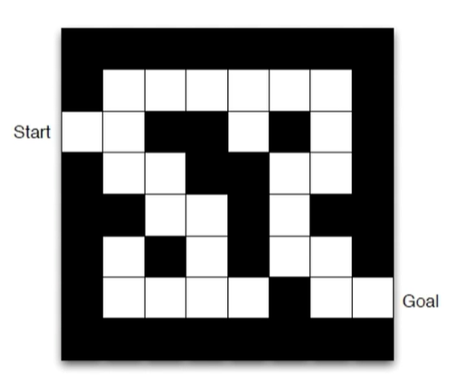

  - 정책 𝜋(s) : 각 칸의 화살표 (해당 상태s에서 취할 행동)

    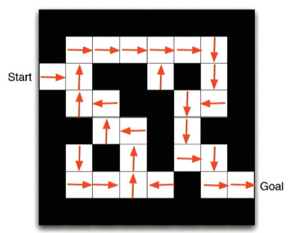

  - 상태 가치함수 \(V_{\pi}(s)\) : 내가 지금 이 칸(\(s\))에 서 있을 때, 앞으로 게임이 끝날 때까지 받게 될 '최종 예상 성적표(총점)'

    - 각 칸의 숫자(해당 상태 s에서의 기대 누적 보상)

    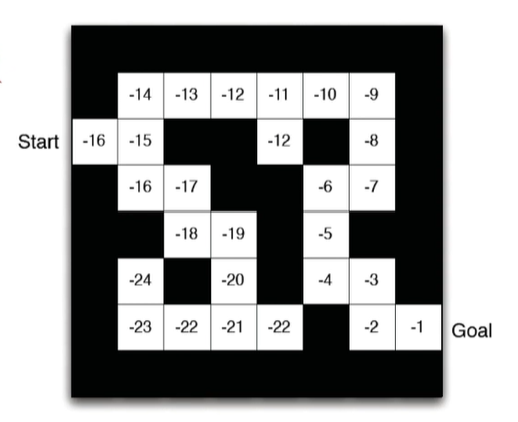

  - 모델 : 에이전트가 예측을 위해 시뮬레이션한 미로의 동작 원리

    - 전이 모델 \(P(s'\vert{}s, a)\) : 칸들의 배치 (내가 현재 칸(\(s\))에서 **어떤 행동(\(a\))을 했을 때**, 실제로 발을 디디게 될 **다음 칸(\(s^{\prime }\))이 어디가 될지** 예측)

    - 보상 모델 \(R(s, a)\): 각 칸의 숫자 (각 칸에 대해 예측한 즉각적인 보상 : 어디 서 있든 간에, '지금 당장 한 칸 움직이는 행동'을 했을 때 받게 되는 **즉각적인 보상(벌금 -1점)**)

      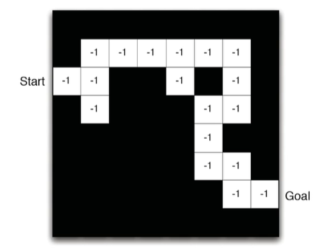

- 학습 대상에 대한 분류

  1. Policy Based(정책 기반) : 상태에 따라 어떤 행동을 할지 결정하는 정책(확률분포) 자체를 직접 학습하여 최적화하는 방식
     - 가치 함수 없음 (REINFORCE)
  2. Value Based (가치 기반) : 최적의 가치 함수(Q함수 등)를 학습하여, 각 상태에서 가치가 가장 높은 행동을 선택하는 방식
     - 정책은 암묵적(DQN)
  3. Actor-Critic : 행동을 선택하는 Actor(정책)와 그 선택을 평가하는 Critic(가치 함수)을 동시에 학습하여 안전성과 효율을 높인 방식
     - A3C,PPO

- 환경 모델 유무에 따른 분류

  1. Model-Based RL : 환경의 변화와 보상을 예측하는 모델을 학습하고, 이를 통해 계획을 세워 행동을 결정 (적은 데이터로 효율적 학습, 모델 오차 위험)

  2. Model-Free RL : 환경에 대한 모델(예측) 없이, 직접 환경과 상호작용하며 얻은 경험(Trial and Error)만으로 정책이나 가치를 학습 (구현이 단순하지만 많은 데이터 필요)

     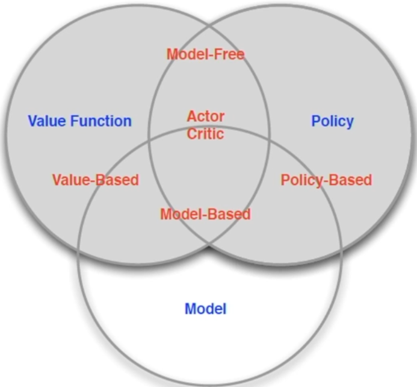

- 강화학습의 근본적인 딜레마 (탐험 vs 활용)

  - 탐험(Exploration) : 현재의 지식으로는 최선이 아닐지라도, **새로운 정보**를 얻고 잠재적으로 **더 큰 보상**을 찾기 위해 가보지 않은 길이나 행동을 시도하는 것

  - 활용(Exploitation) : 이미 학습된 정보(지식)를 바탕으로, 현재 시점에서 가장 보상이 클 것이라고 판단되는 행동을 선택하여 이득을 챙기는 것
  - 탐험만 하면 보상을 얻지 못하고 정보만 쌓이며, 활용만 하면 더 나은 최적의 해(Global Optima)를 놓치고 우물 안 개구리(Local Optima)가 될 위험이 있음
    - Ex) 점심 메뉴 : 단골집(활용 -> 안전한 80점) vs 새 식당(탐험 -> 0점 혹은 100점)
    - 해결전략
      1. g-greedy (무작위성 기반) : 확률 \(\epsilon \)로 랜덤 탐험, \(1-\epsilon\)로 최선 선택
      2. Upper Confidence Bound (UCB, 불확실성 기반): "불확실성에 대한 낙관" 원칙. 평균 보상이 높거나 혹은 아직 덜 가봐서 잘 모르는(불확실성이 큰) 행동에 가산점을 줌
      3. Thompson Sampling (확률분포 기반): 행동의 보상 확률 자체를 확률분포로 추정. 단순히 평균값만 믿는 게 아니라, 대박이 날 수도 있는 확률까지 고려하여 자연스럽게 탐험과 활용의 균형을 맞춤
         - 데이터가 쌓임에 따라 분포의 모양(넓고 완만함 -> 뾰족함)이 변하면서 탐험과 활용 비율 스스로 조절됨
         - **초반 (탐험 중심):** 아는 정보가 없어서 각 행동의 성공 확률 분포가 가로로 넓고 평평한 형태(0부터 1까지 모든 숫자가 나올 확률이 똑같이 평평하고 넓은 모양)
           - 제비를 뽑을 때마다 **진짜 확률과 상관없이 무작위로 높거나 낮은 숫자가 자유롭게 뽑히기 때문에**, 어떤 행동이든 선택될 가능성이 열려 있어 자연스럽게 이것저것 골고루 시도해보게 됨
         - **후반 (활용 중심):** 데이터가 쌓일수록 진짜 좋은 행동의 분포는 높은 값 쪽으로 뾰족해지고, 안 좋은 행동의 분포는 낮은 값 쪽으로 뾰족해짐.
           - 따라서 제비를 뽑아도 항상 좋은 행동에서 높은 값이 나올 확률이 압도적으로 커지므로, 자연스럽게 최선의 행동만 반복

- 순차적 의사결정의 두 가지 문제 유형

  1. 학습(Learning)

     - 환경이 알려져 있지 않음(Unknown)

     - 에이전트가 직접 환경과 상호작용하며 경험으로 학습

       - Ex) 새 게임을 처음 플레이하며 규칙을 파악함

         - 학습 : 게임의 규칙을 모른 채 플레이하며 배움

         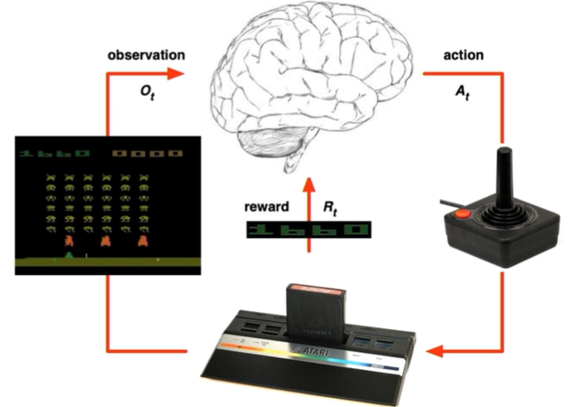

  2. 계획(Planning)

     - 환경 모델이 이미 알려져 있음(Known) - 각 상태로부터 행동을 취했을 때 다음 상태/보상 예측

     - (외부와의 상호작용 없이)시뮬레이션으로 최적의 전략을 탐색

       - Ex) 체스에서 "이 수를 두면 상대가 이렇게..." 시뮬레이션

         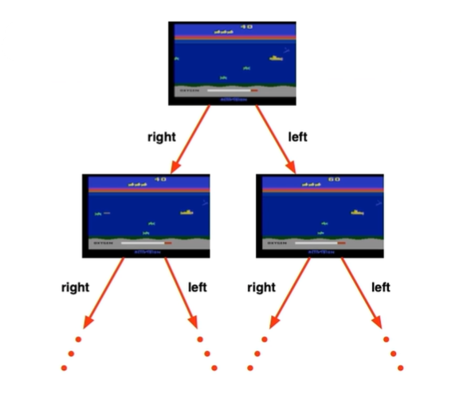

     - 예측(Prediction) - 평가(Evaluation)

       - 주어진 정책  𝜋에서 가치함수를 계산
       - 정책평가 : 현재 정책의 점수(가치 함수)를 평가하는 과정 - "이 정책을 따르면 얼마나 좋을까"
       - Ex) 모의고사를 풀어봄. - "현재 공부 방법(정책)으로 60점이 나오는 구나, 현재 상태 평가"

     - 제어(Control) - 최적화(Optimization)

       - 현재 환경에서 최적의 정책  𝜋*을 찾음
         - 제어를 풀려면 보통 예측을 먼저 풀어야 한다
       - 정책 최적화 : 점수표를 보고 더 나은 행동을 하도록 정책을 수정하는 과정 - "가능한 모든 정책 중 최고는?"
       - Ex) 오답 노트를 만들고 공부 방법을 바꿈. 최고 점수를 받기 위해 전략 수정

#### * 마르코프 결정 과정(Markov Decision Process, MDP)

- 에이전트가 어떤 결정을 내릴 때, "주변 환경이 어떻게 돌아가는지 수학적으로 완벽하게 설명(모델링)해 놓은 지도"
  - "The future is independent of the past given the present"
  - \(\mathbb{P}[S_{t+1}\mid S_{t}]=\mathbb{P}[S_{t+1}\mid S_{1},\dots ,S_{t}]\)
    - 현재 상태(\(S_{t}\))는 과거의 모든 관련 정보를 포함한다(미래를 예측하는 데 필요한 과거의 영향력이 현재 상태에 반영됨)
    - 현재 상태(\(S_{t}\))를 알면, 과거 이력(\(S_1, S_2, \dots, S_{t-1}\))은 버려도 된다.
    - 현재 상태는 미래(\(S_{t+1}\))에 대한 충분 통계량이다.
  
- 상태 전이 행렬(Transition Matrix, P)
  
  - 모든 상태 \(s\) 에서 모든 후속 상태 \(s^{\prime }\) 로의 전이 확률을 모아 놓은 것
  
    - 행은 현재 상태(from s), 열은 다음 상태(to s')
    - 행렬의 임의의 한 행에 있는 확률들을 모두 더하면 항상 1이 됨
  
    ​						\(\text{to}\)
  
    ​		\(P=\text{from}\left[\begin{matrix}P_{11}&\cdots &P_{1n}\\ \vdots &\ddots &\vdots \\ P_{n1}&\cdots &P_{nn}\end{matrix}\right]\)
  
  - 상태 전이 확률(현재 상태가 s일 때, 어떤 행동 a를 취하면 다음 상태 s'로 넘어감')
    -  \(P_{ss^{\prime }}^{a}=\mathbb{P}[S_{t+1}=s^{\prime }\mid S_{t}=s, A_t=a]\) 
  
- 아무리 복잡하고 예외적인 현실 환경이라도, MDP라는 표준 규격(틀) 안에 집어넣을 수 있음
  - MDP의 기본 규격
    - 완전 관측 가능(Fully Observable) : 현재 상태가 환경을 완전히 특징 지음(즉, 과거의 기록을 몰라도 현재 상태만으로 미래를 예측할 수 있는 '마르코프 성질'을 만족함)
  - 거의 모든 강화학습 문제를 MDP로 정형화 가능
    1. 최적 제어 (Optimal Control)는 주로 상태와 행동이 연속적인 MDP를 다룸 (소수점처럼 연속적인 환경)
       - ex) 로봇 팔의 관절 각도 (연속상태)와 모터 토크(연속행동)를 제어하는 문제
    2. 부분 관측 문제(Partially Observable Problem)도 MDP로 변환가능
       - 관측 이력으로부터 구성한 신념 상태(머릿속 생각, belief state)를 사용하여 "완전한 상태"로 취급
    3. 다중 슬롯머신 문제(Multi-armed Bandits)는 상태가 하나인 MDP(상태 전이가 없는 가장 단순한 MDP)
       - 상태가 하나이므로 전이 행렬 불필요, 각 행동 (각 슬롯머신의 팔)의 즉각 보상만 고려
       - '다음 상태'라는 개념 존재하지 않는 환경
         - 에이전트가 처한 상황이나 환경의 조건이 절대 변하지 않는다
         - 결과적으로 상태 가치함수나 행동 가치함수 수식이 오직 **"현재 상태 s₀에서 행동 a를 했을 때 받는 즉각적인 보상의 기댓값 R(s₀, a)"** 하나로 압축(미래 상태 가치를 고려할 필요가 없으므로, 감쇠 인자 \(\gamma = 0\)이 된 특수한 경우로 볼 수 있음)

- 마르코프 과정(=체인)

  - 무기억(memoryless)랜덤 과정으로, 마르코프 성질을 만족하는 랜덤 상태의 시퀀스(\(S_1, S_2, ...\))

  - 수학적으로 튜플 (S : (유한한) 상태들의 집합, P : 상태 전이 확률 행렬)로 표현

  - 에피소드(Episode)

    - 에이전트가 **시작 상태**에서 출발하여 환경과 상호작용을 주고받다가, 앞서 배운 **종단 상태(Terminal State)**에 도달해 게임이 끝날 때까지의 **전체 과정(시퀀스)**
    - 강화학습에서 '한 사이클'을 의미하는 단위
    - \(\text{Episode}=(S_{0},A_{0},R_{1},S_{1},A_{1},R_{2},\dots ,S_{T-1},A_{T-1},R_{T},S_{T})\)

  - 종단 상태(Terminal State, \(s_{T}\))

    - 강화학습(MDP)에서 에이전트의 에피소드가 완전히 끝나는 상태
    - 종단 상태에 도달하면 에이전트는 더 이상 다른 상태로 이동·행동 불가

  - Ex) 학생 마르코프 체인

    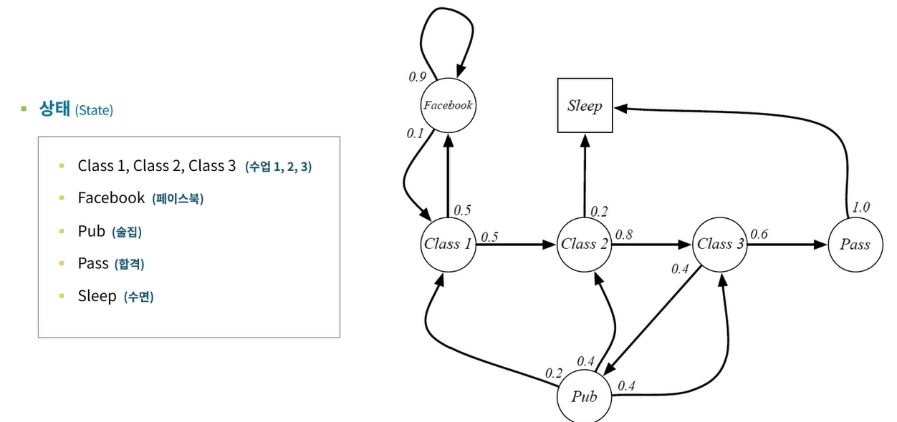

    - 에피소드(Class1에서 시작할 때)

      ~~~
      • C1 → C2 → C3 → Pass → Sleep
      • C1 → FB → FB → C1 → C2 → Sleep
      • C1 → C2 → C3 → Pub → C2 → C3 → Pass → Sleep
      • C1 → FB → FB → C1 → C2 → C3 → Pub → C1 → FB → FB → ...
      ~~~

    - 상태 전이 행렬 (Ex)

      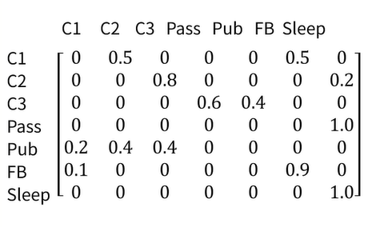

- 마르코프 보상 과정(Markov Reward Process, MRP)

  - 값(value)을 가진 마르코프 체인, 각 상태에 (즉각적인)보상이 부여됨

  - 마르코프 보상 과정은 튜플(S, P, R, \(\gamma \))

    - S : 유한한 상태들의 집합
    - P : 상태 전이 확률 행렬
    - R : 보상 함수  \(R_{s}\) =𝔼 [ \(R_{t+1}\) | \(S_{t}\) =𝑠]
    - \(\gamma \) : 할인율(discount factor, 𝛾∈[0,1])

    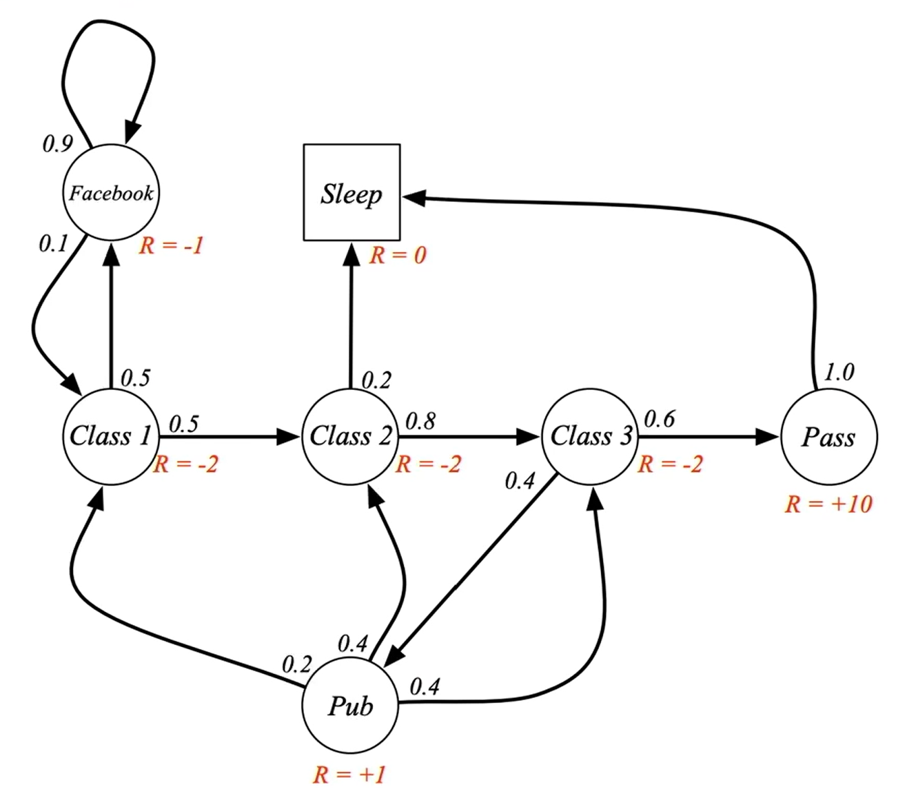

- 누적 보상(Return)

  - 현재 시점 \(t\) 이후부터 미래에 받을 모든 보상을 감가율(Discount Factor)을 적용하여 합산한 **현재 가치**
  - \(G_{t}=\gamma^{0} R_{t+1}+\gamma^{1} R_{t+2}+\cdots =\sum _{k=0}^{\infty }\gamma ^{k}R_{t+k+1}\)
    - \(\gamma \in [0,1]\) 는 미래 보상의 현재 가치
    - \(k+1\) 시간 후에 받는 보상  \(R_{t+k+1}\(의 가치는 \(\gamma ^{k}R_{t+k+1}\( 
    - \(\gamma \) 가 0에 가까우면 **근시안적 평가**(Myopic) \(\rightarrow \(\( 즉각적 보상만 중요
    - \(\gamma \) 가 1에 가까우면 **장기적 평가**(Far-sighted) \(\rightarrow \(\( 미래 보상도 중요
  - 할인율 적용예외
    - 모든 시퀀스가 종료되는 경우, 할인되지 않은MRP(𝛾 =1)를 사용할 수 있음
    - 에피소드가 반드시 유한 시간 내에 종료되는 경우, 누적 보상이 유한하므로 𝛾 = 1을 사용해도 발산하지 않는다.
  
  - Ex) \(S_{1}\) = \(Class1\)에서 시작하고 \(\gamma \) = 1/2인 경우, 누적보상과 가치함수(누적보상들을 합하고 평균)
  
    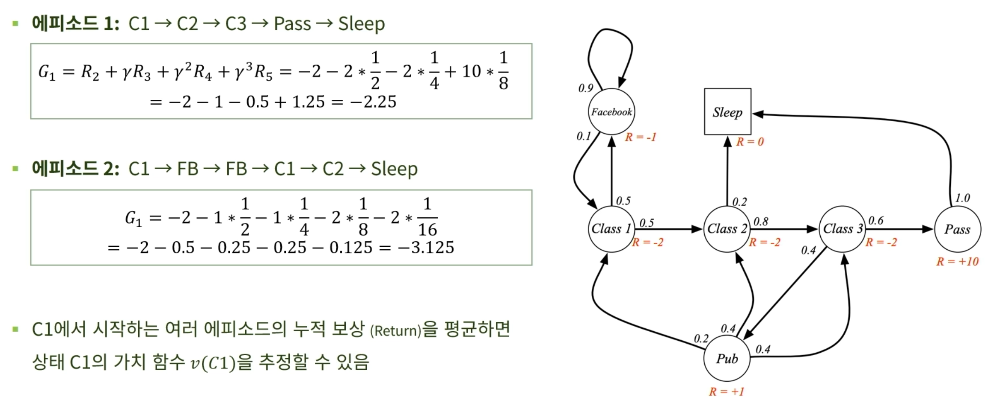
  
  - \(\gamma \) = 0인 경우(즉각적 보상만 고려)
  
    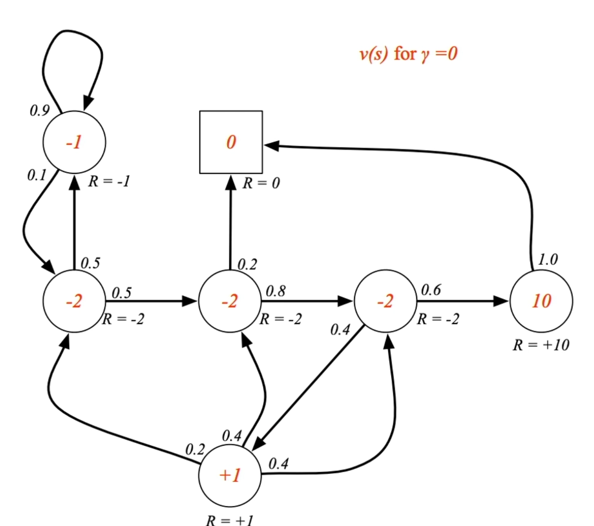
  
  - \(\gamma \) = 0.9인 경우(미래 가치를 많이 고려)
  
    - 할인율이 증가할 수록 Facebook의 가치가 급격히 떨어짐, Class3의 가치가 높아짐(Pass에 가까움)
  
    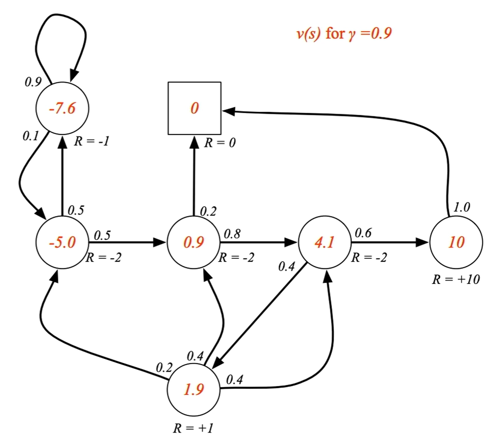
  
- 벨만 방정식 (Bellman Equation)

  - 끝을 알 수 없는 무한한 미래의 보상 \(G_{t}\)을, **지금 당장 받는 보상**과 **다음 칸에 도착했을 때, 그 칸이 품고 있는 미래 잠재 가치** 두 부분으로 쪼개어 재귀적으로 단순화한 것

  - \(v(s)=\mathcal{R}_{s}+\gamma \sum _{s^{\prime }\in S}\mathcal{P}_{ss^{\prime }}v(s^{\prime })\)

    - \(\mathcal{R}_{s}\) : 현재 상태 \(s\)에서 받는 즉각 보상
    - \(\mathcal{P}_{ss^{\prime }}\) : 현재 상태 \(s\)에서 **다음 칸 \(s^{\prime }\)로 갈 확률**
    - \(v(s')\) : **다음 상태 \(s^{\prime }\)의 가치함수 값**
    - \(\sum \) : 갈 수 있는 다음 칸이 여러 개일 수 있으므로 모두 더하라는 뜻

  - 유도과정

    1. 가치함수의 정의

       \(v(s)=\mathbb{E}[G_{t}\mid S_{t}=s]\)

       - **의미:** 현재 시간 \(t\)에 상태 \(s\)에 서 있을 때, **앞으로 받을 모든 누적 보상(**\(G_{t}\)**)의 평균(기댓값** \(\mathbb{E}\))이 곧 이 상태의 가치

    2. 누적 반환값(\(G_{t}\)) 펼치기

       \(\mathbb{E}[R_{t+1}+\gamma R_{t+2}+\gamma ^{2}R_{t+3}+\dots \mid S_{t}=s]\)

    3. 감쇠 인자(\(\gamma \))로 묶기

       \(\mathbb{E}[R_{t+1}+\gamma (R_{t+2}+\gamma R_{t+3}+\dots )\mid S_{t}=s]\)

       - **의미:** 두 번째 항부터 마지막 무한대 항까지를 \(\gamma \)로 하나만 묶어내어 괄호 안에 집어넣음

    4. 괄호 안을 \(G_{t+1}\)로 치환

       \(\mathbb{E}[R_{t+1}+\gamma G_{t+1}\mid S_{t}=s]\)

       - **의미:** 괄호 안에 묶인 수식(\(R_{t+2} + \gamma R_{t+3} + \dots\))이 **"다음 시점(**\(t+1\)**)을 기준으로 생각한 미래 누적 보상 총합(**\(G_{t+1}\)**)"**과 똑같음

    5. 최종 벨만 방정식 완성

       \(=\mathbb{E}[R_{t+1}+\gamma v(S_{t+1})\mid S_{t}=s]\)

       - **의미:** 기댓값 성질에 의해 미래 보상의 총합의 평균(\(\mathbb{E}[G_{t+1}]\))은 결국 **"다음 상태의 가치함수 값인** \(v(S_{t+1})\)"로 바꿀 수 있음

  - Ex) 학생 ERP의 벨만 방정식 (\(\gamma \) = 1)

    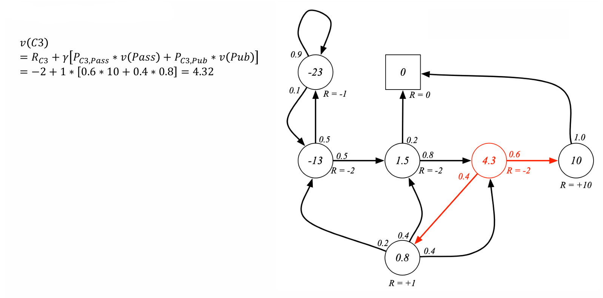

  - 벨만 방정식의 행렬 형태

    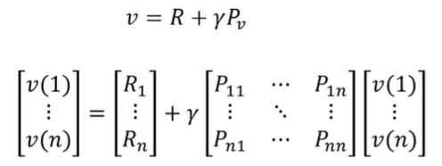

    - V는 각 상태의 가치를 담은 열 벡터
      - **의미:** 우리가 구하고 싶어 하는 **현재 모든 칸들의 진짜 가치 정답지**입니다. (아까 학생 예시의 \([-23, -13, 1.5 \dots]\) 세트가 여기 들어감
    - R은 각 상태의 보상을 담은 열 벡터
      - **의미:** 각 칸에서 당장 얻는 **즉각 보상들의 모음집**입니다. (예: 페이스북 칸의 \(-1\), 패스 칸의 \(+10\) 등)
    -  \(\gamma P v\) (할인율 \(\times \) 상태 전이 행렬 \(\times \) 가치 벡터)
    - \(v = R + \gamma P v\)
      - \(v - \gamma P v = R\) (우변의 \(\gamma P v\)를 좌변으로 이항)
      - \((I - \gamma P) v = R\) (\(v\)로 묶어냄, 이때 \(I\)는 행렬의 숫자 '1' 역할을 하는 단위행렬)
      - \(v = (I - \gamma P)^{-1} R\) (양변에 역행렬을 곱함)

- 마르코프 결정 과정 (Markov Decision Process, MDP)

  - 의사결정이 포함된 마르코프 보상 과정 (모든 상태가 마르코프인 환경)

    - MRP : 상태가 자동으로 전이됨 (에이전트 통제 밖, 환경이 정한 확률)
    - MDP : **에이전트가 행동을 선택**하여 상태 전이에 영향을 줌 (에이전트의 **정책**이 개입)
    - MRP는 상태 가치함수 하나만 존재하고, MDP는 상태 가치함수와 행동 가치함수 두 개가 모두 존재

  - 마르코프 보상 과정은 튜플(S, **A**, P, R, \(\gamma \))

    - S : 유한한 상태들의 집합
    - **A : 유한한 행동들의 집합**
    - P : 상태 전이 확률 행렬
    - R : 보상 함수  \(R_{s}\) =𝔼 [ \(R_{t+1}\) | \(S_{t}\) =𝑠]
    - \(\gamma \) : 할인율(discount factor, 𝛾∈[0,1])

  - Ex) 학생 MDP

    - 학생이 행동을 선택할 수 있음
    - 가능한 행동들 (Study, Facebook, Quit, Sleep, Pub)

    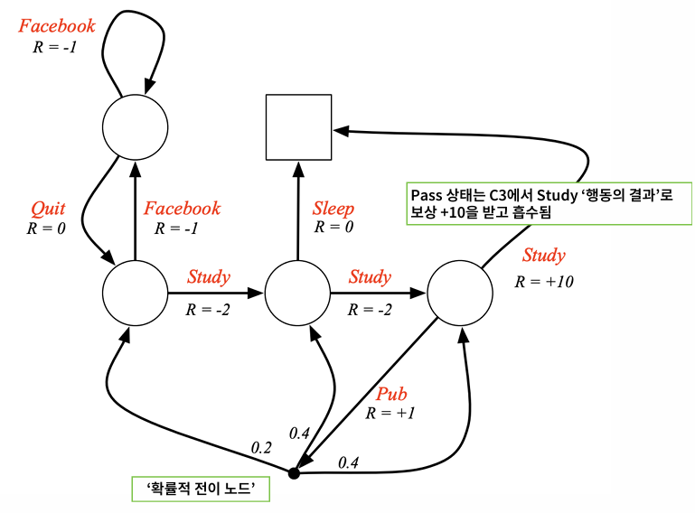

- 정책이 주어진 MDP

  - 정책은 상태전이확률(P), 보상(R)에 영향을 줌
  - \(P_{s,s^{\prime }}^{\pi }=\sum _{a\in A}\pi (a\mid s)P_{ss^{\prime }}^{a}\)
    - **왼쪽 항 (\(P_{s,s^{\prime }}^{\pi }\)):** 정책 \(\pi \)를 따를 때, **"결과적으로 내가 상태** \(s\)**에서 다음 상태** \(s^{\prime }\)**로 넘어가게 될 최종 확률"**
    - **오른쪽 항 (\(\sum \pi(a \mid s) P_{ss'}^a\)):**
      - \(\pi(a \mid s)\) : 내가 이 상태에서 **행동 \(a\)를 선택할 확률 (내 의지)**
      - \(P_{ss^{\prime }}^{a}\) : 현재 상태가 \(s\)인 상황에서 행동 \(a\)가 수행되었을 때, 시스템(환경)의 물리적 규칙이나 제약에 의해 **다음 상태 \(s^{\prime }\)로 시스템이 전이될 확률**
  - \(R_{s}^{\pi }=\sum _{a\in A}\pi (a\mid s)R_{s}^{a}\)
    - **왼쪽 항 (\(R_{s}^{\pi }\)):** 정책 \(\pi \)를 따를 때, **"결과적으로 내가 상태** \(s\)**에서 받게 될 평균 즉각 보상"**
    - **오른쪽 항 (\(\sum \pi(a \mid s) R_s^a\():**
      - \(\pi(a \mid s)\) : 내가 행동 \(a\)를 **선택할 확률**
      - \(R_{s}^{a}\) : 내가 그 행동 \(a\)를 했을 때 **환경이 주는 즉각 보상**
      - **해석:** 각 행동을 해서 얻을 보상 점수에 **내가 그 행동을 할 확률(가중치)을 곱해서 평균**을 낸 것

- MDP 상태 가치 함수 (State-Value Function)

  - **정의**: MDP의 상태 가치 함수 \(v_\pi(s)\)는 **상태 \(s\)에서 시작하여 정책 \(\pi \)를 따를 때의 기대 보상**이다.
    \(v_{\pi }(s)=\mathbb{E}_{\pi }[G_{t}\mid S_{t}=s]\)

  - *"이 상태는 얼마나 좋은가?" (정책 \(\pi \) 하에서)*

    - Ex)  **'학생 MDP 환경'에서 무작위 정책(\(\pi(a \mid s) = 0.5\))과 감쇠 인자 \(\gamma = 1\)을 적용했을 때의 최종 상태 가치함수 연산 결과**

      - **Facebook 가치 상승 (-23 $\rightarrow$ -2.3):** 무작위 정책에 의해 50%의 확률로 'Quit' 행동을 선택하여 탈출할 수 있는 통제권이 생겼기 때문에 상태 가치가 크게 개선됨.  
      - **Class 3 가치 극대화 (7.4):** 보상 $+10$을 주는 Pass 상태에 가장 인접해 있으므로 전체 상태 중 가장 높은 가치를 지님.  
      - **결론:** 같은 환경(지도)이더라도 에이전트가 어떤 정책($\pi$)을 가지느냐에 따라 최종 계산되는 상태 가치함수의 형태와 숫자가 완전히 달라진다.

      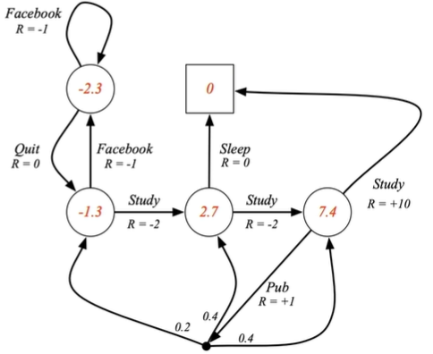

- 행동 가치 함수 (Action-Value Function) \(q_{\pi }\)

  - **정의**: 행동 가치 함수 \(q_\pi(s, a)\)는 **상태 \(s\)에서 행동 \(a\)를 취하고, 이후 정책 \(\pi \)를 따를 때의 기대 보상**이다.
    \(q_{\pi }(s,a)=\mathbb{E}_{\pi }[G_{t}\mid S_{t}=s,A_{t}=a]\)

  - *"이 상태(\(s\))에서 특정 행동(\(a\))을 취하는 것은 얼마나 좋은가?" (정책 \(\pi \) 하에서)*

- 벨만 기대 방정식 (Bellman Expectation Equation)

  -  상태 가치 함수 (State-Value Function)

    \(\begin{aligned}v_{\pi }(s)&=\mathbb{E}_{\pi }[G_{t}\mid S_{t}=s]\\ &=\mathbb{E}_{\pi }[R_{t+1}+\gamma v_{\pi }(S_{t+1})\mid S_{t}=s]\end{aligned}\)

  - 행동 가치 함수 (Action-Value Function)

    \(\begin{aligned}q_{\pi }(s,a)&=\mathbb{E}_{\pi }[G_{t}\mid S_{t}=s,A_{t}=a]\\ &=\mathbb{E}_{\pi }[R_{t+1}+\gamma q_{\pi }(S_{t+1},A_{t+1})\mid S_{t}=s,A_{t}=a]\end{aligned}\)

  - 두 가치함수가 실시간으로 서로의 입력값이 되어주며, 결과적으로는 현재 칸의 가치와 다음 칸의 가치를 연결하는 거대한 하나의 방정식을 완성시키는 관계

    - \(v_{\pi }(s)=\sum _{a\in A}\mathbf{\pi (a\mid s)q}_{\mathbf{\pi }}\mathbf{(s,a)}\)

      - **\(q_\pi(s, a)\) [행동 가치함수]:**
        상태 \(s\)에서 특정 행동 \(a\)를 **이미 선택했다고 고정**했을 때, 미래에 받게 될 누적 보상의 기댓값
      - **\(\pi(a \mid s)\) [정책 확률]:**
        에이전트가 상태 \(s\)에서 실제로 그 행동 \(a\)를 **선택하게 될 확률**
      - **시그마 (\(\sum _{a\in A}\)) [가중 평균 연산]:**
        에이전트는 상태 \(s\)에서 딱 하나의 행동만 하는 것이 아니라 확률 분포(\(\pi \))에 따라 여러 행동을 할 수 있습니다. 따라서 **"각 행동을 했을 때 얻을 점수(**\(q\)) \(\times \) **실제로 그 행동을 할 확률(**\(\pi \)**)"**을 가능한 모든 행동에 대해 다 더해줌

    - \(q_{\pi }(s,a)=R_{s}^{a}+\gamma \sum _{s^{\prime }\in S}\mathbf{P}_{\mathbf{ss}^{\prime }}^{\mathbf{a}}\mathbf{v}_{\mathbf{\pi }}\mathbf{(s}^{\prime }\mathbf{)}\)

      이 식은 에이전트가 상태 \(s\)에서 행동 \(a\)를 취한 **직후의 타임라인을 쪼개어** 평가합니다.

      1. **\(R_{s}^{a}\) [즉각 보상]:**
         상태 \(s\)에서 행동 \(a\)를 수행했을 때 환경으로부터 **즉시 발생하는 보상의 기댓값** (이 보상을 받는 순간 시간 단계가 다음 칸으로 넘어갑니다.)
      2. **\(\sum_{s' \in S} P_{ss'}^a v_\pi(s')\) [도달 가능한 다음 상태들의 가치 기댓값]:**
         - **\(P_{ss^{\prime }}^{a}\) :** 행동 \(a\)를 했을 때, 환경의 물리적 법칙에 의해 **다음 상태 \(s^{\prime }\)로 전이될 확률**입니다.
         - **\(v_\pi(s')\) :** 그렇게 도착하게 될 **다음 상태들의 장기적인 가치함수 값**입니다.
         - **\(\sum \) :** 환경의 불확실성 때문에 다음 칸이 여러 군데일 수 있으므로, **"다음 칸으로 갈 확률** \(\times \) **그 다음 칸의 가치"**를 곱해서 모두 더해준(기댓값) 것입니다.
      3. **\(\gamma \) [할인율]:**
         다음 칸들의 가치는 한 단계 미래의 점수이므로 감쇠 인자를 곱해 현재 가치로 환산해 줍니다.

    - \(v_{\pi }(s)=\sum _{a\in A}\pi (a\mid s)\left[R_{s}^{a}+\gamma \sum _{s^{\prime }\in S}P_{ss^{\prime }}^{a}v_{\pi }(s^{\prime })\right]\)

      - 상태 s의 가치

        - 정책에 따라 행동을 선택
        - 각 행동의 즉각 보상과 다음 상태의 가치를 계산
        - 전이 확률로 가중 평균

        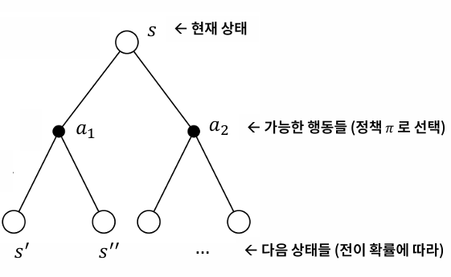

    - 행동 가치만으로 벨만 방정식 표현 

#### * 동적 프로그래밍

- 복잡한 문제를 더 작은 하위 문제로 나누어 푸는 알고리즘 설계 기법
  - 각 부분 문제를 해결하고, 부분 문제의 해를 결합하여 전체 문제 해결
- Dynamic : 순차적/시간적 요소가 있는 문제

- Programming : 프로그램, 즉 정책(policy)을 최적화하는 것

  - ex) 선형 프로그래밍(Linear Programming)

- 동적 프로그래밍의 응용 사례

  - 스케줄링 알고리즘
    - 특정 작업을 스케줄에 넣을지 말지 결정할 때, 이전 작업들의 최적 해에 의존함(재사용)
  - 문자열 알고리즘
    - 시퀀스 정렬 : 두 문자열 전체의 최적 정렬은, 부분 문자열끼리의 최적 정렬 결과에서 파생됨
  - 그래프 알고리즘
    - 최단 경로 알고리즘 : 중간 경유지들을 거쳐가는 더 짧은 부분 경로의 정보를 이용해 전체 거리를 갱신함
  - 그래프 모델
    - Viterbi 알고리즘 : 현재 시점에서 가장 확률이 높은 상태에 도달하기 위해, 직전 단계까지의 누적 확률 값을 저장해 다음 단계로 넘김
  - 생물정보학
    - 격자 모델(Lattice models) : 복잡한 전체 단백질 구조의 가장 안정적인 상태를, 나누어진 작은 부분 사슬들의 최적 에너지 배치를 결합하여 예측

- 필요조건

  - MDP는 아래의 두 조건 모두 만족함
    - 벨만 방정식이 재귀적 분해 제공
    - 가치 함수가 해를 저장하고 재사용

  1. 최적 부분 구조(Optimal Substructure)

     - 최적 해가 부분 문제의 최적 해로 구성됨
       - 벨만 최적 방정식은 "현재 상태에서 최선의 선택을 했을 떄의 가치는 [지금 얻는 보상] + 다음 상태에서 얻을 수 있는 최선의 가치]의 합과 같다"
     - 최적성 원리가 적용됨
       - 최적성 원리(Principle of Optimality)
         - 전체 경로가 최적(Best)이 되려면, 그 경로를 쪼갠 아주 작은 하위 문제들의 선택(행동)도 각각 최적이어야만 한다
       - ex) 서울->부산 최단 경로 = 서울 -> 대전 최단 경로 + 대전 ->부산 최단 경로

  2. 중복되는 부분 문제(Overlapping Subproblems)

     - 동일한 부분 문제가 여러 번 반복됨
     - 한 번 계산한 결과를 저장하고 재사용
       - ex) 피보나치 수열 계산 시 같은 값을 반복 계산
       - 에이전트가 환경을 탐색하며 동일한 상태를 반복 방문할 때, 매번 미래의 보상을 처음부터 다시 계산하지 않고 '가치함수'에 각 상태의 가치를 저장하여 재사용

     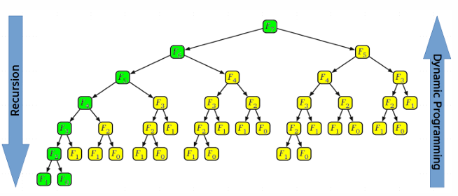

- 최적 정책의 구조(\(\pi ^{*}\))

  1. **최적의 첫 행동 (\(A^{*}\)):** 지금 당장 현재 상태에서 취해야 할 단 하나의 가장 최선의 행동

  2. **후속 상태 (\(S^{\prime }\))에서의 최적 정책:** 첫 행동을 하고 난 뒤, 그 미래 상태(\(S^{\prime }\))에서부터 목적지까지 이어지는 나머지 모든 과정에서의 최적의 정책

     **\(v_\pi(s) = v_\*(s) \iff v_\pi(s') = v_\*(s')\)**

     - **좌변 (\(\implies \)):** 현재 상태 \(s\)에서 나의 정책이 진짜 정답(최적 가치 \(v_{*}\))을 달성했다면,
     - **우변 (\(\impliedby \)):** 그 행동으로 인해 도달하게 될 **미래의 모든 후속 상태 \(s^{\prime }\)에서도 무조건 최적의 가치를 달성하는 선택을 해야만 한다**는 뜻

- MDP에서 어떻게 동적 프로그래밍을 활용할 수 있는지

  - MDP에서의 계획(Planning)
    - MDP의 모든 정보를 알고 있다고 가정
    - 환경과 상호작용 없이 계산만으로 해결
  - 예측(Prediction)문제 - 정책을 따랐을 때 미래의 가치를 환산하는 것
    - 입력 : MDP \(\langle S, A, P, R, \gamma \rangle\) + 정책 \(\pi \), 혹은 MRP \(\langle S, P^\pi, R^\pi, \gamma \rangle\)
    - 출력 : 가치 함수  \(v_{\pi }\)
  - 제어(Control)문제 - 최적의 가치함수와 행동은 무엇인지
    - 입력 : MDP \(\langle S, A, P, R, \gamma \rangle\)
    - 출력 : 최적 가치 함수 \(v^{*}\) + 최적 정책 \(\pi ^{*}\)

- 반복적 정책 평가

  - 문제 : 주어진 정책𝜋을 계속 따를 떄, 각 상태가 얼마나 좋은지(\(v_{\pi }\))평가하기 예측

  - 해결 방법 : 벨만 기댓값 백업(역방향)을 반복 적용

    - \(v_1 \rightarrow v_2 \rightarrow \dots \rightarrow v_\pi\)
    - 벨만 방정식(현재 상태의 가치 = 보상 + 다음 상태의 가치)을 반복적으로 적용하면, 점차 실제 정확한 가치로 수렴

  - 동기식 백업(synchronous Backups)

    - 각 반복 k+1에서
    - 모든 상태 \(s \in S\)에 대해
    - 이전 값 \(v_k(s')\)로부터 \(v_{k+1}(s)\)를 업데이트
      - **\(s\) (현재 상태):** 에이전트가 **지금** 서 있는 위치 (Present)
      - **\(s^{\prime }\) (후속 상태):** 에이전트가 앞으로 행동을 취해 **도착하게 될 미래**의 위치 (Future)

    - **의미:** 현재 상태 \(s\)의 새로운 가치를 알기 위해, 내가 갈 수 있는 다음 상태들(\(s^{\prime }\))의 과거 추정치(\(v_{k}\))를 계산에 활용
      1. **시간적 공간 (\(s \rightarrow s'\)):** 나는 현재(\(s\)) 칸에 서서, **미래(**\(s^{\prime }\))에 갈 칸들을 바라보며 계산.
      2. **데이터의 버전 (\(k\)):** 하지만 아직 진짜 미래의 정답 가치는 모릅니다. 그래서 미래 칸(\(s^{\prime }\))에 임시로 저장되어 있던 **'과거 라운드(**\(k\)**) 버전의 점수'**를 빌려와서 현재 칸(\(s\))의 점수를 업데이트하는 것

    - 동기식은 맵 전치(모든 상태)가 발맞추어 동시에 한 단계씩만 발전하게 만듬
      - 동기식의 핵심은 "내가 계산할 때, 남들이 방금 계산한 값에 영향을 받지 않겠다"는 규칙
      - 갱신 방식 : 가치함수 배열 2개(과거배열, 현재배열)
      - `과거_배열`을 보고 모든 칸의 새 점수를 계산해서 `현재_배열`에 일단 채워 넣습니다. 이때까지는 가치함수가 실제로 바뀌지 않은 상태
      - 모든 칸의 계산이 **백 퍼센트 끝나야만** 비로소 `과거_배열 = 현재_배열`로 **통째로 한 번에 갱신**
      - **이유:** 계산 순서(예: 1번 칸부터 계산할지, 100번 칸부터 계산할지)에 따라 결과가 왜곡되는 것을 막고, 이론적인 안정성을 완벽하게 보장하기 위해서

    - **참고:** 한 번에 \(v_{k+1}(s)\)를 업데이트하지 않고, 하나씩 바로바로 덮어쓰는 방식은 비동기식 백업(Asynchronous Backups)
      - '과거 점수판'과 '새 점수판'을 따로 두지 않고, **단 하나의 점수판(In-place)만 두고 실시간으로 값을 바꾸는 방식**
      - 갱신 방식 : 가치함수 배열을 딱 **1개**만 씁니다 (`실시간_배열`)

- 벨만 기대 백업

  - 업데이트 규칙 : \(v_{k+1}(s)=\sum _{a\in A}\pi (a|{}s)\left[R_{s}^{a}+\gamma \sum _{s^{\prime }\in S}P_{ss^{\prime }}^{a}v_{k}(s^{\prime })\right]\)

  - 벡터 형태 : \(v_{k+1}=R^{\pi }+\gamma P^{\pi }v_{k}\)

  - 주어진 정책에 따라 행동할 때 현재 칸(\(s\))의 새 점수는, 갈 수 있는 모든 미래 칸(\(s^{\prime }\))들의 '이전 라운드 점수(\(v_{k}\))'와 '즉각 보상'을 확률적으로 평균 내어 계산

    - **\(v_{k+1}(s)\)** : **[현재]** 이번 라운드(\(k+1\))에 갱신할 현재 상태 \(s\)의 새로운 가치
    - **\(\sum_{a} \pi(a\vert{}s)\)** : **[행동 선택]** 정책 \(\pi \)에 따른 모든 가능한 행동(\(a\))의 확률 고려
    - **\(R_{s}^{a}\)** : **[보상]** 행동 \(a\)를 취했을 때 받는 즉각 보상
    - **\(\gamma \)** : **[할인율]** 미래 가치를 현재 가치로 깎아주는 비율 (\(0 \le \gamma \le 1\))
    - **\(\sum_{s'} P_{ss'}^a\)** : **[상태 전환]** 환경 확률(\(P\))에 따른 모든 가능한 다음 상태(\(s^{\prime }\))의 확률 고려
    - **\(v_k(s')\)** : **[미래]** 다음 상태 \(s^{\prime }\)의 **이전 라운드(\(k\)) 가치함수 값** (★동기식 백업의 핵심!)

  - **동기식 백업 (\(v_{k+1} \leftarrow v_k\)):** 점수판 배열을 2개 두고, 모든 칸이 지난 라운드의 고정 데이터(\(v_{k}\))만 보고 계산한 뒤 **마지막에 한 번에 교체(시점 일치)**.

  - **비동기식 백업 (\(v \leftarrow v\)):** 점수판 배열 1개만 두고, 계산이 끝나는 대로 **그 자리에서 실시간으로 덮어씀(In-place)** \(\rightarrow \) 최신 데이터 즉시 재사용으로 수렴 속도 훨씬 빠름.

    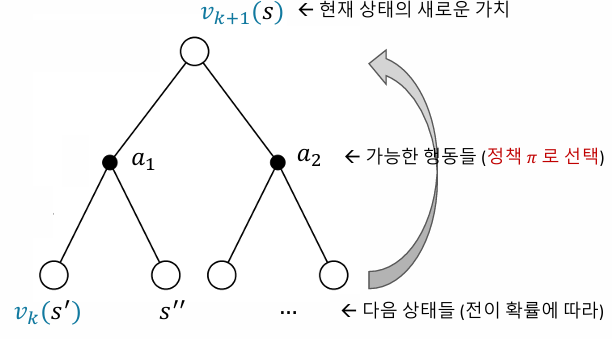

- 반복적 정책 평가 예제 - 작은 격자 세계(Small Gridworld)

  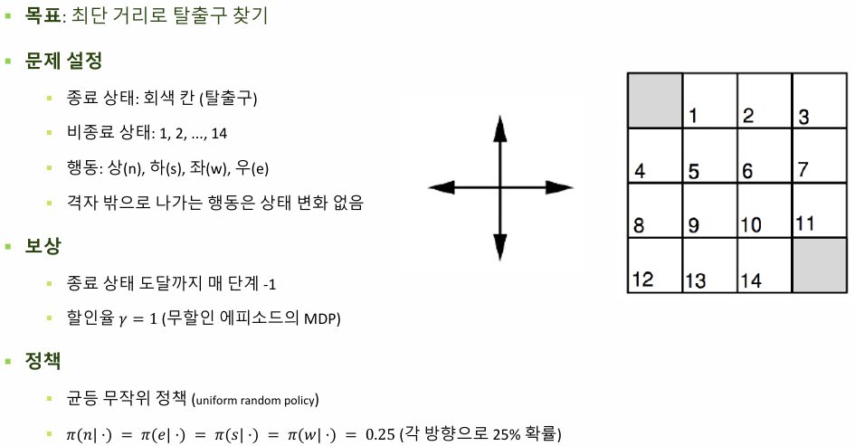

  - \(k = 0\) (초기화)
    - **상황:** 처음에는 아무것도 계산되지 않았기 때문에, 종료 상태를 포함한 **모든 칸의 과거 점수(\(v_{0}\))를 전부 `0.0`으로 설정**해 둡니다.
    - 이때 정책은 무작위(상/하/좌/우 각각 25% 확률)
  - \(k = 1\) (첫 번째 라운드 업데이트)
    - 이제 모든 칸(\(s\))에 대해 수식을 돌려 **이번 라운드의 새로운 점수(**\(v_{1}\))를 구함.
    - 예시로 **회색 종료 칸 바로 옆 칸(위에서 두 번째 줄, 맨 왼쪽 칸)**의 가치를 계산해 보면 다음과 같음.
      - 위로 가면 종료 칸에 도착하므로 즉각 보상 \(-1\)을 받고, 종료 칸의 가치는 과거 점수판(\(v_{0}\)) 기준 `0.0`입니다. \(\rightarrow \) \(-1 + 0 = -1\)
      - 나머지 3개 방향(하, 좌, 우)으로 가면 일반 칸으로 가므로 즉각 보상 \(-1\)을 받고, 그 일반 칸들의 과거 점수(\(v_{0}\)) 역시 전부 `0.0`입니다. \(\rightarrow \) \(-1 + 0 = -1\)
      - 네 방향 모두 결과가 \(-1\)이므로, 평균(기댓값)을 내도 `-1.0`이 됨.
    - **★ 동기식 백업의 핵심:** 이때 모든 일반 칸이 똑같이 주변의 `0.0`이라는 **과거 값(\(v_{0}\))만 참조해서 동시에 계산**하기 때문에, \(k=1\) 단계에서는 종료 칸(0.0)을 제외한 **모든 칸의 점수가 한꺼번에 똑같이 `-1.0`으로 교체**
  - \(k = 2\) (두 번째 라운드 업데이트\)
    - 이제 주변 칸들의 점수가 모두 `-1.0`으로 바뀐 **새로운 과거 점수판(**\(v_{1}\))이 준비되어있음. 이 판을 보고 다시 업데이트(\(v_{2}\))를 함.
    - **종료 상태 바로 옆 칸(예: 위쪽 줄의 왼쪽에서 두 번째 칸)**을 다시 계산해 보면
      - 왼쪽으로 가면 종료 칸에 도착하므로 \(-1\) 보상을 받고, 종료 칸의 과거 점수(\(v_{1}\))는 `0.0` \(\rightarrow \) \(-1 + 0.0 = -1.0\)
      - 위, 아래, 오른쪽으로 가면 일반 칸으로 가는데, 그 칸들의 과거 점수(\(v_{1}\))는 모두 `-1.0` \(\rightarrow \) \(-1 + (-1.0) = -2.0\)
      - 네 방향의 기댓값을 평균 내면: \(\frac{1}{4}(-1.0) + \frac{3}{4}(-2.0) = -0.25 - 1.5 = \mathbf{-1.75}\) (소수점 첫째 자리만 반올림하여 표기하면 그림 속 `-1.7`이 됨)
    - 반면, 종료 칸과 멀리 떨어진 **정중앙 칸**들은 사방을 둘러봐도 전부 과거 점수가 `-1.0`인 칸들뿐입니다. 따라서 \(-1 + (-1.0) = \mathbf{-2.0}\)이 됨

  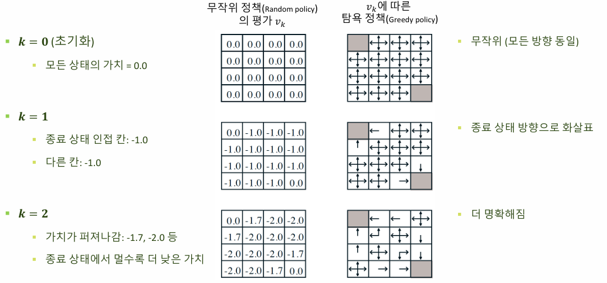

  - 점수판의 변화: "종료 칸에서 멀어질수록 페널티가 누적됨"

    맨 아래 \(k=\infty\)의 가치 점수판을 보면 숫자가 **`-14`, `-20`, `-22`** 등으로 아주 낮아져 있습니다.

    - **종료 칸 바로 옆 칸 (`-14`):** 종료 칸(0.0)이 코앞에 있기 때문에 탈출하기 쉽고, 그만큼 감점을 적게 받아서 점수가 가장 높습니다.
    - **정중앙 칸 (`-20`):** 탈출구에서 한참 멀기 때문에 탈출하기까지 더 많은 발걸음(\(-1\) 페널티)이 필요하므로 점수가 더 낮습니다.
    - **가장 구석진 칸 (`-22`):** 탈출구(회색 칸)에서 가장 대각선 멀리 떨어져 있어서 감점을 가장 많이 받아 점수가 제일 낮습니다.

  - 오른쪽 화살표(탐욕 정책)의 비밀: "가장 높은 점수를 향해라"

    주변 4칸의 점수(\(k=\infty\))가 다 계산되고 나면, 에이전트는 **"주변 칸들 중에서 점수가 가장 높은(감점이 가장 적은) 칸으로 가자!"**라는 마음(탐욕 정책, Greedy Policy)을 먹게 된다.

    예를 들어, **두 번째 줄의 두 번째 칸**을 손가락으로 짚어보세요. 이 칸의 점수는 `-18`. 이 칸을 둘러싼 주변 칸들의 점수를 비교해보면

    - **위 (\(\uparrow \)) 칸 점수:** **`-14`** (높음)
    - **왼쪽 (\(\leftarrow \)) 칸 점수:** **`-14`** (높음)
    - **아래 (\(\downarrow \)) 칸 점수:** `-20` (낮음)
    - **오른쪽 (\(\rightarrow \)) 칸 점수:** `-20` (낮음)

  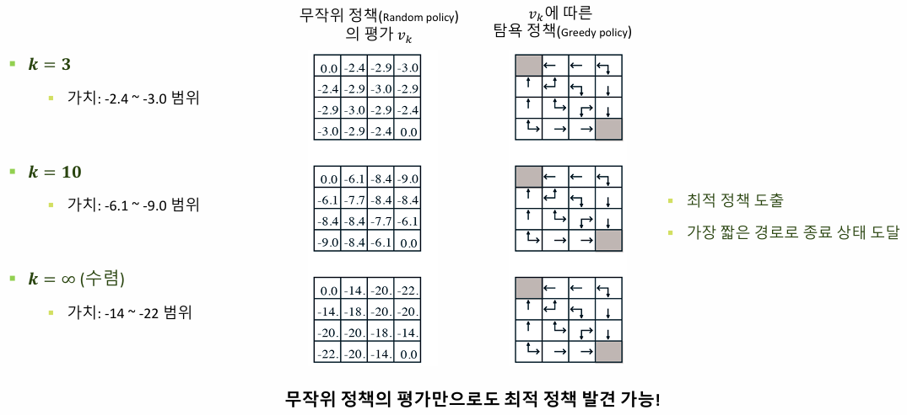

- 정책을 개선하는 방법

  - 정책이 바뀌면 가치 함수가 바뀜
  - 가치 함수가 바뀌면 정책도 바뀌어야 함
  - 이 과정을 반복하면, 둘 다 최적의 상태에서 만남

  1. 정책 평가
     - 현재 정책 \(\pi \)를 평가
       \(v_{\pi }(s)=\mathbb{E}[R_{t+1}+\gamma R_{t+2}+\dots |S_{t}=s]\)
  2. 정책 개선
     - \(v_{\pi }\)에 대해 탐욕적(\(v_{\pi }\)가 큰값으로 행동하는 것)으로 행동하며 정책 개선)
       \(\pi ^{\prime }=\text{greedy}(v_{\pi })\)

  - 탐욕적 개선의 원리

    1. 결정적 정책 (Deterministic Policy)

    - **수식:** \(a = \pi(s)\)
    - **의미:** 확률(예: 상 25%, 하 25%)로 움직이는 게 아니라, 어떤 상태(\(s\))에 처하면 **무조건 정해진 행동(\(a\)) 딱 하나만 선택**하는 규칙입니다.
    - **비유:** "매일 점심에는 무조건 김치찌개만 먹는다"처럼 고민 없이 정해진 메뉴 하나만 고르는 고집 있는 상태입니다.

    2. 탐욕적 개선 (Greedy Improvement)의 원리

       1. **더 나은 선택지 찾기 (\(\text{argmax}\)):**
          - 원래 내 규칙은 김치찌개였는데, 주변 메뉴들의 만족도(\(q_{\pi }\))를 조사해 보니 **제육볶음의 만족도가 훨씬 높다**는 것을 발견
          - **\(\pi'(s) = \text{argmax}_{a \in A} q_\pi(s,a)\)**: "가장 만족도가 높은 행동(\(a\))을 새로운 정책(\(\pi ^{\prime }\))으로 삼겠다!" 즉, 메뉴를 **제육볶음으로 변경**
       2. **"오늘만 제육볶음" vs "예전처럼 김치찌개" 비교:**
          - 수식 중간의 파란색 글씨를 보세요: `오늘만 제육볶음(\(\pi'\))을 먹고 내일부터는 다시 김치찌개(\(\pi\))를 먹는 것`이 `예전처럼 매일 김치찌개만 먹는 것`보다 당연히 만족도가 높거나 같을 것. (\(\ge v_\pi(s)\))
       3. 최종 결론: 정책 개선 정리 (Policy Improvement Theorem)

       - **수식:** \(v_{\pi'}(s) \ge v_\pi(s)\)
       - **의미:** 오늘 하루만 제육볶음으로 바꿔서 좋았다면, **"앞으로 평생 점심 메뉴를 제육볶음(\(\pi ^{\prime }\))으로 아예 바꿔버리는 것"이 예전 정책(\(\pi \))보다 무조건 이득이거나 최소한 똑같다**는 정리
       - 이 과정을 거치면 맵의 모든 상태에서 가치가 **개선되거나(더 좋은 길을 찾거나) 유지(이미 최적화)**

  - 정책 반복의 핵심 패러다임

    - **정책이 바뀌면 가치 함수가 바뀜** (새로운 메뉴를 먹으니 내 자산/만족도가 변함)
    - **가치 함수가 바뀌면 정책도 바뀌어야 함** (바뀐 자산/만족도를 보니 또 다른 행동이 더 좋아짐)
    - **이 과정을 반복하면, 결국 둘 다 최적의 상태에서 만남 (\(\pi = \pi^\*\), \(v = v^\*\))**

  - 정책 반복 알고리즘 흐름도

    ~~~
    [초기 정책 π₀] (예: 매일 밤 차를 전혀 옮기지 않는다)
          ↓
     1. 정책 평가 (Policy Evaluation)
        : 현재 정책을 유지했을 때 각 상태(차의 대수 조합)의 장기적인 가치(V)를 
          벨만 기대 방정식을 이용해 끝없이 업데이트하며 구합니다.
          ↓
     2. 정책 개선 (Policy Improvement)
        : 구해진 가치(V)를 바탕으로 "내일 밤 몇 대를 옮겨야 가장 이득일까?"를 
          모든 상태에 대해 탐욕적(Greedy)으로 계산해 새로운 정책 π₁을 만듭니다.
          ↓
    [새로운 정책 π₁]이 기존 π₀와 같다면 종료(최적 정책 달성)! 다르면 다시 1번으로 반복!
    ~~~

  - 정책 개선 수렴조건

    - **개선이 멈추는 조건** (모든 가능한 행동긔 가치를 전부 평가해 보아도, 현재의 정책의 행동이 가장 높은 가치를 가질 때)
      \(q_{\pi }(s,\pi ^{\prime }(s))=\max _{a\in A}q_{\pi }(s,a)=q_{\pi }(s,\pi (s))=v_{\pi }(s)\)
    - **이는 벨만 최적 방정식을 만족**
      \(v_{\pi }(s)=\max _{a\in A}q_{\pi }(s,a)\)
    - **결론**
      - \(v_\pi(s) = v_*(s) \text{ for all } s \in S\) 따라서, \(\pi \)는 최적 정책

  - 예제 (Jack's Car Rental)

    - 목표 : 장기 수익 최대화 정책 찾기

    - 문제 설정

      - 상태 : 두 지점(1지점, 2지점)에 각각 남아있는 자동차의 수 (각 지점당 최대 20대)
      - 행동 : 매일 밤 1지점에서 2지점으로, 혹은 반대로 차를 이동시키는 수 (최대 5대 이동 가능)
      - 보상 :차를 한 대 대여할 때마다 \(+10\$\), 밤사이에 차를 한 대 옮길 때마다 \(-2\$\) (비용 발생)
      - 전이 : 차량 반납 요청(무작위)

    - 확률 분포(Poisson 분포)

      - **Poisson 분포** \(P(n) = \frac{\lambda^n}{n!} e^{-\lambda}\) (\(n\): 반납/요청)
      - **1지점:** 평균 요청 3, 평균 반납 3
      - **2지점:** 평균 요청 4, 평균 반납 2

      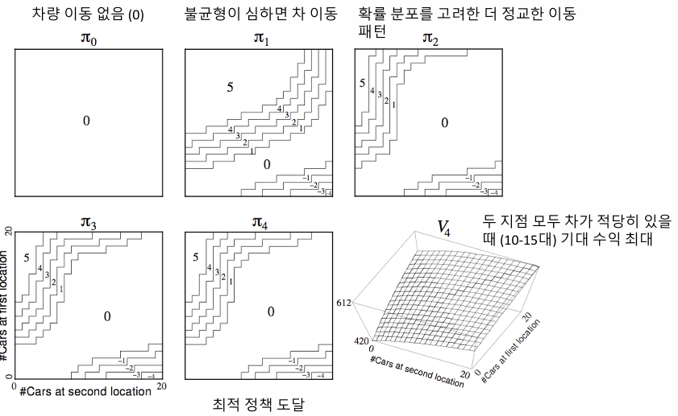

- 수정된 정책 반복
  - 기존 방식은 현재 정책의 가치를 완벼하게 계산한 뒤에 정책을 바꿈
  - 대안
    - - \(\epsilon \)-수렴 조건 도입: 값이 아주 조금 변할 때까지만 계산하고 멈춤
      - \(k\)번 반복 후 중단: **\(k\)번만 계산해보고 정책 바꿈** *(우측 필기: \(k=3\))*
    - **극단적 경우 (\(k = 1\))**
      - 매 반복마다 정책 업데이트 (한 번만 보고 정책 바꿈)**\(\rightarrow \) 가치 반복(Value Iteration)**

- 결정적 가치 반복

  - 끝에서부터 거꾸로 정답 채우기

    - 다음 단계(미래 상태 \(s^{\prime }\))의 진짜 최적 정답(\(v_*(s')\))을 알고 있다면, 역방향 탐색을 통해 현재 상태 \(s\)의 최적 정답도 곧바로 계산가능
    - ex) 미로 찾기를 할 때, 입구에서 해매는 게 아니라 출구(보상을 아는 곳)에서부터 거꾸로 거리를 계산해 오는 방식

    \(v_{*}(s)\leftarrow \max _{a\in A}\left(R_{s}^{a}+\gamma \sum _{s^{\prime }\in S}P_{ss^{\prime }}^{a}v_{*}(s^{\prime })\right)\(

    - **정책 반복(\(\sum_a \pi\))과의 차이점:**
      - 이전 정책 평가 수식에서는 정책 확률(\(\pi \))에 따라 모든 행동의 평균을 냈습니다.
      - 가치 반복 수식에서는 \(\max _{a}\)가 들어갑니다. 즉, 확률적으로 평균을 내지 않고 **"내 주변 미래 칸 중에서 점수가 가장 높은 최선의 행동(**\(\max \)**) 딱 하나만 바라보고 점수를 매기겠다"**는 뜻

- DP 기반 강화학습 알고리즘 핵심 요약 비교

  | 구분                  | 사용하는 벨만 방정식                    | 알고리즘 명칭                                      | 핵심 특징 및 요약                                            | 수식적 힌트                        |
  | --------------------- | --------------------------------------- | -------------------------------------------------- | ------------------------------------------------------------ | ---------------------------------- |
  | **예측 (Prediction)** | **벨만 기대 방정식**                    | **반복적 정책 평가** (Iterative Policy Evaluation) | 정책은 가만히 고정해 두고, 그 정책의 **가치함수(v)만 끝없이 계산**함 | \(\sum \) (확률적 평균)            |
  | **제어 (Control)**    | **벨만 기대 방정식** + 탐욕적 정책 개선 | **정책 반복** (Policy Iteration)                   | **[평가 → 개선]을 무한 반복**함. 수학적으로 정확하지만 속도가 느림 | \(\sum \rightarrow \text{argmax}\) |
  | **제어 (Control)**    | **벨만 최적 방정식**                    | **가치 반복** (Value Iteration)                    | 평가 과정을 굳이 끝까지 안 하고 압축함. **처부터 최적 가치만 추적**해 빠르고 효율적임 | \(\max \)                          |

- DP 테이블 방식의 한계와 복잡도
  - **시간 복잡도 (상태 가치 함수 기준):** \(\mathcal{O}(mn^2)\)  *(행동 개수 m, 상태 개수 n)*
  - **치명적인 한계 (차원의 저주):** 바둑판처럼 상태(n)가 수백만, 수천만 개로 엄청나게 많아지면 컴퓨터 메모리와 연산 속도가 버티지 못함 (DP 테이블 방식 사용 불가)
  - **해결책:** 나중에는 이 거대한 테이블을 그대로 쓰지 않고, 가치 함수를 예측하는 **근사(Approximation) 방법**이나 인공신경망을 결합한 **딥러닝(DQN 등)**을 사용해 풀어야 함

#### * 동적 프로그래밍 확장

- 기존 동기식 백업의 한계

  - 모든 상태를 병렬로 업데이트(backup)
  - 계산 비용이 높음
  - 불필요한 상태까지 업데이트(backup)
    - ex) 이미 정답을 찾은 칸이나 로봇이 평생 갈 일 없는 구석진 칸까지 매번 똑같이 계산

- 비동기식 DP(Asynchronous DP)의 장점

  - 개별 상태를 독립적으로 업데이트(backup)
  - 순서가 상관 없음. 당장 필요한 곳부터(임의 순서로) 업데이트 가능
  - 계산량을 크게 줄일 수 있음
  - 모든 상태가 계속 선택되면 정답(수렴)은 똑같이 나옴
  - 어떤 상태를 언제 업데이트할지 선택 가능

- 비동기식 DP의 3가지 방법

  1. 제자리 동적 프로그래밍 (ln-Place dynamic programming)
     - 가치 함수 복사본 하나만 사용
     - “메모장을 두 개나 펴지 팔고, 하나에 쓰고 지우고 하꾸' (메모리 효율성)
  2. 우선순위 스와핑(prioritisedsweeping)
     - 벨만 오차가 큰 상태 우선 업데이트
     - “틀린 정도가 심한 문제부터 풀자' (중요한 상태에 집중)
  3. 실시간 동적 프로그래밍(Real-Time dynamic programming)
     - 에이전트가 경험한 상태만 업데이트
     - 관련 상태에만 집중
     - "내가 지금 서 있는 곳 주변부터 풀자" (현실성)

- 제자리 동적 프로그래밍(In-Place DP)

  - 가치함수나 알고리즘의 테이블을 업데이트할 때, 과거 데이터 보관용 임시 배열을 따로 만들지 않고 **단 하나의 배열(메모리 공간)만 유지하며 실시간으로 값을 덮어쓰는(In-Place) 방식**

    \(v(s) = \max_{a \in A} \left( R_s^a + \gamma \sum_{s' \in S} P_{ss'}^a \mathbf{v(s')} \right)\)

  - 순차적으로 계산하는 도중, 방금 고쳐진 최신 옆 칸 데이터를 다음 계산에 곧바로 사용

  - 새로운 가치(정보)가 온 동네로 퍼지는 속도가 동기식보다 훨씬 빨라 **정답에 도달하는 속도가 압도적으로 빠름**

- 우선순위 스와핑

  - 모든 상태를 공평하게 순회(Sweeping)하는 대신, 가치 갱신이 가장 시급한 상태부터 **우선순위를 두어 업데이트**하는 스마트한 비동기식 DP 방식
    - \(\left|{}\max _{a\in A}\left(R_{s}^{a}+\gamma \sum _{s^{\prime }\in S}P_{ss^{\prime }}^{a}v(s^{\prime })\right)-v(s)\right|{}\)
    - **우선 업데이트:** 벨만 오차가 크다는 것은 **"현재 점수가 엉터리라 가장 많이 뜯어고쳐야 한다"**는 뜻이므로, 이 오차가 큰 상태를 1순위로 업데이트함
    - **벨만 오차(Bellman Error):** 내가 예상한 값과 실제로 주변 데이터를 통해 계산한 값의 차이(오차 절댓값)를 측정함
  - 알고리즘 동작 과정
    1. **오차 측정:** 모든 상태 중에서 벨만 오차가 가장 큰 상태(칸)를 찾음.
    2. **제자리 갱신(Backup):** 해당 칸의 가치를 최신 값으로 업데이트(In-Place)함.
    3. **역추적(Backtracking):** 방금 내 점수가 바뀌었으므로, 나에게 영향을 받게 될 **이전 상태(선행 상태)들의 벨만 오차도 연쇄적으로 업데이트**함.
    4. **우선순위 큐(Priority Queue) 활용:** 이 효율적인 순서를 컴퓨터 메모리 상에서 관리하기 위해 오차가 큰 순서대로 정렬되는 '우선순위 큐'에 넣어 연산 속도를 극대화함

- 실시간 동적 프로그래밍(Real-Time DP)
  - 전체 상태 공간을 전부 순회하는 불필요한 연산을 줄이기 위해, **실제 경험(에피소드)을 가이드로 삼아 에이전트가 지나간 경로의 상태들만 업데이트**하는 방식
  - 알고리즘 동장 과정
    - 매 시간 단계마다 현재 상태 \(S_{t}\)에서 행동 \(A_{t}\)를 취하고 즉각 보상 \(R_{t+1}\)을 얻은 후, **방금 지나온 상태 \(S_{t}\)의 가치를 제자리 가치 반복 수식으로 업데이트**함.
      \(v(S_{t})=\max _{a\in A}\left(R_{S_{t}}^{a}+\gamma \sum _{s^{\prime }\in S}P_{S_{t}s^{\prime }}^{a}v(s^{\prime })\right)\)
  - RTDP의 장점
    - **핵심 상태 집중:** 에이전트가 목적지를 가기 위해 **자주 방문하는 중요한 상태들만 집중적으로 업데이트**함.
    - **불필요한 계산 제거:** 로봇이 절대 갈 일이 없는 맵의 구석진 곳이나 쓸모없는 지역은 계산에서 아예 제외하므로 연산량이 획기적으로 줄어듬.
    - **온라인 학습:** 실제 움직임(에피소드 진행)과 학습(가치 함수 업데이트)이 동시에 실시간으로 일어남

- Back up 방식

  1. 전폭 백업(Full-Width Backups)

     - DP방식

     - 현재 상태에서 가능한 모든 미래의 행동과 결과를 다 따져서 평균을 냄(이상적)

     - MDP 전이/보상 함수 지식 필요

     - 복잡도 : \(\mathcal{O}(\vert{}S\vert{}^2\vert{}A\vert{})\) [qto2-H]

       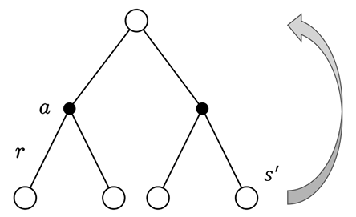

     - 문제점

       - 단 한 칸(s)을 업데이트하기 위해 **사방으로 갈라지는 모든 가지(a, s')를 전부 끝까지 탐색**해야 함

       - **차원의 저주 (Curse of Dimensionality):**

          상태 개수 |S|가 조금만 늘어나도 연산량이 제곱(|S|²)으로 폭발하여, 대규모 문제에서는 단 한 번의 라운드(백업)를 도는 것조차 컴퓨터가 버티지 못하고 뻗어버림

     - 해결책 : 샘플 백업

       - 모든 미래를 다 펼쳐서 평균을 내는 비현실적인 방식 대신, **실제 환경과 부딪히며 경험한 '단 하나의 샘플 경로'만 보고 가치를 업데이트**하는 강화학습(Model-Free RL, 예: TD 학습, Q-Learning 등) 기법으로 나아가야 하는 결정적인 계기가 됨

       

  2. 샘플 백업

     - 모든 미래의 경우의 수를 전부 계산하여 평균을 내는 대신, **실제로 한 번 움직여 보며 얻은 '단 하나의 샘플 경로'만 보고 가치를 업데이트**하는 방식

       - 전체 전이 확률 대신 샘플 경험 사용 (일단 한번 해보기) -> 현실적
       - 보상 함수 R과 전이 확률 P 불필요 (모든 경우의 수를 따지지 않음)

     - 장점

       1. **모델 프리 (Model-Free):** MDP에 대한 사전 지식이 전혀 불필요함.

       2. **차원의 저주 해결:** 모든 후속 상태를 다 계산할 필요가 없으므로 샘플링을 통해 복잡도가 획기적으로 낮아짐.

       3. **일정한 백업 비용 \(\mathcal{O}(1)\):** 전체 상태 개수 n과 무관함. 다음 상태가 수억 개가 넘어도 **내가 실제로 도달한 단 하나의 상태만 고려**하므로 계산 비용이 항상 일정함

          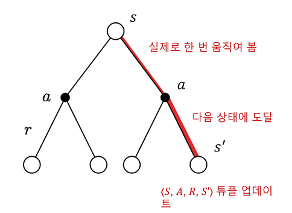

- 근사 DP(Apprximate Dynamic Programming)

  - 상태를 집어넣으면 대략적인 점수를 찍어 맞춰주는 인공지능 예측 모델
  - **배경:** 지금까지는 모든 상태(\(s\))마다 점수(\(v\))를 하나씩 표에 적어 놓는 **테이블(Tabular) 방식**을 사용했음
    - **한계 (차원의 저주):** 현실 세계는 상태 공간이 너무 커서 테이블에 모든 값을 저장하는 것이 물리적으로 불가능함.
      - *예 1:* 바둑의 상태 개수는 \(10^{170}\)개나 됨.
      - *예 2:* 자율주행차의 속도 값처럼 연속적인 실숫값은 무한대이므로 표로 만들 수 없음.
  - **해결책: 함수 근사 (Function Approximation)**
    - 모든 상태의 값을 일일이 저장하는 대신, **상태를 입력하면 가치(값)를 뚝딱 계산해서 출력해 주는 '마법의 함수(**\(\hat{v}\))를 만듦.
    - 가치함수를 함수로 근사 -> \(\hat{v}(s, w)\) : 파라미터 \(w\)로 표현
    - **일반화(Generalization):** 표에 없는 처음 보는 새로운 상태가 나오더라도, 기존에 배웠던 비슷한 상태의 경험(\(w\))을 토대로 가치를 유연하게 추정할 수 있음
  - 함수 근사의 대표적인 예시
    1. **선형 함수 (Linear Function):** \(\hat{v}(s, w) = w^T \phi(s)\)
       - 상태의 특징 벡터 \(\phi(s)\)에 가중치 \(w\)를 곱하는 단순한 형태.
    2. **신경망 (Neural Network, 딥러닝):** \(\hat{v}(s, w) = \text{NN}(s; w)\)
       - 인공신경망 내부의 가중치(\(w\))들을 조절해가며 가치 함수를 근사

  - 적합 가치 반복(Fitted Value Iteration) 알고리즘
    - 전체 상태를 다 계산할 수 없으므로, **일부 상태만 샘플링하여 머신러닝의 '지도 학습(Supervised Learning)' 원리로 근사 함수를 학습**시키는 방법
    - 샘플링한 상태들의 벨만 최적 방정식 계산값을 **정답지(Label)**로 삼고, 함수 근사 모델(\(\hat{v}\))이 이 정답을 잘 맞추도록 파라미터(\(w\))를 조정함
    - 동작단계(매 반복 k마다 실행)
      1. 상태 샘플링 (Sampling)
         - 전체 상태 \(S\) 중에서 연산 가능한 수준의 **몇 개의 대표 상태들(\(\tilde{S} \subseteq S\))만 추출**
      2. 타겟 계산(Target/Label생성)
         - 추출된 대표 상태 \(s \in \tilde{S}\)에 대해 **벨만 최적 방정식**을 돌려 이상적인 목표 가치값(\(\tilde{v}_k(s)\))을 계산함
         - **수식:** \(\tilde{v}_k(s) = \max_{a \in A} \left( R_s^a + \gamma \sum_{s' \in S} P_{ss'}^a \hat{v}(s', w_k) \right)\)
         - *주의:* 이때 우변의 미래가치 (\(\hat{v}\))는 아직 완벽하지 않은 현재 파라미터 \(w_{k}\)로 대충 추측한 '임시 정답'임. 이 계산 결과가 지도 학습의 **정답 레이블(Label)** 역할을 함
      3. 함수 근사 학습(Optimization)
         - 함수 모델 \(\hat{v}(s, w)\)가 방금 2단계에서 계산한 정답(\(\tilde{v}_k(s)\))을 출력하도록, **오차(벨만 오차)를 줄여가며 파라미터 \(w\)를 업데이트**
  - 함수 근사의 장단점
    - 장점 : 대규모 상태 공간 처리 가능, 배우지 않은 상황도 비슷한 경험을 통해 대처, 메모리 효율적
    - 단점 : 근사 오차 발생, 오차가 쌓이면 수렴 보장 어려움, 함수 클래스 선택 중요

- 가치 함수 공간

  - 가치 함수를 표가 아니라 벡터 공간 V의 한 점으로 가정
  - 가치 함수의 벡터 공간은 \(\vert{}S\vert{}\)차원
    - 맵에 존재하는 총 상태(칸)의 개수가 곧 그 공간의 차원 수가 되며, 하나의 점수판 전체를 그 공간 안의 '단 하나의 점'으로 나타낼 수 있다
  - 벨만 백업(업데이트)은 점을 다른 위치로 옮기는 작업
    - 우리가 한 라운드 계산을 돌려서 점수판의 값을 `(10, 20, 30)`에서 `(12, 25, 32)`로 업데이트했다면, 벡터 공간 관점에서는 **점(\(v_{\text{old}}\))이 다른 좌표(\(v_{\text{new}}\))로 슥 이동한 것**과 같다
  - 목표 : 이 이동이 무작위가 아니라, 정답(\(v_{*}\))이라는 표적을 향해 점점 다가가는 이동임을 보여야 한다

-  \(\infty \)-Norm (Infinity Norm)

  - \(\vert{}S\vert{}\)차원 가치 함수 공간에서 **두 가치 함수(두 점수판) 사이의 거리를 수학적으로 측정하는 방법**

  - 모든 칸을 다 비교해 봤을 때, 점수 차이가 가장 크게(최악으로) 나는 단 한 칸의 차이값을 두 점수판 사이의 거리로 정의

    - **사용 이유 (최악의 경우 통제):** 가장 많이 틀린 칸(최악의 오차)조차 벨만 백업을 거치면 거리가 줄어든다는 것을 증명하기 위함. 이를 통해 **맵 전체가 예외 없이 결국 정답으로 수렴할 수밖에 없음**을 수학적으로 보장
    - **수식:** \(\lVert{}u - v\rVert{}_\infty = \max_{s \in S} \vert{}u(s) - v(s)\vert{}\)

    - Ex) 점수판 \(u = [1, 2, 3]\) 이고, 점수판 \(v = [1, 3, 2]\) 일 때,
    - 1번 칸 차이: \(\vert{}1 - 1\vert{} = 0\)
    - 2번 칸 차이: \(\vert{}2 - 3\vert{} = 1\)
    - 3번 칸 차이: \(\vert{}3 - 2\vert{} = 1\)
    - 이 중 가장 큰 차이(\(\max \))가 `1`이므로, 두 가치 함수의 거리는 `1`

- 수축 연산자 (Contraction Operator, \(T^{\pi }\))

  - 현재 가치 함수(점수판)를 입력받아 벨만 방정식에 따라 **한 라운드 계산하여 새로운 가치 함수를 만들어내는 연산(행동)**을 의미하며, 이 연산을 거치고 나면 **정답판과의 최악의 오차 거리가 항상 강제로 줄어드는 성질**을 가짐

    - 수식 : \(T^\pi(v) = R^\pi + \gamma P^\pi v\)

  - 수축 연산자는 \(\gamma \)-수축 (\(\gamma \)-contraction)

    - 이 계산(\(T^{\pi }\))을 거치고 나면, 임의의 두 점수판 \(u\)와 \(v\) 사이의 최악의 오차 거리가 **최소한 할인율 \(\gamma \) 배만큼 무조건 줄어듬**
    - Ex) 할인율 \(\gamma = 0.9\)라면, 백업을 한 번 돌릴 때마다 가장 심하게 틀렸던 칸의 오차가 **원래 오차의 90% 이하로 강제로 압축(수축)**

     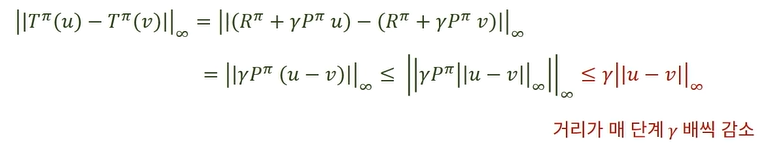

    ​	

    1. **\(\lVert T^\pi(u) - T^\pi(v) \rVert_\infty\)** : 백업을 한 번 거친 두 점수판의 거리를 잽니다.

    2. **\(\lVert (R^\pi + \gamma P^\pi u) - (R^\pi + \gamma P^\pi v) \rVert_\infty\)** : 수식을 대입해 보니 똑같이 더해져 있던 즉각 보상 \(R^{\pi }\)가 서로 빠지면서 사라집니다. (보상은 고정값이라 거리에 영향을 안 줍니다.)

    3. **\(\lVert \gamma P^\pi (u - v) \rVert_\infty\)** : 가치 차이에 할인율 \(\gamma \)와 전이 확률 \(P^{\pi }\)만 남습니다.

    4. **\(\le \gamma \lVert u - v \rVert_\infty\)** : 확률 \(P^{\pi }\)의 총합은 어차피 \(1\)(100%) 이하이므로 밖으로 나가면서 지워지고, 결국 **상수인 할인율 \(\gamma \)만 앞으로 쏙 빠져나옵니다.**

       **결론:** 백업 후의 거리(\(\lVert T^\pi(u) - T^\pi(v) \rVert_\infty\))가 백업 전의 원래 거리(\(\lVert u - v \rVert_\infty\))에 \(\gamma \)를 곱한 것보다 항상 작거나 같습니다

- 수축 사상 정리(Contraction Mapping Theorem)

  - 가치 함수 공간 \(V\)에서 정의된 연산자 \(T\)가 거리를 계속 줄이는 성질(\(\gamma \)-수축)을 가지고 있다면, 다음 **3가지 수학적 규칙**이 무조건 성립한다는 정리
    - **유일한 고정점(Fixed Point) 존재:** 수많은 점수판 중 업데이트를 해도 값이 더 이상 안 바뀌는 완벽한 정답 판(\(v_{*}\))은 **우주에 딱 하나만 존재**한다.
    - **반드시 수렴:** 처음에 점수판을 엉터리(0점 등)로 채우고 **어떤 위치에서 시작하든 상관없이, 반복하면 결국 그 단 하나의 정답으로 수렴**한다.
    - **선형 수렴 속도:** 매 라운드마다 오차가 할인율 \(\gamma \)의 비율만큼 고정적으로 줄어든다. (\(\gamma \)가 작을수록 오차가 더 빠르게 깎이므로 수렴이 빠르다)
  - Fixed Point
    - \(T(v_*) = v_*\)
    - 기계(\(T\))에 정답판(\(v_{*}\))을 넣었더니, 한 라운드 계산을 돌리고 나와도 값이 똑같이 정답판(\(v_{*}\)) 그대로 나오는 상태. 즉, **좌변과 우변의 균형이 완벽하게 맞아떨어져 '벨만 오차가 0'이 된 마법의 상태**를 수학적으로 고정점이라고 부르며, 이것이 곧 우리가 찾던 **최종 정답(해)**''

- 벨만 최적 연산자와 가치 반복의 수렴성

  - 벨만 최적 백업을 수학적 기호 \(T^{*}\)로 정의함: \(T^*(v) = \max_{a \in A} \left( R^a + \gamma P^a v \right)\)

  - **특징 (\(\max \) 연산자의 수축 유지):** 수식에 \(\max \) 기호가 들어가더라도, 할인율 \(\gamma \)의 존재 덕분에 최악의 오차 거리를 줄여나가는 **\(\gamma \)-수축 특성이 완벽하게 유지됨**

     (\(\lVert T^*(u) - T^*(v) \rVert_\infty \le \gamma \lVert u - v \rVert_\infty\))

  - 정책 평가와 정책 개선을 번갈아 수행하는 과정(정책의 개입) 없이도, **벨만 최적 백업(\(T^{\*}\))을 단독으로 반복하는 것만으로 최적 가치 함수(\(v_{\*}\))에 반드시 수렴함(가치 반복 알고리즘의 작동 보장)**

- DP 기반 핵심 알고리즘 및 수렴성 최종 요약

  | 알고리즘             | 사용하는 연산자                       | 수렴 목적지                   | 알고리즘 특징                                                |
  | -------------------- | ------------------------------------- | ----------------------------- | ------------------------------------------------------------ |
  | **반복적 정책 평가** | 기댓값 연산자 (\(\sum \))             | 현재 정책 점수 (\(v_{\pi }\)) | 정책은 가만히 고정해 두고, 가치함수 점수판만 계산함.         |
  | **정책 반복**        | 기댓값 연산자 (\(\sum \)) + 정책 개선 | 최적 정책 (\(\pi _{*}\))      | 평가 단계를 끝까지 다 채워서 수렴시킨 후 개선함 (정확, 느림). |
  | **가치 반복**        | 최적값 연산자 (\(\max \))             | 최적 가치 (\(v_{*}\))         | 평가를 끝까지 안 하고 딱 한 번만 한 뒤 바로 개선함 (빠르고 효율적). |
